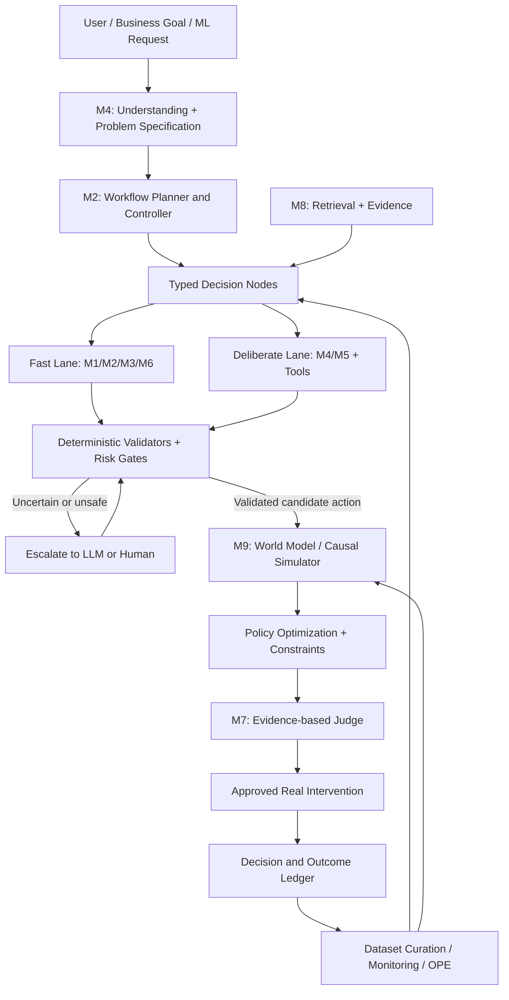
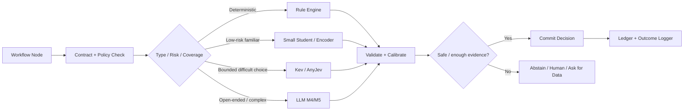
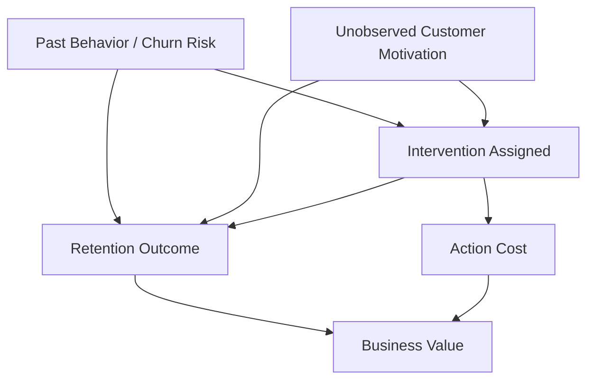
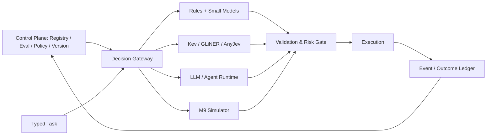

# DCLab | Decision-Centric AI, Decision Fabric & Decision World Model

**English edition of the November 8, 2026 expanded technical blueprint (v2.0).**  
**Scope:** Product architecture, decision-model research, dataset preparation, model training, scientific evaluation, deployment, risk controls and implementation roadmap for **M1-M9**.  
**Status:** Proposal and historical repository-grounded audit. A described module or dataset is not proof that a proposed capability is production-ready. Current repository state must be rechecked.  
**Reference repositories:** [DCLab code](https://github.com/Shahriyar-Moradi/Research_Development_DCLab) and [private DCLab records](https://github.com/Shahriyar-Moradi/dclab-records).

> DCLab should not be merely an LLM for machine learning. It should develop, evaluate, serve and coordinate different decision models for different tasks, and ultimately predict the possible consequences of actions through a World/Causal Model. Deterministic safeguards remain essential around learning and execution.

**Editorial note:** This English edition faithfully preserves the original v2 research direction, decision taxonomy, experimental goals, implementation phases, risks and important documented snapshots. The source's English code/schema examples are carried over in the corresponding sections as reference material. Some repetitive narrative has been consolidated for clarity; consult the historical source for line-by-line provenance. The later November 15 harness diagnosis adds a dependency: test model-only versus current harness *before* treating additional routing models or fine-tuning as a solution to intelligence loss.

## 1. Vision and North Star

The long-term center of gravity is **M9, the Decision World Model**. M1-M8 support observation, understanding, selecting, executing, judging and learning. M9 should help answer not simply "what action should we take?" but "what state changes could this action produce, with what likelihood, time horizon, costs and uncertainty?"

Three research tracks must be kept distinct rather than merged into a single leaderboard:

- **Track A: Decision-centric prediction / classical replacement.** Test whether a Decision Head, neural/tabular foundation model or another trainable approach can directly solve `X -> y` problems better than strong Random Forest, XGBoost, LightGBM and CatBoost baselines under fair conditions.
- **Track B: Fast decision workflow.** Train or adapt economical decision makers for stable workflow nodes such as intent, leakage suspicion, split selection, tool choice, next action, eligibility and escalation.
- **Track C: World model and policy intelligence.** Learn conditional next-state and outcome distributions, evaluate interventions/policies, allocate actions under constraints and improve from observed feedback.

**Business and engineering objectives:** Improve decision utility and task completion, lower p50/p95/p99 node/workflow latency, reduce cost per successful workflow, provide calibrated/abstaining decisions and evidence provenance, collect legally trainable records, estimate future outcomes with valid uncertainty, and deploy through shadow/canary/rollback controls. Success must be measured with real end-to-end metrics, not isolated model inference speed.

**Important claim boundaries:** Faster than a large LLM does not mean faster or better than a tree model. Choosing a good model for a task is not the same as directly predicting the task's target. Predicting churn is not predicting the causal effect of a discount on churn. Synthetic world-model performance does not imply identified real-world causal effects. Proposed datasets or registered model roles are not automatically deployed trained models.

## 2. Terminology and architecture boundaries

| Concept | Operational meaning | Not to be confused with |
|---|---|---|
| Model role/family | A responsibility such as workflow decision or solver | One unique trained weight file |
| Decision point | A bounded node with state, action space, constraints and correctness rubric | Unstructured free-form chat |
| Decision model | Scores/selects valid options, perhaps using encoders, LLMs or decision heads | Necessarily a new standalone model architecture |
| Classical ML | Logistic, trees, random forests, GBMs, etc. | Obsolete baselines |
| Generative LLM | Interprets, reasons, writes plans/code and uses tools | The cheapest default for every simple decision |
| Student/distilled model | Smaller model specialized on constrained tasks | Universal teacher replacement |
| Decision Fabric | Runtime that selects the appropriate model/path at each decision node | Merely a serving endpoint |
| Decision World Model | Conditional model of environment transitions and intervention outcomes over time | A single churn classifier or generic chatbot |
| Policy | Mapping from state to action probabilities under constraints | Risk score alone |
| Propensity | Actual probability that the historical logging policy assigned an action | Arbitrary prediction confidence |
| Counterfactual | Unobserved potential outcome of an action for a unit/state | Directly observed fact |
| Shadow mode | Produces recommendations without controlling real action | Production promotion |
| Sealed test | Held outside prompting, selection and training | Iteratively used dev set |
| Gold/silver | Independently defensible ground truth versus weaker teacher/rule labels | Number of rows |

There are **nine target model roles M1-M9**, but this is not a commitment to train nine weights. In the November 8 snapshot, repository inventory mentioned M1-M8; M9 was proposed. The grouping is four decision-first roles (M1/M2/M3/M6), two LLM-first roles (M4/M5), and three supporting/world roles (M7/M8/M9). One backbone can support several heads/adapters; a role may need multiple versions. Use stable machine-readable IDs and explicit aliases where legacy `m7_routing` conflicts with M7 judge naming.

## 3. Full M1-M9 model-role map

| ID | Role | Inputs | Outputs | Required baseline |
|---|---|---|---|---|
| M1 | Student models | Structured state, options, labels | Choice and confidence | Rule and logistic/GBM |
| M2 | Workflow decision | Workflow state, history, constraints | Next node/tool/stop | Current workflow rules |
| M3 | ML technical decision | Data card, problem card, evidence | Split/metric/model-family/leakage verdict | Existing technical validators |
| M4 | Workflow LLM | Requirements, cards, evidence | Problem interpretation, structured plan/stage/code | Strong prompted LLM |
| M5 | Solver LLM | Task, data, tools, budget | Verified code/model/report | Current agent and strong model |
| M6 | Stepwise decision | State_t, history, options, budget | Next action/abstain | Deterministic policy |
| M7 | Judge/reward | Candidate, rubric, tests/evidence | Score/preference/verdict | Independent tests and human/rule judges |
| M8 | Retrieval/reranker | Query, filters, candidates | Ranked evidence references | BM25/hybrid retrieval |
| M9 | Decision world model | State, action, history, context | Outcome distribution, next state, risk | Empirical/counterfactual baseline |

**Ownership:** M2 owns workflow transitions; M6 owns learnable sequential action selection. M3 recommends technical ML decisions; M5 uses tools to solve; M7 independently judges tested outcomes. M8 retrieves evidence; M9 predicts consequences. No language model may certify the success of its own tool execution without verified artifacts. M1 is a pattern for many students, not necessarily a monolithic artifact.

## 4. Per-model-family design and evaluation

### M1: Small student models

Target repetitive nodes such as `column.semantic_role`, `column.is_identifier`, `feature.leakage_suspect`, `request.intent`. Compare rules, logistic regression, gradient boosting, small encoders, GLiNER-like approaches, Kev-class decision heads and small Qwen configurations. Train cross-entropy on **verified** labels; use permitted distillation/KL only if rights are clear; calibrate separately. Score accuracy/F1/proper scoring rules, selective risk, OOD and option-order robustness, p95 latency, memory and cost. Fail fast if performance barely beats rules or confidence is unsafe. Prefer in-process low-latency inference for genuinely tiny models.

### M2: Workflow decision models

Decide `request.intent`, `problem.ready`, `problem.pack`, `workflow.next_question`, `workflow.move`, `request.tool`, `workflow.stop` and similar transitions. Input includes actual request text, structured case/data/problem state, recent actions and constraints. Actions may be `ask_clarification`, `route_to_analysis`, `prepare_data`, `plan_ml`, `execute`, `report`, `refuse/stop`, `escalate`. Compare rules, GBM, encoders, GLiNER, Kev/AnyJev, Qwen SFT and hybrids on matched input modalities. Gold routing labels must be corroborated by user intent or external evaluation, not by agreement with the existing router. Assess the downstream workflow result, not only class accuracy. **November 15 caution:** a faster M2 cannot correct an architecture that removes open-ended solution choices before planning.

### M3: ML Decision Models

Distinguish **M3-A**, bounded technical decisions (leakage, split, metric, model family, data quality) from **M3-B**, a direct `X -> y` neural/tabular challenger to classical algorithms. M3-A can use multiple specialized heads and hard science gates; M3-B needs a separate fair benchmark with the same data splits, feature availability, budgets and comparison protocols as XGBoost/LightGBM/CatBoost. Do not claim that winning model selection or technical routing proves better direct prediction.

### M4: Workflow LLM

Convert natural requirements and verified evidence into a grounded ProblemFrame, hypotheses, solution options and execution-stage outputs. Prefer SFT on **verified structured stage results**, with explicit scientific validation, rather than on unverified prose. Measure plan completeness, internal consistency, evidence use, feasible implementation, tool/schema validity and useful refusal. Keep prompt-only strong-model and existing harness baselines.

### M5: Solver LLM

Perform tool-driven problem solving: data inspection, feature engineering, code development, execution, evaluation, debugging and final artifacts. Train only with real or well-verified trajectories including failure recovery and execution outcomes. Evaluate end-to-end on isolated datasets; require actual runnable code and evidence. A trajectory from developing the DCLab repository is not automatically equivalent to solving external ML tasks. Benchmark direct model and minimal agent separately from the complex harness.

### M6: Stepwise Decision Models

Select actions from structured state/history/options with costs and risk. Start with behavior cloning on valid ordered episodes; explore contextual bandits/offline RL only with valid propensities, reward/outcome definitions and off-policy evaluation. Score cumulative utility, regret, action validity, calibration, robustness to rare states and error propagation. Do not learn irreversible write policies from unverified synthetic transcripts.

### M7: Judge and Reward Models

Judge code, plans, tool outcomes and business decisions with independent reference tests and human-defined rubrics. Compare classifiers, pairwise rankers and reward models. Detect false approvals, judge disagreement, model-family bias and grading contamination. Prioritize deterministic code/science checks; LLM judges supplement rather than replace tests.

### M8: Retrieval and Reranking

Retrieve versioned evidence, relevant prior experiments, compatible policies and documentation. Compare lexical BM25, hybrid search, encoders and trainable rerankers. Evaluate recall@k, MRR/nDCG, citation fidelity, hard negatives, cross-tenant access isolation and latency. The retrieval model should not hallucinate or reinterpret measurements as fresh facts.

### M9: Decision World Model

Model conditional environment transitions and outcomes under a chosen action across specified horizons, including uncertainty and operational constraints. Begin with simple, falsifiable one-step synthetic experiments and rigorous causal baselines; only progress to temporal/multi-step world modeling when the logging and identification assumptions are tested. The optimizer that chooses actions is distinct from the model that predicts consequences.

## 5. Candidate architectures and reference technologies

Evaluate these as **candidates**, not as already proven DCLab components:

| Technology | Appropriate experiments | Limitation |
|---|---|---|
| Jev / TypeSafe System One | External typed probabilistic decision API baseline | Hosted behavior and vendor claims require independent verification; no assumption of available weights |
| Kev-style backbone + LoRA/pointer/decision head | Bounded M1/M2/M3/M6 decisions | Verify actual release, reproducibility and training rights |
| AnyJev-style LLM logits/readout adaptation | Zero-training typed-choice baseline | Requires suitable logits/backbone; not necessarily new weights |
| GLiNER / compact encoders | Classification, structured labels, routing and option scoring | Must be compared on OOD, calibration and downstream success |
| Qwen/open-weight LLM plus adapter | Multi-stage reasoning, tools and structured output | Cost, tool reliability, forgetting and license must be tested |
| Logistic/GBM, XGBoost, LightGBM, CatBoost | Hard practical baselines for bounded choices and tabular tasks | Do not handicap them with unequal splits/features |
| GNN/Graph Transformer | Relational and graph decisions when graph structure matters | Requires meaningful graph entities/edges and comparison to graph-free methods |

Separate architecture benchmarks for decision classification, constrained choice, direct prediction, end-to-end reasoning and causal policy selection. For any logit/option-ranking mechanism, test permutation of option order, label names, template changes and unknown options. Never confuse API similarity with identical internals.

## 6. Track A: Challenge classical ML fairly

Two falsifiable hypotheses: (1) a decision-centric architecture can **directly** improve tabular prediction on some datasets; (2) a specialist can improve the **decision about which model/preprocessing/metric to use**. They are separate outcomes.

Use diverse datasets across size, categorical share, missingness, imbalance, numerical/categorical mixes and train/test shift. Fix folds, leakage controls, scoring metrics and data budgets. Tune classical baselines properly; compare equivalent feature information and sensible compute limits. Report paired differences, intervals, learning curves, peak memory, model loading, CPU/GPU inference latency, training time and total cost. Include data/OOD family shifts. A null or negative result is a valid research outcome: it should not be relabeled an architecture success.

For production claims distinguish **speed versus LLMs**, **speed versus classical baselines**, **quality of direct prediction**, and **quality of meta-decisions**. These are four different measurements.

## 7. Track B: Decision Fabric and workflow intelligence

The Fabric should be a risk-aware **model/router execution plane**, not an extra unconstrained conversation. Each node has a typed state, admissible action set, authority requirements, evidence, latency budget, cost budget and rollback behavior. The router considers simple rules/students/encoders first when safe and escalates to a stronger model or human if uncertainty/risk warrants it. Validation should not disappear just because the chosen model is small.

Core services: policy/decision registry, versioned model adapters, confidence calibration, risk tiers, cost-aware escalation, tool permission checks, idempotency, decision event ledger, shadow/canary and end-to-end telemetry. Model selection is a *proposal* subject to scientific safety and authorized writes.

**Avoid a new model for every step:** Many nodes lack enough gold data or repeat infrequently. Shared backbones with multiple heads, adapters or task prompts may be more cost-effective. Compare end-to-end cost/quality/maintenance before creating per-node endpoints. Sequential error propagation can dominate a nominally excellent per-node accuracy: measure downstream recovery and selective fallback.

**Suggested risk tiers:** informational/read-only, bounded reversible computation, workflow-state changes, external financial/business actions. Each increase in effect size requires stronger validations, policy checks, approval and audit. A "fast lane" cannot bypass safety just to shave tokens.

## 8. M9 Decision World Model: scientific specification

Define a structured state `s_t`, permitted action `a_t`, observed context/history `h_t`, next state `s_(t+1)`, delayed outcome `y_(t+h)` and time horizon `h`. A practical model approximates `p(s_(t+1), y_(t+h) | s_t, a_t, h_t)` and uncertainty, not a single unconstrained natural-language forecast. The policy is separately optimized over the action set with costs, capacities and risk constraints.

For retention, possible nodes include customer state, engagement, contact eligibility, support issues, service usage, promotion exposure, billing, churn/retention, action cost and discount history. Distinguish pre-action confounders from post-action mediators. If previous offers depend on customer risk, observational action/outcome data are confounded; predictive accuracy alone cannot identify causal treatment effects. Explicitly record action propensities and treatment assignment, positivity/overlap, outcome timing and missingness.

Start with one-step response prediction or simple causal uplift on controlled synthetic/randomized data. Compare no-action/random, churn-risk targeting, uplift, decision-head and constrained policy. Then test delayed effects, repeated actions, changing states, uncertainty coverage and policy evaluation. Use DR/IPS or related off-policy estimators only under defensible assumptions and sensitivity analysis. A multi-step rollout obtained by recursively applying a one-step predictor is not reliable proof of long-horizon causal dynamics.

Outcome criteria: next-state predictive score, calibration/interval coverage, policy value, regret versus an oracle **only where an oracle exists**, fairness/capacity/eligibility compliance, and drift across scenarios. Real-world promotion requires careful identification and controlled trials.

## 9. Realistic workflows to validate the architecture

**A. Scientific Data Science workflow:** Problem framing, data inventory, target definition, point-in-time feature availability, leakage review, train/eval split, baselines, features, model comparison, error analysis, report and deployment/monitoring plan. Its decision nodes should select tools/models only after the problem has been understood. A dynamic task graph should be revisable from real evidence while retaining deterministic validation.

**B. Business Retention/Churn workflow:** Identify the decision (whom to contact, with which offer, at what cost), characterize risk, segment customers, define eligible actions, estimate response or uplift, rank actions under budget, seek approval, record delivered treatments and follow outcomes. Never equate churn propensity with incremental treatment response when action-outcome evidence is absent.

**MVP replication:** Use existing synthetic retention/uplift replicas when verified, with scenario/seed separation. Test model-only planning versus current DCLab and a late-binding harness before benchmarking downstream Fabric routing. No live side-effects until permission/safety gates pass.

## 10. Unified Decision Contracts

Standardize `DecisionTask.v1` and `DecisionResult.v1`: stable decision ID, point ID, model/policy/validator version, schema version, state and evidence refs, source hashes, admissible action set, budget, risk tier, chosen action or abstention, calibrated uncertainty, timing, trace ID and cited verdict. These contracts must be strict enough for reproducible execution, but **not** force all scientific tasks into a premature problem-family choice.

For action/outcome learning, use distinct immutable `InterventionRecord`, `OutcomeEvent` and `WorldTransition`: entity ID, action, eligibility/assignment, policy version, known propensity, action timestamp, outcome observation timestamp, horizon, censoring and source. Distinguish `p(outcome | state)` (prognosis), `p(outcome | state, action)` (observational conditional prediction) and **causally identified** potential-outcome estimates. None may silently replace the others.

Required invariants: referential integrity, action permitted by policy, idempotent external actions, no future data available at decision time, immutable evidence links, versioned schema compatibility, valid outcome horizons, explicit missing propensity, tenant isolation, and honest abstention when unsupported.

## 11. Dataset engineering, provenance and contamination

Treat **data audit and readiness as P0**, before training an internal decision model or a large world model. Each record must answer: source/session/commit; hash and raw-content location; generator and label validator; tenant; consent at collection/training/export; privacy removal; provider rights; split group; any evaluator conflicts; and action/outcome link to its policy version.

| Tier | Description | Permitted use |
|---|---|---|
| Gold | Reliable human measurement, independent tests or permitted benchmark ground truth | Train/dev in authorized splits |
| Silver | Rule-/teacher-derived with known uncertainty | Weighted auxiliary data with independent validation |
| Weak | Inferred intent, clicks, proxies | Explicitly analyzed and downweighted; never misreported as gold |
| Unlabeled | Context without a verified task label | Representation learning or authorized active labeling |
| Eval-only | Restricted provider outputs or sealed benchmark records | Evaluation under applicable terms, not training |
| Quarantined | Invalid, duplicate, unauthorized or contaminated | Audit only |
| Synthetic truth | Known replica generator answer | Group by generator scenario/seed and validate OOD |

**Gold requirements by role:** M1 state/options/verified labels; M2 request/workflow state/correct route/outcome; M3 data card and scientific decision evidence; M4 verified stage outputs; M5 executed code and tool trajectory; M6 ordered states/actions/rewards/transitions; M7 independently reviewed preferences; M8 query/candidates/relevant passages; M9 state/action/next-state/outcome/propensity with identification context.

**Validity gate:** `schema_valid && consent_valid && license_valid && !leaked && !duplicate && proper_split && task_label_suitable`. Issue a quality report for per-point counts, label trust, family/linguistic/error coverage, exact/near duplicates, time/project/tenant leakage, rights, valid references, benchmark protection, state/action/propensity missingness, domain/class skew, and reproducibility. Count of rows alone is **not** supervised readiness.

Split by appropriate company, person, project, dataset, session, time, task family and/or generator scenario/seed. Copies of the same conversation, replay or derived example stay in the same split. Build a blocklist for sealed benchmark identities/URLs/hashes and similarity. Never expose gold test solutions to agent prompts or optimization.

## 12. Historical audit of DCLab code and private records (November 2026 snapshot)

The historical research referenced `dclab_core/store.py`, DCLab model/storage infrastructure, experiments and an external private `dclab-records` repository with `raw/`, `records/`, `sets/`, `quarantine/`, `runs/`, `schemas/` and service records. Access to the private store requires appropriate GitHub permissions. This is **historical evidence**, not proof of present state.

The source README reported dataset-set counts: `m1_students` 80, `m2_workflow_decisions` 25, `m3_ml_decisions` 86, `m4_workflow_llm` 19, `m5_solver_llm` 11, `m6_stepwise_decisions` 7, `m7_judges` 8, `m8_retrieval` 1, and a separate `m7_routing` compatibility group of 8. **These are defined sets, not successful trained models.**

Selected historical dataset-card snapshots (built around November 1; numbers must be revalidated against source manifests):

| Set/version | Train | Dev | Sealed | Pending sealed | Concern |
|---|---:|---:|---:|---:|---|
| M1 `column.semantic_role/v1` | 16499 | 4136 | 34 | 4484 | Label provenance/quality |
| M2 `rnd/workflow.next_question/v1` | 2732 | 1119 | 2 | 1033 | Very limited verified evaluation |
| M2 `rnd/problem.ready/v1` | 282 | 114 | 1 | 104 | Small independent gold |
| M3 `binary/data.more_rows/v1` | 28 | 0 | 0 | 0 | Not ready for standalone pilot |
| M4 `understand_problem/v2` | 2298 | 1097 | 177 | 690 | Quality review required |
| M4 `plan/v2` | 48 | 2 | 2 | 1 | Weak planning coverage |
| M5 `trajectories/selfplay/v1` | 801 | 280 | 304 | 242 | Synthetic generalization/rights |
| M5 `trajectories/studio/v3` | 7 | 1 | 7 | 6 | Few verified real-like solves |
| M5 `trajectories/reasoning/v1` | 0 | 0 | 1 | 0 | Not SFT-ready |
| M5 `trajectories/development/v2` | 239 | 24 | 306 | 57 | Repo-development bias |
| M5 `verified_code/v1` | 4 | 5 | 7 | 0 | Very few executed code samples |
| M6 `graph/v1` | 776 | 250 | 146 | 156 | Need reward/transition audit |
| M7 `code/v1` | 218 | 64 | 15 | 110 | Narrow judge domain |
| M7 `human_labels/v1` | 7 | 2 | 2 | 0 | Sparse human gold |
| M8 `evidence/v1` | 16 | 8 | 2 | 4 | Too small for dedicated reranker |
| Routing `request.intent/v1` | 1271 | 392 | 198 | 437 | Written vs actual label bias |

One source card counted about 24,960 `none` and 193 teacher labels for M1 semantic-role data: **16,499 train rows do not imply 16,499 valid supervised labels**. Routing labels in the snapshot were mostly written rather than real; hold out writers/companies to detect stylistic overfitting. The November 3 `MODELS_INVENTORY` described approximately 17 decision points with scikit-learn students, two independently passing gates, many still in rule/shadow serving, and no recorded successful proprietary Qwen-class solver fine-tune at that snapshot. Recheck this against current manifests and commits before making product claims.

**Required current audit:** Enumerate all manifests, source/license/consent, label distribution by point, split overlap and duplication, training/eval status, external provider restrictions, existing checkpoints/serving aliases and actual success evidence. Produce `READY`, `NEEDS_DATA` or `BLOCKED` with provenance per decision point and model role.

## 13. Fine-tuning and training recipes

**Training is role-dependent, not one-size-fits-all.** Start with strong rules/classical/zero-shot baselines; train only when a suitable gold dataset and independent validation exist.

| Role | Initial recipe | Objective and extensions |
|---|---|---|
| M1 | Logistic/GBM, optionally small encoder/head | Cross-entropy, calibration, optional permitted distillation |
| M2 | GLiNER/Kev/AnyJev/LLM baseline then bounded fine-tune | CE/NLL, cost-sensitive routing, multi-task adapter if justified |
| M3-A | Per-point classification | CE plus hard constraint evaluation |
| M3-B | Task-appropriate neural/tabular foundation predictor | Supervised prediction losses; separate direct-prediction arena |
| M4 | Verified structured stage SFT | Token CE, schema validation, optional permitted preference tuning |
| M5 | Verified tool/code trajectories | Teacher forcing + actual tool/coding evaluation; verifiable reward only |
| M6 | Ordered episode behavior cloning | Action CE/sequence loss; offline RL only when OPE assumptions pass |
| M7 | Human/test grounded classification or pairwise ranking | CE/ranking objective and agreement/calibration |
| M8 | Embedding and reranker fine-tuning | Contrastive/pairwise relevance objectives |
| M9 | State transition/outcome/causal baseline | Time-dependent likelihood/loss, uncertainty and defensible causal evaluation |

For small-data regimes use simple models and abstention rather than overfitting a large backbone. Track option order and hard negatives, including no-answer/unsupported actions. For LLM adapters use LoRA/QLoRA only if memory/license and valid data justify it. Prevent catastrophic forgetting with permitted replay tasks, low epochs, checkpoint comparison, task-family holdouts and continuous general-code tests. Record full manifests, tokenizers/chat-template versions, precision, base/adapter hashes, seeds, data source rights, compute and environment.

Do not record inaccessible hidden reasoning or assume API-generated answers are trainable. Recheck commercial output rights before training. Distinguish verified external test results from internal dev improvements.

## 14. Decision Model Arena and benchmarks

Maintain at least two **separate leagues**: (A) direct `X -> y` predictive modeling versus tuned classical baselines, and (B) constrained pointwise decisions, workflow routing and tool/action selection. A third system-level track assesses full task completion, and World Model policy value has its own causal/effectiveness protocol. Combining these into one score hides failure modes.

Per case freeze: input/state snapshot, action choices, schema version, expected outcome, evaluator, split group, allowed tools, latency/cost constraints, test sequence and protected gold. Compare models on matched options and same feature visibility. Include adversarial label synonyms, option-order permutations, OOD domains, unseen writers, English/Persian slices, missing information and invalid-action traps. Evaluate top-1/action correctness, log loss/Brier, calibration and ECE, selective-risk coverage, downstream tool correctness, p50/p95/p99 and total task expense. Report paired bootstrap confidence intervals and hard safety violations rather than only mean accuracy.

**Promotion gates:** Proposed numerical thresholds are hypotheses to freeze **before** seeing sealed results. Preserve shadow mode if reliability/cost is unproven; do not optimize on sealed outcomes. Store all run manifests, trace IDs, selected/abstained actions, verifier reasons and model hashes for replay.

## 15. Deployment: control plane and decision plane

Separate a **Control Plane** (model/policy registry, experiment manifests, permissions, drift monitoring, label and provenance governance, version/promote/retire operations) from a **Decision Plane** (low-latency runtime inference, calibrated routing, tool validation, escalation and event capture). Inference can be in-process or an approved model-serving endpoint based on actual latency and cost. Cache only when safe and keyed by full versioned state/action context.

Use staged serving: offline evaluation -> shadow -> canary -> production, with baseline comparison, kill switches and rollback. Monitoring must capture distribution/label drift, uncertainty, abstention, tool errors, scientific guard failures, data license/consent changes, cost and full workflow outcomes. Use MLflow/W&B/Langfuse or existing observability only if they add a justified capability; avoid maintaining parallel truths.

## 16. Security, permissions, privacy and causal safety

Enforce tool permissions at the execution layer, not in prompts. Maintain strict tenant and dataset scope, redaction, encryption, key rotation, source retention/deletion policy, protected holdouts, untrusted-content handling, audit records, and human approval for irreversible or financially meaningful action. Treat model outputs, downloaded documents and tool arguments as untrusted until validated.

For M9, safety includes scientific validity: define the decision timestamp, pre/post-treatment variables, confounding and treatment assignment, temporal leakage, interference, positivity, missingness, delayed outcomes and uncertainty. Never label a propensity model as causal uplift without identification assumptions. Start with simulated or shadow policies, then carefully approved experiments; log assignment propensities when interventions are tested.

Avoid unsafe automatic loops: no autonomous repeated promotions, unapproved spend, writes to external CRMs, reward self-labeling, or retraining from unvalidated model judgments. Maintain rollback and incident review.

## 17. Phased implementation roadmap

Work in coordinated lanes, not one giant release. **Data**: audit and curate; **Research**: test alternative decision models against hard baselines; **Product**: integrate contracts and telemetry into existing DCLab infrastructure; **World**: build valid outcome/transition evidence and a narrowly scoped simulator.

| Phase | Main objective | Exit evidence |
|---|---|---|
| P0 | Inventory code, datasets, licenses, model/checkpoint reality | Dataset/model readiness matrix, blocked sources, selected pilots |
| P1 | Versioned decision and intervention contracts, registry/aliases | Contract tests, round-trip store/ledger, time/tenant invariants |
| P2 | Arena adapters and frozen evaluation | Classical/rule/encoder/LLM comparisons with reproducibility |
| P3 | Pilot specialized M2/M3, optional M4 SFT | Verified gains, calibration, cost, safety and model cards |
| P4 | Fast Decision Fabric with bounded escalation | Non-regressing end-to-end completion and reduced cost/latency |
| P5 | Larger solver/stepwise pilots as data permits | Verified external solves, sequential evaluations and ablations |
| P6 | Synthetic one-step M9 + causal baseline | Correct uncertainty and valid held-out synthetic policies |
| P7 | Temporal world-model and off-policy evaluation research | Proven assumptions, robust scenario generalization |
| P8/P9 | Controlled action/policy experiments and operational readiness | Business/causal validation, approvals and rollback |

**P0 outputs:** `dataset_inventory.json`, `license_matrix.json`, `readiness_report.md`, anonymized `blocked_examples.csv`, `proposed_pilots.yaml`. For every role/point, label READY/NEEDS_DATA/BLOCKED with source links and no training on sealed/eval-only data. **P1:** Define DecisionTask/Result, InterventionRecord, OutcomeEvent, WorldTransition, idempotency, timestamps, aliases, ledger adapters and immutable evidence. **P2/P3:** Run one M2 routing pilot, one M3-A leakage/split pilot and optionally one M4 stage SFT if gold exists; keep M3-B classic-ML replacement a separate study. **P4:** Deploy bounded node selectors, calibrated uncertainty, escalation, permissions and shadow/canary; only retain complexity that improves measured E2E quality. **P6/P7:** Begin randomized retention replica, add action cost/budget/eligibility, then temporal transitions, multiple horizons, uncertainty and counterfactual testing.

**Revised dependency (November 15):** Complete Model-Only/Minimal Agent/Current Harness/Late-Binding diagnosis *before* promoting M2 routing or redesigning core intelligence. A new framework or trained router can otherwise reproduce the deterministic trap.

## 18. Five falsifiable MVP experiments

| MVP | Hypothesis | Main baselines and data | Required stop rule |
|---|---|---|---|
| 1. Fast Routing | GLiNER/Kev/small Qwen reduces Home/Lead cost and latency without losing route quality | `m7_routing/request.intent`, audited M2; rules/logistic/strong LLM | Stop if gold is absent or gain is writer-style overfitting |
| 2. ML Technical Decision | A specialist improves `feature.leakage_suspect` decisions safely | Prediction moment, column profile, synthetic traps, real validation | Never trade critical leakage detection for minor latency gains |
| 3. Ten-Node Workflow | Hybrid Fabric reduces turns/cost/latency while preserving verified completion | Claude-only/current agent, replay -> shadow -> controlled | No real side effects before permissions and science pass |
| 4. Retention World Model | Causal/outcome policy improves simulated utility over churn-risk targeting | `retention_actions`; no-action/random/risk/uplift/head/hybrid | Keep synthetic claims synthetic; split scenarios/seeds |
| 5. Direct Prediction Challenger | A neural/tabular decision architecture beats tuned GBMs on defined datasets | XGBoost/LightGBM/CatBoost, matched splits/budgets | Demand paired intervals and OOD evidence; negative findings count |

For each MVP pre-register inputs, comparator, independent data split, metrics, effect size, safety gate, compute cap, stop condition and result artifact. Do not over-interpret a few favorable examples.

## 19. Repository integration and artifact layout

The original proposed a documentation home under `docs/architecture/decision_intelligence/`, a planning home under `engineering/planning/decision_intelligence/`, research tracks for decision models/Fabric/World Model, and immutable results under `evidence/campaigns/`. Confirm ownership/conventions against actual HEAD before adding folders. Extend existing `dclab_core`/`dclab_rnd` contracts and adapters rather than creating an incompatible parallel runtime.

The private data store should separate raw/records/sets by M-role, quarantine, manifests, verified examples and runs, with immutable version IDs and access controls. Preserve the legacy `m7_routing` alias and treat `m9_world_model` as **proposed** until actually created. Never copy private training data into the public code repository by convenience.

## 20. Engineering backlog and test contracts

| Epic | Tasks | Definition of done |
|---|---|---|
| DI-0xx Readiness | Enumerate manifests, license/consent matrix, dedup/split, model reality, readiness report | Every set has auditable status and blocked-source evidence |
| DI-1xx Contracts | DecisionTask/Result, intervention/outcome events, registry IDs/aliases, ledger adapters, auth tests | Versioned schemas, round-trip and tenant/time/idempotency tests |
| DI-2xx Arena | Frozen dev/sealed cases, classical rules, GLiNER/Kev/AnyJev/Qwen adapters, calibration, option-order/OOD, paired statistics | Reproducible quality/calibration/latency/cost evidence |
| DI-3xx Training | Family-specific exports, M2/M3 pilots, optional M4, replay builder, promotion policy | Rights-pass adapters, complete model cards, rollback tests |
| DI-4xx Fabric | Decision gateway, risk/uncertainty, ten-step workflow, event telemetry, shadow | Safe tool behavior, useful E2E improvement and ablations |
| DI-5xx World | Simulator baseline, treatment/outcome contracts, causal estimators, temporal transitions, sensitivity | Valid policy comparison under documented assumptions |

Test categories: schema compatibility, replay and idempotency, rule/model fallback equivalence, sensitive action refusal, point-in-time correctness, leakage and split isolation, evaluator agreement, option permutation invariance, budget exhaustion, external API failure and rollback. Keep sealed evidence protected.

## 21. Risks, open decisions and falsifiable hypotheses

**Critical risks:** weak teacher-only labels; contaminated sealed tests; invalid causal interpretation; training on provider-restricted/PII data; unauthorized writes. **High risks:** unfair XGBoost comparisons, too many per-node endpoints, real production latency, writer-style overfitting, unrealistic long-horizon simulations, runaway GPU/API costs, and self-reinforcing policy feedback. **Medium risk:** legacy registry-number collision (`m7_routing` versus judge M7). Each needs explicit owner, observable trigger, mitigation, hard stop and rollback.

**Research hypotheses to register:**

- H1: Bounded encoder/decision-head choices reduce cost/latency versus large LLMs at acceptable accuracy.
- H2: Fine-tuned routing reduces *workflow errors*, not just intent-label error.
- H3: Combined model+rules improves leakage suspicion versus either alone.
- H4: Multi-head shared backbone improves practical quality/cost compared with per-point models.
- H5: Selective escalation reduces workflow cost without compromising safety.
- H6: Novel neural/tabular decision models outperform strong classical prediction baselines on a pre-declared subset.
- H7: M4 verified-stage fine-tuning improves valid planning completion versus prompt-only.
- H8: M5 needs more verified end-to-end ML trajectories, not only repository-development SFT.
- H9: M9 causal/constraint-based retention policy improves synthetic value over risk-only targeting.
- H10: Temporal dynamics improve policy value in genuinely delayed-effect scenarios.

Every hypothesis must record `independent_variables`, `dataset/split`, `baseline`, `metric`, `effect_threshold`, `risk`, `budget`, `stop_condition` and `evidence_link` **before** running the protected evaluation.

**Open decisions:** legacy M7 routing naming; first M2 and M3 pilots; local versus rented GPU; selection among GLiNER/Kev/AnyJev/Qwen only after arena; gold/silver policies; retention versus campaign uplift first M9 environment; approved real-world sources and exact outcome definitions; judge scope; world-model shadow/controlled gate; data retention and tenant deletion policy.

## 22. Sources, status and evidence limitations

Historical DCLab references:

- [Core Model Registry](https://github.com/Shahriyar-Moradi/Research_Development_DCLab/blob/main/dclab_core/store.py)
- [STORING_PHASE_PLAN](https://github.com/Shahriyar-Moradi/Research_Development_DCLab/blob/main/docs/guides/STORING_PHASE_PLAN.md)
- [MODELS_INVENTORY](https://github.com/Shahriyar-Moradi/Research_Development_DCLab/blob/main/docs/guides/MODELS_INVENTORY.md)
- [PHASE12_TRAINING_DATA_PLAN](https://github.com/Shahriyar-Moradi/Research_Development_DCLab/blob/main/docs/guides/PHASE12_TRAINING_DATA_PLAN.md)
- [PHASE13_CLAUDE_FIRST_PLAN](https://github.com/Shahriyar-Moradi/Research_Development_DCLab/blob/main/docs/guides/PHASE13_CLAUDE_FIRST_PLAN.md)
- [THREE_MODELS.md](https://github.com/Shahriyar-Moradi/Research_Development_DCLab/blob/main/docs/guides/THREE_MODELS.md)
- [Retention Replica](https://github.com/Shahriyar-Moradi/Research_Development_DCLab/blob/main/dclab_core/replicas/retention_actions.py)
- [Campaign Uplift Replica](https://github.com/Shahriyar-Moradi/Research_Development_DCLab/blob/main/dclab_core/replicas/campaign_uplift.py)
- [Private DCLab Records](https://github.com/Shahriyar-Moradi/dclab-records)
- [Fine-tuning Research](https://github.com/Shahriyar-Moradi/Research_Development_DCLab/tree/main/research/llm-fine-tuning)

External model/reference names in the original historical document should be verified against current publications, real model-card licensing and reproduction evidence before implementation. The design distinguishes verified source statements, assumptions, target capabilities and future research. Nothing in this edition establishes new model scores or successful production deployment.


---

## Appendix A. Preserved original technical diagrams, JSON contracts and reference code

The following are the original English-language technical snippets from the November 8 blueprint. They are design references, **not verified production APIs**.


### Source section 1 technical examples





### Source section 5 technical examples


```text
State (shared context) + Typed Question + Named Options
                         │
                         ▼
                Qwen Backbone (prefill)
                         │
                   LoRA Adaptation
                         │
                   Decision / Pointer Head
                         │
            Softmax / Probabilities per Option
                         │
              Calibration + Abstention Gate
```


### Source section 7 technical examples





```python
# Pseudocode: design sketch, not existing production API

def decide(task, registry, budget):
    assert validate_schema_and_permissions(task)
    actions = allowed_actions(task)
    if not actions:
        return abstain("no_valid_action")

    if deterministic_answer_exists(task):
        return verified_rule_answer(task)

    model = registry.best_eligible_model(
        point=task.point, risk=task.risk, latency_budget=budget.latency
    )
    proposal = model.predict(task)
    proposal = calibrate_for_domain(proposal, task.point)

    if invalid_action(proposal, actions) or not all_hard_constraints_pass(proposal, task):
        return abstain("invalid_or_unsafe")

    if estimated_selective_risk(proposal) > task.max_acceptable_risk:
        return escalate_to_llm_or_human(task)

    return log_and_commit(proposal, task)
```


### Source section 8 technical examples





### Source section 10 technical examples


```yaml
schema_version: decision_task.v1
request_id: req-uuid
workflow_id: workflow-uuid
node_id: split.strategy
case_id: case-uuid
actor: dclab_system
tenant_id: pseudonymous-tenant-key
observed_at: 2026-11-08T08:00:00Z

context:
  task_family: binary_classification
  intent: train_a_churn_model
  prediction_moment: before_next_billing_cycle
  state_snapshot_ref: immutable-state-hash
  state:                       # structured safe features ONLY
    rows_band: 10k_100k
    has_entity_groups: true
    has_time_order: true
    target_imbalance_band: medium
  history_refs: [step1-id, step2-id]
  evidence_refs: [datacard-hash, rulebook-version]

decision:
  question: Which validation split prevents leakage?
  action_space:
    - {id: stratified, feasible: true}
    - {id: group, feasible: true}
    - {id: temporal, feasible: true}
    - {id: group_temporal, feasible: true}
    - {id: need_more_information, feasible: true}
  constraints:
    require_group_isolation: true
    require_time_safety: true
  risk_tier: R2
  max_acceptable_risk: null    # must be derived from measured policy
  allowed_to_execute: false   # decision only, no side effect

supervision:
  gold_action: group_temporal
  label_source: benchmark
  label_confidence: high
  verified_by: split_validator_v3
  justification_ref: evidence-hash

provenance:
  raw_entry_id: raw-uuid
  raw_sha256: sha256...
  source_commit: commit-sha
  consent_scope: train
  retention_policy_ref: policy-v1
  source_license: verified-internal
  split_group: dataset-family-and-project
  split: train
```


```json
{
  "schema_version": "decision_result.v1",
  "request_id": "req-uuid",
  "decision_point": "split.strategy",
  "model": {
    "role": "M3",
    "architecture": "kev_pointer_head",
    "model_id": "dclab/m3-split-kev-4b",
    "checkpoint_revision": "sha-or-immutable-tag",
    "calibration_version": "cal-v1"
  },
  "decision": {
    "selected_action": "group_temporal",
    "probabilities": {
      "stratified": 0.02,
      "group": 0.09,
      "temporal": 0.13,
      "group_temporal": 0.72,
      "need_more_information": 0.04
    },
    "abstained": false,
    "uncertainty": {"type": "calibrated_predictive", "value": 0.28}
  },
  "validation": {
    "schema_valid": true,
    "hard_constraints_passed": true,
    "validator_version": "split_validator_v3"
  },
  "runtime": {
    "cold_start": false,
    "latency_ms": null,
    "compute_cost_usd": null
  },
  "evidence_refs": ["datacard-hash"],
  "execution": {"authorized": false, "executed": false},
  "review_required": false
}
```


```yaml
InterventionRecord.v1:
  intervention_id: uuid
  unit_id: pseudonymous_id
  decision_task_id: uuid
  state_snapshot_ref: hash
  eligible_action_ids: [none, email, call]
  logging_policy_id: retention_policy_v2
  assigned_action: email
  assignment_mechanism: randomized        # or observational/manual
  action_propensity: 0.30               # actual logging probability
  assigned_at: timestamp
  executed_at: timestamp | null
  execution_status: pending | succeeded | failed | cancelled
  budget_cost: number | null
  currency: AED | USD | ...
  approval_ref: uuid | null
  consent_ref: uuid

OutcomeEvent.v1:
  outcome_id: uuid
  intervention_id: uuid
  observed_at: timestamp
  horizon_days: integer
  outcome_name: retained_30d
  observed_value: true | false | number | null
  observable: true | false
  censor_reason: null | unavailable | opted_out | ...
  attribution_window_ref: policy-version
  measurement_source: events | payment | survey | ...
  correction_of: uuid | null

WorldTransition.v1:
  transition_id: uuid
  unit_id: pseudonymous_id
  state_before_ref: hash
  action_intervention_id: uuid
  state_after_ref: hash | null
  start_at: timestamp
  end_at: timestamp
  transition_source: observed | synthetic | simulated
  observation_quality: gold | silver | unverified
```


### Source section 11 technical examples


```text
Owned operational sources / tests / runs / human feedback / licensed public data
                               │
                               ▼
                   RAW immutable + hashes
                               │
                               ▼
                Normalized RECORDS + provenance
                               │
                               ▼
                CURATION + privacy/license checks
                               │
                               ▼
                  Gold / Silver / Rejected
                               │
                               ▼
              Train / Dev / Sealed by group/time
                               │
                               ▼
                Model-neutral Canonical Tasks
                               │
                ┌──────────────┼──────────────┐
                ▼              ▼              ▼
        Classic Features   Decision Options   LLM Chats/Tools
                │              │              │
                └──────────────┼──────────────┘
                               ▼
                Train + Evaluate + Registry
                               │
                               ▼
                      Shadow/Canary Serve
                               │
                               ▼
                 Logged Action + Real Outcome
                               │
                               └────► M9 / Causal Learning
```


### Source section 13 technical examples


```json
{
  "id": "m2-route-example-001",
  "task": "request.intent",
  "state": "Customer asks to clean and merge two CSV files before analytics",
  "question": "Which workflow should handle this request?",
  "options": ["prediction", "analysis", "preparation", "reporting", "business", "advice"],
  "gold_option": "preparation",
  "gold_source": "human_verified",
  "difficulty": "normal",
  "hard_negative_option": "analysis",
  "split_group": "unique-session-and-user",
  "permission": "train"
}
```


```text
Dataset Snapshot + Schema/Licence Audit
             │
             ▼
Train/Dev/Sealed Split Lock
             │
             ▼
Baseline Evaluation + Compute Budget
             │
             ▼
Preprocessing / Chat Template / Choice Formatter
             │
             ▼
Training Run (LoRA/Classifier/Contrastive/Dynamics)
             │
             ▼
Dev Metrics + Error Analysis + Calibration
             │
             ▼
Frozen Exam Request + Sealed Gate
             │
             ▼
Model Card + Artifacts + Registry
             │
             ▼
Shadow → (optional) Canary → Promotion
             │
             ▼
Outcome Monitoring / Rollback / Retraining Candidate
```


```yaml
experiment_id: DM-Arena-M2-001
hypothesis_id: H-B1
owner_role: decision_researcher
dataset:
  snapshot_id: store-snapshot-sha
  canonical_task: request.intent
  train_manifest_sha256: ...
  dev_manifest_sha256: ...
  sealed_exam_id: request-intent-sealed-v1
  group_split_strategy: session_and_source
  consent_gate_passed: true
  license_gate_passed: true

model:
  architecture: kev_like_pointer_head
  backbone: pinned_model_revision
  adapter: lora
  adapter_revision: run_sha
  calibration: temperature_v1
  tokenizer_revision: pinned

train:
  seed: 42
  max_steps: configurable
  effective_batch_size: configurable
  optimizer: pinned
  learning_rate: configurable
  max_context_tokens: measured
  compute_cap_usd: owner_approved
  hardware: actual_gpu_device

baseline_ids: [current_rule, gliner_pretrained, qwen_prompted]
metrics: [macro_f1, brier, ece, selective_risk, p95_latency_ms, cost_per_decision]
artifacts: [model_card, train_log, dev_predictions, failure_examples, resource_report]
promotion: shadow_only_until_sealed_gate
```


### Source section 15 technical examples





### Source section 19 technical examples


```text
Research_Development_DCLab/
├── docs/
│   └── architecture/
│       └── decision_intelligence/
│           ├── README.md
│           ├── DCLab_Decision_Architecture_Blueprint.md    # this document
│           ├── DECISION_MODEL_REGISTRY.md
│           ├── UNIFIED_DECISION_CONTRACTS.md
│           ├── WORLD_MODEL_SPEC.md
│           └── DECISION_RISKS_AND_GATES.md
├── engineering/
│   └── planning/
│       └── decision_intelligence/
│           ├── README.md
│           ├── implementation_plan.md
│           ├── phase_00_data_audit.md
│           ├── phase_01_contracts.md
│           ├── phase_02_arena.md
│           ├── phase_03_training.md
│           ├── phase_04_decision_fabric.md
│           └── phase_05_world_model.md
├── dclab_core/
│   └── ... existing versioned core contracts ...
├── dclab_rnd/
│   └── ... existing store, gateway, harness, agents ...
├── research/
│   ├── decision-models/                     # proposed research track
│   ├── decision-fabric/                     # proposed research track
│   └── decision-world-model/                # proposed research track
└── evidence/
    └── campaigns/
        └── ... immutable metrics ...
```


```text
dclab-records/                         # private, existing store convention
├── raw/
├── records/
├── sets/
│   ├── m1_students/
│   ├── m2_workflow_decisions/
│   ├── m3_ml_decisions/
│   ├── m4_workflow_llm/
│   ├── m5_solver_llm/
│   ├── m6_stepwise_decisions/
│   ├── m7_judges/
│   ├── m8_retrieval/
│   ├── m7_routing/                    # existing compatibility alias
│   └── m9_world_model/               # PROPOSED, not existing
├── quarantine/
├── schemas/
├── runs/
└── service/
```


```bash
# Proposed commands; do not run without implementation
python -m dclab_rnd.decision_audit inventory --repo ./training_records/store
python -m dclab_rnd.decision_arena evaluate --spec research/decision-models/evals/routing_v1.yaml
python -m dclab_rnd.decision_arena report --run DM-Arena-M2-001
python -m dclab_rnd.world_model simulate --scenario retention_v1 --seed 42
python -m dclab_rnd.world_model evaluate-policy --policy retention_policy_v1
```
