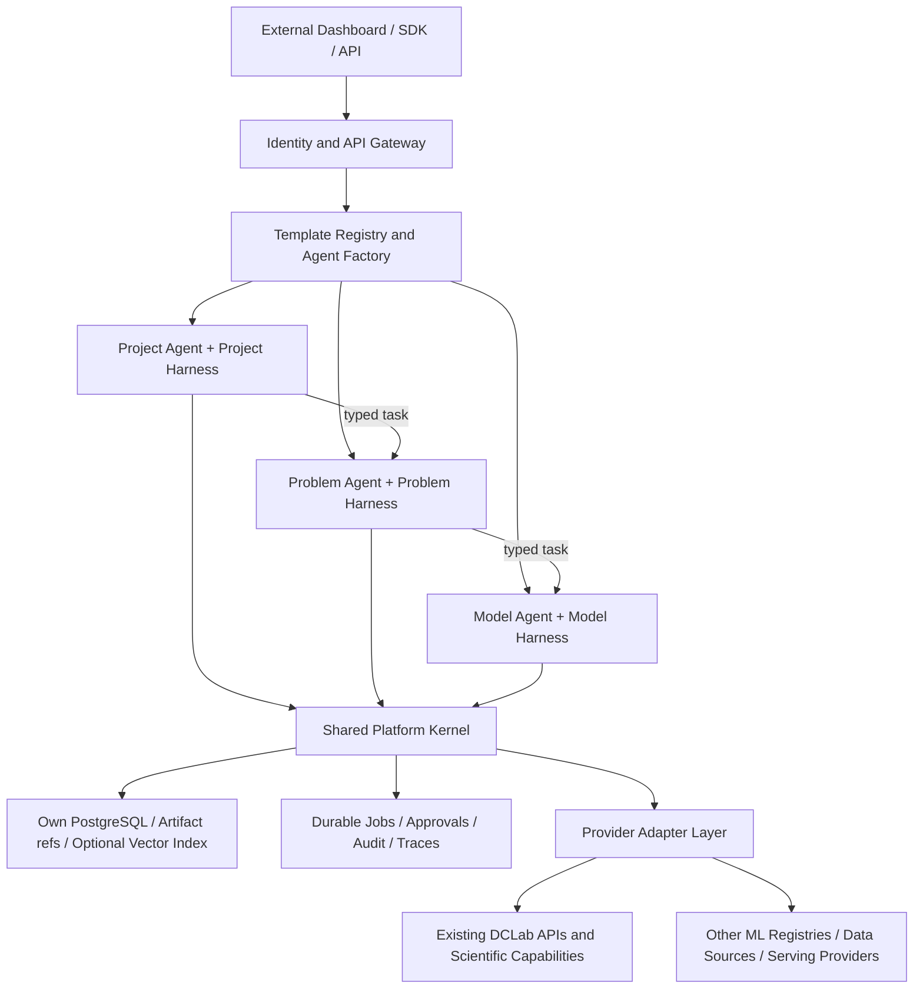

# DCLab Agentic ML External Platform
## Master Product and Engineering Roadmap

**Version:** 2.0  |  **Date:** 10 November 2026  |  **Status:** proposed engineering plan; not a claim of implemented features.

### Final architecture decision (supersedes versions 1.0 and 1.1)

Build a **standalone external agentic ML platform** with **three independently specialized but reusable agent/harness templates**: **Model Agent + Model Harness**, **Problem Agent + Problem Harness**, and **Project Agent + Project Harness**. They share one **common platform kernel** for tool dispatch, memory, job execution, policy, approval, tracing and tenancy. The external platform is not a rewrite of DCLab. It may integrate with DCLab using versioned API/adapter boundaries and selectively emulate proven patterns, but it remains deployable and useful if DCLab is offline.

Each registered model/problem/project receives a *persistent identity and configuration* that binds the appropriate template; it does **not** receive a newly hand-coded harness, a newly trained LLM, or a permanently consuming worker. New model-family backends may require a reusable task-kind or framework adapter, which is distinct from building a per-entity agent.

### What the system accomplishes

- **Model Agent:** knows a model family and its versions, training datasets, features, experiment evidence, evaluation windows, production state, drift, diagnostics and retraining possibilities. It can trigger only authorized workflows and must not invent metrics.
- **Problem Agent:** manages *one* business/technical problem and all of its context, hypotheses, datasets, discussions, decisions, candidate/adopted/rejected solutions, experiments, linked models and outcomes. It is not merely an intake or classification agent.
- **Project Agent:** manages *one project containing one or more problems*, their solution portfolios, people, budgets, milestones, conversations, dependencies, decisions and progress. It delegates specialist work while retaining project-level governance.
- **Shared infrastructure:** provides consistent safety, tenancy, memory retrieval, audit, jobs, typed tool calls, evidence and cost controls to all three, but each harness owns its own domain-specific lifecycle.
- **Standalone product:** exposes an external dashboard, public API, SDK and optional DCLab connector. Billing and payment features are intentionally deferred.

### Explicitly excluded architecture choices

The older two-harness model (one Model profile and a combined Problem/Project profile) is **obsolete**. Do **not** implement it. Do **not** create a fourth persistent Solution Agent in the MVP. A Solution is a versioned entity and workflow within the Problem Harness, while Project Agent coordinates solutions across problems. Do **not** modify DCLab's core routing or science engine just to serve the external product. Do **not** store raw datasets, every chat turn or the whole model state inside LLM prompt memory.

### Core ownership model

| Entity | Cardinality | Persistent owner | What can change without changing agent ID |
|---|---|---|---|
| Workspace | Many projects | tenant policy / owner | teams, grants |
| Project | One Project Agent per project | Project Harness | problem portfolio, milestones, decisions |
| Problem | One Problem Agent per problem | Problem Harness | objectives (as revisions), hypotheses, solutions |
| Solution | Zero or more per problem | Problem Agent with Project oversight | approach, revision, adoption state |
| ModelFamily | One Model Agent per registered family | Model Harness | versions, deployment alias, monitoring policy |
| ModelVersion | Many per model family | Model registry | version record immutable; aliases point to new versions |
| Task / Investigation | Many per entity | shared orchestration + owner agent | state transitions, checkpoints and results |

A problem can reference multiple model families; a model may serve more than one problem if grants permit it. A project has one or more problems. Cross-project sharing of models or solutions must be explicit, not accidental. The existing DCLab Case Agent may provide an intake source, but remains a separate internal concept.

### Layered deployment

### Program boundaries and scope control

1. **Data preparation first.** Record provenance, training rights, schema and leakage checks before training or retrieval.
2. **Science is deterministic.** Evaluation, splits, feature generation, model fitting and challenger selection run through tested functions, not by LLM guesswork.
3. **All write operations are separately authorized.** Proposing an action is not executing it; production deployment requires explicit approval and provider receipt.
4. **Evidence survives conversations.** Model scores and business KPIs live in canonical records, with version, cohort, window, threshold and source.
5. **Business impact is not model performance.** Improved ROC-AUC is not proof of lower churn; causal claims require appropriate experiments or qualified analysis.
6. **Observability before autonomy.** Events trigger deterministic triage; LLM investigation is reserved for reasoning that genuinely requires it.
7. **Reuse is measured.** The release gate requires **five models, three problems, and two projects** instantiated through manifests and generic adapters, without custom Agent or Harness subclasses.
8. **No indefinite free-form multi-agent conversation.** Use typed task contracts, budgets, exact references, dependencies, and retry limits.

### Phase map

| Phase | Subplans | Packages | Main gate |
|---|---:|---:|---|
| 0: Foundation, DCLab Gap Audit and Reference Scenario | 3 | 9 | G0 |
| 1: Shared Infrastructure, Template Registry and Agent Factory | 4 | 12 | G1 |
| 2: Model Agent Template and Specialized Model Harness | 3 | 10 | G2 |
| 3: Problem Agent Template and Specialized Problem Harness | 3 | 10 | G3 |
| 4: Project Agent Template and Specialized Project Harness | 3 | 10 | G4 |
| 5: Typed Multi-Agent Collaboration and Workflow Orchestration | 3 | 9 | G5 |
| 6: Event-Driven Monitoring, Investigation and Continuous Lifecycle | 3 | 9 | G6 |
| 7: External Dashboard, API Productization, Generalization and Production | 3 | 10 | G7 |

### Delivery strategy and release slices

**Slice A: Architecture proof (G0-G1).** An external service instantiates one Model, one Problem and one Project instance with isolated context and common audited execution, using manifests only. No DCLab core changes.

**Slice B: Model utility (G2).** Churn Model Agent answers version/feature/metric questions and invokes a safe evaluation or challenger job with evidence and permissions.

**Slice C: Problem and project intelligence (G3-G4).** Each Problem Agent tracks solutions, conversations and rationale; Project Agent coordinates two problems, budgets and milestones. All records persist across model and solution replacements.

**Slice D: Collaboration (G5).** An investigation flows Project -> Problem -> Model, returns evidence and explicit next steps, with bounded tool use and approvals.

**Slice E: Proactive lifecycle (G6).** Events open durable investigations and, where authorized, candidate experiments, without alert storms or unsafe deployments.

**Slice F: Product and reuse (G7).** External dashboard and API, security/reliability, 5/3/2 onboarding, operator docs, production release candidate.

### Core dependency chain

`G0 contract + dataset -> G1 factory/kernel/three harnesses -> G2 Model -> G3 Problem -> G4 Project -> G5 delegation -> G6 events -> G7 external release`.

A minimum dashboard shell exists in G1 and Model/Problem/Project UI slices arrive throughout G2-G4. Phase 7 completes productization, not the first appearance of a usable UI.

### Milestone status

This pack describes **proposed implementation**. The earlier repository inspection identified existing DCLab modules for agent runtime, registry, task contracts, science, retraining, monitoring, lineage and jobs. Their existence is **not** evidence that the new external product or any phase is already implemented. Phase 0 must verify actual compatibility and tests. No phase is marked complete by this document.

### Other documents in this pack

- `01_ARCHITECTURE_AND_BOUNDARIES.md` sets component responsibilities and deployment assumptions.
- `02_TEMPLATE_AND_HARNESS_SPEC.md` defines the three template contracts and lifecycle state machines.
- `03_DOMAIN_DATA_AND_API_CONTRACTS.md` defines persistence, context and service APIs.
- `04_SECURITY_GOVERNANCE_AND_EVALUATION.md` specifies permissions, dataset governance, reproducibility, benchmarks and release gates.
- `phases/PHASE_0_...md` through `PHASE_7_...md` contain **subplans**, **work packages**, steps, dependencies, tests and acceptance criteria.
- `05_DELIVERY_BACKLOG.md` and `tracker.csv` provide reviewable package tracking.
- `06_ARCHITECTURE_DECISIONS.md`, `07_END_TO_END_SCENARIOS.md` and `examples/` provide decisions and executable-style contracts.

### What should be coded first

1. `P0-01`: Run the real repo/test integration audit and publish the reuse/extend/build matrix.
2. `P0-02`: Ratify the three-template external architecture, and do not accidentally apply the old two-profile plan.
3. `P0-04` and `P0-05`: Approve a churn dataset and register reproducible model evidence.
4. `P1-01` through `P1-06`: Boot the independent service and prove one factory yields three isolated harness instances.
5. `P2-01` through `P2-04`: Deliver the first useful read-only Model Agent and evaluation path before implementing full proactive operation.
