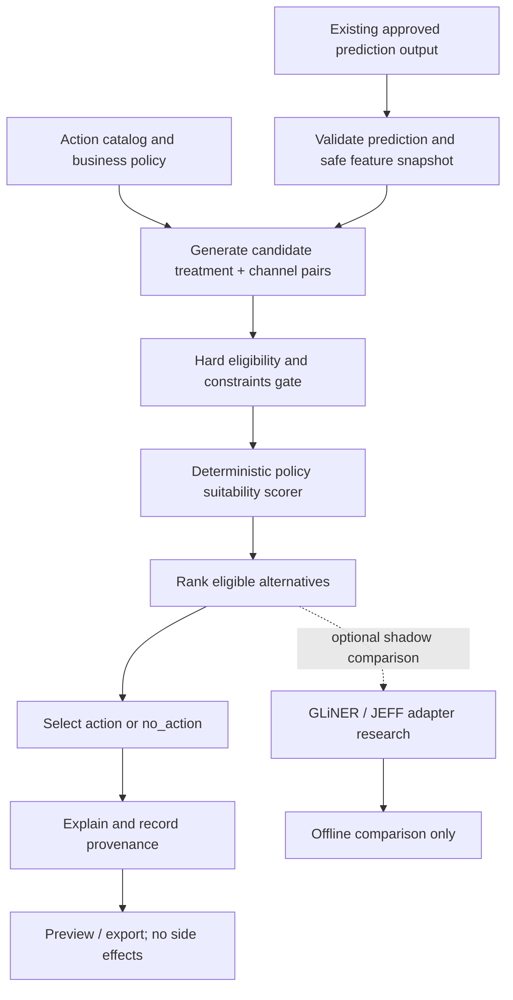

# DCLab Next Best Action (NBA) Decision Engine
## Complete MVP Implementation Plan

**Plan version:** 1.0  
**Prepared:** 2026-11-13 (Asia/Dubai)  
**Target MVP window:** Friday, November 13 through Sunday, November 15, 2026  
**Status:** Proposed; not yet implemented  
**Primary use case:** Churn prediction → customer-specific retention action recommendation  
**Future scope:** Fraud, customer support, credit risk, recommendations, and other prediction-to-decision use cases  
**Repository:** [Research_Development_DCLab](https://github.com/Shahriyar-Moradi/Research_Development_DCLab)

---

## 1. Executive decision

Build **Next Best Action (NBA)** as a reusable **post-prediction decision capability** within DCLab, not as a separate churn predictor and not as a new orchestration framework. Its first implementation uses a transparent, deterministic policy engine over customer features from the existing CSV plus an upstream churn prediction. The engine returns **eligible, ranked interventions, their channels, explicit rationale, and a record that can be evaluated later**.

**Non-negotiable distinction:** A churn model estimates the likelihood of churn. With only customer features and churn labels, there is **no evidence that any intervention prevents churn**. Therefore, the MVP ranks options using **policy suitability**, not proven causal impact, learned treatment effects, or an invented probability of success. True personalized treatment selection is a later research stage requiring action assignment, exposure, cost, and outcomes, ideally with randomized exploration.

### MVP outcome

For every valid customer snapshot, DCLab can:

1. Read a model-generated churn score and safe customer context from the existing project run.
2. Generate candidates from an extensible action catalog.
3. Apply hard eligibility, safety, contact-policy, and budget constraints.
4. Assign deterministic, **non-probabilistic** policy suitability scores and rank candidates.
5. Return one recommended action, up to three alternatives, a `no_action` fallback, and grounded explanations.
6. Preview or export recommendations, with no customer contact or discount applied automatically.
7. Record a versioned recommendation event so future outcomes can be joined safely.

### Scope and explicit exclusions

| Included in MVP | Not included in MVP |
|---|---|
| Existing churn predictor → NBA adapter | Retraining or replacing the existing churn predictor |
| CSV safe-feature mapping and schema checks | Claiming the CSV contains action-effect ground truth |
| Seven agreed action categories | Real message sending, billing changes, or benefit activation |
| Deterministic decision rules and budget/contact checks | Automatic authorization to contact customers |
| Ranked results, reasons, no-action fallback | Uplift, causal recommendation, reinforcement learning |
| Optional shadow-model adapter for experiments | Making GLiNER/JEFF a mandatory production dependency |
| Unit, integration, and scenario evaluation | Claiming measurable churn reduction from offline policy tests |
| Local preview, export, provenance, record schema | Building an entirely new workflow or storage system |

---

## 2. Alignment with the existing DCLab repository

The plan references repository materials inspected on November 13, 2026:

- [`README.md`](https://github.com/Shahriyar-Moradi/Research_Development_DCLab/blob/main/README.md): DCLab Research Studio, shared `dclab_core/`, `dclab_rnd/`, `general_pipeline/`, research/evidence directories, and existing test commands.
- [`research/churn-prediction/README.md`](https://github.com/Shahriyar-Moradi/Research_Development_DCLab/blob/main/research/churn-prediction/README.md): active Telco churn research; one customer per snapshot, `Churn` target; identifies `customerID` as an ID rather than a model feature; prediction timestamp and horizon **not recorded** in the public dataset.
- [`docs/guides/TASK_PLANNING_ARCHITECTURE.md`](https://github.com/Shahriyar-Moradi/Research_Development_DCLab/blob/main/docs/guides/TASK_PLANNING_ARCHITECTURE.md): existing `ProblemMap`, `SolutionPlan`, `SolutionWorkflow`, studio stage execution, guardrails, and evidence ownership. The document distinguishes implemented functionality from future planning work; do not assume proposed task execution is present.
- [`dclab_core/ledger.py`](https://github.com/Shahriyar-Moradi/Research_Development_DCLab/blob/main/dclab_core/ledger.py): existing decision points concern workflow/technical decisions. **Do not repurpose this technical training/decision ledger for customer retention actions without a separately reviewed contract.**
- [`research/workflow-actions/README.md`](https://github.com/Shahriyar-Moradi/Research_Development_DCLab/blob/main/research/workflow-actions/README.md): addresses generated workflow units, not customer Next Best Action. Do not conflate these concepts.

**Integration principle:** Add a small, opt-in post-prediction extension and reuse the current project store, model outputs, authorization, run evidence, UI and export mechanisms where compatible. Confirm actual handler interfaces and file structure at implementation time. File paths in Section 12 are **proposals, not claims that those modules currently exist**.

---

## 3. Product requirements and user journey

### Primary user story

> As a DCLab user who has already trained or selected a churn prediction model, I want a per-customer recommendation of the next retention action, using the customer context available in my table, so I can inspect and prioritize interventions rather than receiving only a churn risk number.

### User journey

1. User loads a customer CSV through the existing DCLab project flow.
2. User selects a churn target and runs or selects an approved model, keeping current leakage checks and holdout behavior unchanged.
3. The project exposes safe inference-time feature values and model predictions for eligible records.
4. User opens **Next Best Action** and selects a catalog/policy revision.
5. DCLab previews recommended actions and explanations. User may filter by risk, action, eligibility, or unresolved constraints.
6. User reviews a customer-level detail card: prediction, eligible actions, rejected actions/reasons, selected action + channel, and provenance.
7. User may export a preview as CSV/JSON. **Export is not permission to execute actions.**
8. If a future business system executes an action, a distinct approval/integration layer records delivery, results, and possible adverse effects.

### Business-level acceptance criteria

- Every valid record has one explicit result, including `no_action` or `blocked` when appropriate.
- No unsupported claims that an action is statistically optimal.
- User can see **why** an action was selected and why alternatives were rejected.
- Every constraint is enforced **before** ranking and never bypassed by a model suggestion.
- The same inputs, policy version, and catalog version yield the same output.
- No action is executed on a customer by the MVP.

---

## 4. Agreed action catalog: seven action families

The original seven choices remain supported. However, **channel and treatment must be modeled separately**. For example, “10% discount via email” is one offer delivered over a channel; “email” alone is typically an outreach method. Preserve the agreed category `personalized_email` as a user-friendly catalog entry, normalized internally to a `reengagement_message` treatment over the `email` channel.

| Catalog ID | User-facing action | Internal treatment | Possible channel | Typical context signal (hypothesis only) |
|---|---|---|---|---|
| `personalized_email` | Personalized email | `reengagement_message` | email | Reduced engagement, if safely measured |
| `discount` | Discount | `discount` | email, WhatsApp, in-app, support | Possible price friction; **do not infer price sensitivity from churn alone** |
| `promotion` | Promotion / bundle | `promotion` | email, WhatsApp, in-app | Potential product-feature mismatch |
| `free_service` | Trial / free service / upgrade | `service_trial` | in-app, email, support | Relevant service not currently activated |
| `proactive_support` | Proactive support | `support_outreach` | phone, email, support ticket | Support issue or known unresolved case |
| `payment_assistance` | Payment assistance | `payment_assistance` | in-app, email, phone | Payment friction evidenced by allowed columns |
| `no_action` | No action | `none` | none | No safe/eligible intervention or no policy-supported reason to intervene |

**Important:** The table contains **candidate hypotheses**, not validated effectiveness relationships. No rule is active unless its required column exists and its meaning has been confirmed. In the known Telco churn CSV, features such as `tenure`, `Contract`, `MonthlyCharges`, `PaymentMethod`, and `TechSupport` may be present; the table does **not** necessarily contain recent logins, failed payments, support-ticket counts, consent, or discount history. Never pretend missing signals exist.

### Recommended catalog fields

```yaml
catalog_version: "nba-actions-v1"
actions:
  - id: "discount"
    treatment_type: "discount"
    channels: ["email", "in_app"]
    enabled: false  # Explicit business enablement required
    params:
      percent: 10      # Example only; not an authorized company policy
    constraints:
      require_consent_for_marketing_channels: true
      require_approved_discount_cap: true
      require_budget: true
      cooldown_days: null   # Unknown => block automated contact
    estimated_causal_effect: null
  - id: "no_action"
    treatment_type: "none"
    channels: ["none"]
    enabled: true
    params: {}
    constraints: {}
    estimated_causal_effect: null
```

Catalog version, default-disabled expensive options, and an explicit absence of causal-effect estimates are mandatory. The UI can offer example settings, but such examples must not become silently active defaults.

---

## 5. Data contracts and feature availability

### 5.1 Required input sources

**A. Existing prediction artifact**

- `customer_id` or safe stable row key (needed for traceability; not for predictive learning)
- `prediction_timestamp` and `prediction_horizon` when truly known, otherwise `unknown`
- `model_id`, `model_version`, `run_id` and model output version
- `churn_probability` in `[0,1]`, or a separate accepted classification contract with a clearly marked reduced capability
- prediction status / validity

**B. Customer context**

- One safe snapshot per customer at the same decision moment
- Approved inference features only, with feature types and missingness preserved
- `feature_schema_version`, `snapshot_id`, source-file fingerprint
- Data provenance and data-availability timestamp where available

**C. Policy and business configuration**

- Enabled catalog entries and allowed channels
- Discounts/costs, budgets, consent, channel eligibility, contact cooldown, exclusions
- Capacity limits and conflict-resolution order for batch selection
- Currency/unit for cost parameters when provided

### 5.2 Two explicit operating modes

| Mode | Inputs | Allowed result |
|---|---|---|
| `policy_preview` | Model output + safe CSV columns + explicitly enabled policy | Ranked, **advisory** policy matches with reasons |
| `policy_blocked` | Missing required context/approval/eligibility | `no_action` or `blocked`, with reason codes |

Future `learned_uplift` mode is **not** part of MVP. If predictions are only class labels and no calibrated scores exist, skip risk-based thresholds or use an approved label policy; never manufacture a probability.

### 5.3 Column validation rules

- Never include target `Churn`, future outcomes, post-decision fields, or identifiers in the model's predictive input. `customerID` may be used solely as a key after appropriate access controls.
- Filter feature mappings to time-safe columns. Existing DCLab leakage review remains authoritative.
- Do not silently turn `TechSupport=No` into “customer filed many tickets.” It may mean a subscription option, not a service interaction count.
- Do not silently interpret `PaymentMethod=Electronic check` as repeated failed payments.
- Do not infer marketing consent, contact history, campaign budget, account value, or customer preferences from absent fields.
- Missing features produce an `unknown_feature`/`insufficient_context` reason and disable dependent rules.
- Prevent accidental training/test leakage: NBA evaluation must not re-use test outcomes to tune action policy.
- Store minimal data needed for auditing; prefer approved keys/hashes over raw PII.

### 5.4 Example input contract

```json
{
  "schema_version": "nba.input.v1",
  "decision_id": "preview-20261113-0001",
  "project_id": "telco-demo",
  "customer_id": "C1024",
  "prediction": {
    "task": "churn",
    "model_id": "selected-model",
    "model_version": "model-run-version",
    "probability": 0.86,
    "predicted_at": null,
    "horizon_days": null
  },
  "context": {
    "tenure": 4,
    "Contract": "Month-to-month",
    "MonthlyCharges": 85.5,
    "TechSupport": "No"
  },
  "metadata": {
    "snapshot_id": "snapshot-001",
    "feature_schema_version": "telco-v1",
    "source_fingerprint": "sha256:example-only",
    "prediction_time_status": "unknown"
  },
  "config": {
    "catalog_version": "nba-actions-v1",
    "policy_version": "nba-policy-v1",
    "execution_mode": "preview_only"
  }
}
```

The probability and feature values above are synthetic illustrations, not measured results from the DCLab project. Missing timestamps are **explicitly unknown**, rather than fabricated.

---

## 6. Decision engine design

### 6.1 Execution sequence



**Do not make a new generic execution controller.** The upstream model remains owned by the current studio pipeline. The NBA engine consumes an output artifact and produces a new, separately versioned decision artifact.

### 6.2 Gating order

1. **Request validity:** Schema, model output, row identity, safe feature scope, policy revision.
2. **Permission/eligibility:** Consent, allowlist/exclusions, product eligibility, affordability flags, contactable channel, restrictions.
3. **Business constraints:** Discount cap, campaign budget, capacity, cooldown; if unknown and needed, candidate is blocked, not assumed eligible.
4. **Policy suitability:** Only eligible candidate pairs get a deterministic score.
5. **Batch allocation:** Reconcile campaign-level budget/capacity using stable priority and deterministic ties. A row-level best action may be displaced after allocation; explanations must reflect that.
6. **Selection:** Preferred eligible option or `no_action`.
7. **Explanation + audit:** Structured reason codes, cost/constraint provenance, selected revision, and optional manual override, separately identified.

### 6.3 Initial policy scoring

The MVP should use an interpretable **ordinal suitability score**, not a “chance of retention” score:

```text
policy_suitability(action, customer) =
    sum(approved feature-match weights)
  - cost_penalty_if_configured
  - contact_fatigue_penalty_if_observed
  - business_priority_penalty_if_configured
```

Every weight and threshold belongs to a named policy revision. **Risk probability may determine whether to prioritize review, but it is not evidence that one specific action works better than another.** Scoring should not synthesize unavailable input fields. `no_action` remains eligible by default.

Rules for the initial configuration (examples, **not automatically approved**):

- If safe evidence indicates a recent unresolved support problem and support outreach is enabled → increase suitability of `proactive_support`.
- If an authoritative failed-payment count exists and help is available → consider `payment_assistance`.
- If a verified engagement metric shows inactivity → consider `personalized_email`, subject to channel consent.
- If approved price-friction evidence exists **and** discount limits/budget are configured → consider `discount`.
- If a service-fit flag is verified and trial eligible → consider `free_service` or `promotion`.
- Without meaningful evidence, sufficient constraints, or valid contact permission → choose `no_action` or mark `blocked`.

**Current Telco CSV fallback:** When the dataset has only tenure/contract/monthly charges and no action history/consent, the engine can produce **explicitly exploratory, policy-based candidates**, but should default to no executable offer and avoid claiming a top-ranked treatment has retention benefit.

### 6.4 Recommendation output contract

```json
{
  "schema_version": "nba.output.v1",
  "decision_id": "preview-20261113-0001",
  "customer_id": "C1024",
  "mode": "policy_preview",
  "prediction": {"task": "churn", "probability": 0.86},
  "selected": {
    "action_id": "no_action",
    "treatment_type": "none",
    "channel": "none",
    "policy_suitability_score": null,
    "estimated_uplift": null,
    "estimated_net_value": null,
    "reason_codes": ["INSUFFICIENT_VERIFIED_ACTION_CONTEXT"]
  },
  "alternatives": [
    {
      "action_id": "personalized_email",
      "channel": "email",
      "eligibility": "blocked",
      "reason_codes": ["MARKETING_CONSENT_UNKNOWN"]
    }
  ],
  "execution_status": "not_executed",
  "method": "deterministic_policy_v1",
  "catalog_version": "nba-actions-v1",
  "policy_version": "nba-policy-v1",
  "source_run_id": "model-run-version",
  "limitations": ["NO_ACTION_OUTCOME_DATA", "PREDICTION_HORIZON_UNKNOWN"]
}
```

Do not call `policy_suitability_score` a probability or confidence. Never populate `estimated_uplift` or `estimated_net_value` from arbitrary heuristics. JSON exports must remain consistent with the UI.

---

## 7. Model strategy: baseline first, GLiNER / JEFF optional

### Track A: Deterministic baseline (production MVP)

- Typed rules and stable policy versioning; no LLM required.
- Testable constraints, missing-data behavior, explanations, and deterministic ranking.
- Zero causal claims; works offline with CI dependencies where feasible.
- Serves as the benchmark **any learned decision model must beat**.

### Track B: GLiNER2.5-Decide experimental adapter (shadow)

- First verify model weights, license, actual API, candidate-label format, hardware requirements, and whether commercial use is permitted.
- Build an optional serializer of **approved feature values** to a structured decision context.
- Produce a proposed catalog action ID only; normalize and validate it against the same hard constraints as the baseline.
- Keep its output in `shadow_predictions`, separate from the user-facing recommended action unless independently approved.
- Measure valid-action rate, latency, throughput, reproducibility, policy violations, explanation grounding, and agreement/disagreement with the baseline.
- **Do not use baseline-generated labels as independent evidence of superior effectiveness.** They can train policy imitation, not treatment optimization.

### Track C: JEFF / Any-JEFF feasibility study (shadow or research only)

- Verify that the candidate is appropriate for the actual task/data and available for the planned use; do not assume it is a drop-in NBA model.
- Document input representation, output head, licensing, compute, label requirements, and reliable inference integration.
- If the model requires supervised `best_action` labels that the dataset does not have, mark the track blocked pending labels and do **not** manufacture a performance comparison.

### Track D: True learned next-best-action (post-MVP)

- Collect per-action assignment/offer/delivery and outcomes, including who was eligible and who received `no_action`.
- Establish consistent prediction/decision/intervention/outcome timestamps and outcome windows.
- Where ethically and operationally feasible, run controlled randomized treatment/control groups with consent, exclusions, and cost controls.
- Compare treatment-specific uplift, incremental profit, calibration, uncertainty and policy value using appropriately identified data.
- Consider T-learner/S-learner/X-learner, uplift forests, causal forests, contextual bandits or policy learning **only after** checking causal identification assumptions and overlap/propensity support.

**Model selection rule:** Treat GLiNER and JEFF as scientific hypotheses to evaluate, not predetermined winners. A simpler deterministic baseline is an entirely acceptable MVP result.

---

## 8. Business constraints and safe defaults

The user has not supplied concrete company-specific budgets, discount limits, approved channels, or consent records. Therefore the MVP ships with **configuration slots and conservative defaults**, not guessed values.

| Constraint | Config field | Safe behavior when unknown |
|---|---|---|
| Maximum discount | `max_discount_percent` | Block discount |
| Currency, cost and budget | `currency`, `cost_per_action`, `campaign_budget` | Block spend-bearing actions; allow advisory preview |
| Contact permission | `marketing_consent`, `channel_permissions` | Block outbound marketing contact |
| Contact cooldown | `cooldown_days`, `last_contact_at` | Block auto-contact; annotate unverified in preview |
| Customer eligibility | `eligible_products`, `excluded_accounts` | Block action needing an unknown entitlement |
| Capacity | `max_support_cases`, `max_campaign_recipients` | Block capacity-bound live allocation |
| Approval | `approved_by`, `approval_revision` | Preview only; never dispatch |
| Regional / company policy | `policy_region`, `policy_ruleset` | No live execution without configured policy |

**Separation of concerns:** `recommendation != authorization != execution != delivered != outcome`. A future execution service needs its own approval, credentials, idempotency, retries, receipt handling, and jurisdiction-specific policy review. None of those is implicit in a preview.

---

## 9. Evaluation and evidence strategy

### 9.1 Offline tests possible immediately

| Dimension | Metric | Gate for MVP |
|---|---|---|
| Schema | Valid input/output contract rate | 100% for valid fixtures |
| Constraints | Forbidden/over-budget/unauthorized candidate selected | **0** in test suite |
| Determinism | Same input/config produces same result | 100% |
| Coverage | Every valid row produces selected/no-action/blocked state | 100% |
| Grounding | Reasons refer to real available fields/rules | 100% in test fixtures |
| Missing values | No fabricated features or permissions | 100% in test fixtures |
| Batch allocation | Allocated cost/capacity never exceeds configured constraints | 100% in test fixtures |
| Integration | End-to-end preview from stored churn model predictions | Pass on one real project fixture |
| Explainability | Every exclusion includes reason code | 100% |
| Safety | No message, payment, or account mutation from preview | 100% |

Also record p50/p95 recommendation latency and throughput, but set performance targets **after** capturing a baseline on the target environment. Never invent a numeric SLA before measuring it.

### 9.2 What offline MVP tests cannot establish

- A higher recommendation score does **not** mean higher retention probability.
- Agreement between GLiNER and hand-written rules does **not** establish a causal best action.
- Accuracy against synthetic labels only measures imitation of the labeling policy.
- Churn model ROC-AUC/AP does not measure quality of retention interventions.
- Historical churn without intervention assignment/outcomes cannot establish uplift or campaign ROI.

### 9.3 Test cases (minimum)

1. High churn risk with sparse CSV context → advisory-only candidate or `no_action` with clear limitations.
2. Verified unresolved support issue → `proactive_support` eligible if enabled and approved.
3. Failed-payment evidence missing → `payment_assistance` not invented.
4. `TechSupport=No` → does not trigger a fake ticket count.
5. Email channel lacks consent → reject outbound marketing action.
6. Discount exceeds cap or budget → reject despite high policy score.
7. Contact cooldown unavailable → no silent permission.
8. Two customers compete for a limited budget → stable allocation with no overspend.
9. Churn score `null`, `-0.1`, `1.2`, or invalid string → explicit validation failure or supported reduced mode.
10. Duplicate customer IDs or mismatched row order → no accidental row/prediction join.
11. Target/identifier/after-decision columns → excluded from predictive feature use.
12. All actions disallowed → `no_action` with reason codes.
13. Optional model proposes unknown action → reject and safely fall back.
14. Re-running identical artifact and policy → identical recommendations and fingerprints.
15. Preview endpoint, export, and shadow evaluation → no external side effects.

---

## 10. UX, notebook and report deliverables

### MVP UI section: “Next Best Action”

Keep the page lightweight and consistent with the current DCLab Studio/Notebook experience.

**Overview panel:** Source prediction run, available features, catalog version, policy version, number of evaluated customers, recommendation distribution, blocked count, warnings.

**Customer table:** Customer key, churn risk (if provided), recommended action, channel, policy suitability score, top reason, eligibility/blocked status, policy revision. Support sorting and filtering.

**Customer detail panel:** Available evidence, candidate-by-candidate eligibility, selected action, reasons, missing data, configuration warnings, **“Estimated retention improvement: unavailable”**.

**Controls:** Select catalog/policy revision, preview, compare baseline vs optional shadow model, export CSV/JSON, and review policy configuration. Do not add a “Send” control in MVP.

**Report:** Model provenance, input snapshot, feature limitations, policy version and thresholds, counts, rejection distributions, examples, test evidence, and explicit non-causal interpretation.

**Graceful fallback:** If adding a new UI page risks the deadline, ship a Notebook stage/card and downloadable preview first, then promote to a dedicated page as a follow-up.

---

## 11. Implementation milestones: November 13–15, 2026

### Day 1 — Friday, November 13: Design + contracts + baseline core

**P0 deliverables**

- [ ] Confirm actual upstream prediction artifact shape and safest integration point in the current Studio code.
- [ ] Create research note `research/next-best-action/README.md` with hypothesis, boundaries and datasets.
- [ ] Freeze `nba.input.v1`, `nba.output.v1`, catalog and policy schemas.
- [ ] Implement action catalog and explicit `no_action` fallback.
- [ ] Implement feature availability/eligibility checks and standardized reason codes.
- [ ] Implement deterministic single-row policy scorer (with no implied causal meaning).
- [ ] Add unit tests for validity, missing data, disallowed actions and reproducibility.

**Exit gate:** Pure-function preview works on a small synthetic fixture without external services, and unsupported features cannot generate fake recommendations.

### Day 2 — Saturday, November 14: Integration + batch constraints + evaluation

**P0 deliverables**

- [ ] Read selected churn predictions and the matched approved feature snapshot from an existing project artifact.
- [ ] Enforce stable customer key alignment, duplicate checks and feature provenance.
- [ ] Add batch-level budgets, capacity, cooldown checks, deterministic tie resolution and exclusion reasons.
- [ ] Create new customer recommendation records, separate from existing technical ledger points.
- [ ] Build end-to-end tests against the Telco data shape. Do not rely on absent consent or intervention labels.
- [ ] Add preview/export interface using an existing project route, tool or Notebook artifact boundary.
- [ ] Capture baseline latency and coverage measurements.

**Exit gate:** Batch preview produces a valid export and audit metadata; overspend, forbidden actions and real side effects are impossible in the MVP path.

### Day 3 — Sunday, November 15: UI + shadow comparison + release gate

**P0 deliverables**

- [ ] Add compact Notebook/Studio Next Best Action view or card.
- [ ] Display action, channel, evidence, alternatives, exclusions, and limitations.
- [ ] Run all unit/integration/scenario tests plus current DCLab repository checks.
- [ ] Produce an MVP evaluation report and reproducible example.
- [ ] Review privacy, authorization boundaries, missing fields, and no-execution contract.
- [ ] Release as an opt-in preview feature with an explicit experimental/non-causal label.

**P1 only if P0 is stable**

- [ ] GLiNER2.5-Decide adapter as a shadow experiment with structured outputs and gating.
- [ ] JEFF/Any-JEFF feasibility memo; only implement if a suitable supported interface is verified.
- [ ] Rich UI charting and policy sensitivity display.

**Exit gate:** One DCLab churn project can run end-to-end prediction → NBA preview → reproducible export + explanation with no policy violations.

**Schedule caveat:** This is a target plan for a focused three-day MVP, not a claim that the code has been implemented. If P0 slips, move P1 experiments and dedicated UI polish to the next iteration rather than weakening safety/testing.

---

## 12. Proposed code organization and ownership

Paths below are **suggested new modules**, to be reconciled against actual repository conventions before coding.

```text
research/
  next-best-action/
    README.md
    experiments/
      baseline_vs_shadow/
    evaluation/
      MVP_EVALUATION.md

dclab_core/
  next_best_action/                # New pure, deterministic domain logic
    __init__.py
    contracts.py                  # Versioned typed input/output contracts
    catalog.py                    # Action and channel definitions
    eligibility.py                # Hard business and permission constraints
    policies.py                   # Feature rules and transparent scoring
    allocator.py                  # Deterministic batch budget/capacity assignment
    explain.py                    # Structured reason codes / explanation

dclab_rnd/
  studio/                          # Existing host, exact insertion TBD
    ...                            # Thin adapter from model records to NBA

  # Project storage integration TBD: new customer recommendation records
  # Reuse host auth, project scope, run evidence and export conventions.

tests/
  test_next_best_action_contracts.py
  test_next_best_action_policy.py
  test_next_best_action_allocation.py
  test_next_best_action_integration.py
```

**Integration tasks:**

- Resolve where the selected model prediction is materialized and how to read only approved inference features.
- Bind recommendation records to `project_id`, source `run_id`, catalog/policy revision and input fingerprint.
- Prefer existing `dclab_rnd/studio` export and evidence storage patterns; avoid duplicating train/validation/holdout logic.
- Consult the current auth/toolbox/guard system before exposing a new endpoint. A schema validator is **not** an authorization system.
- Preserve existing `Decision Ledger` semantics for methodological/workflow decisions; create a distinct retention decision record type.
- Avoid new dependencies in the core baseline; optional model libraries belong in experimental extras.
- If a CLI is useful, add it through existing tooling conventions rather than promising a path that does not yet exist.

### Proposed callable interface

```python
# Conceptual contract; not an existing imported API.

def recommend_next_action(
    prediction: PredictionRecord,
    customer_context: SafeFeatureSnapshot,
    catalog: ActionCatalog,
    policy: DecisionPolicy,
    business_context: BusinessConstraints,
) -> RecommendationRecord:
    """Pure, deterministic, preview-only recommendation with reason codes."""


def recommend_batch(
    predictions: list[PredictionRecord],
    contexts: list[SafeFeatureSnapshot],
    catalog: ActionCatalog,
    policy: DecisionPolicy,
    constraints: BusinessConstraints,
) -> BatchRecommendationResult:
    """Apply campaign budget/capacity limits using stable allocation order."""
```

### Reason-code examples

`CONTEXT_MATCH`, `INSUFFICIENT_VERIFIED_ACTION_CONTEXT`, `FEATURE_MISSING`, `RISK_UNAVAILABLE`, `MARKETING_CONSENT_UNKNOWN`, `CONTACT_COOLDOWN_UNVERIFIED`, `DISCOUNT_CAP_NOT_CONFIGURED`, `BUDGET_NOT_CONFIGURED`, `BUDGET_EXCEEDED`, `CHANNEL_NOT_PERMITTED`, `NOT_ELIGIBLE`, `MODEL_PROPOSED_UNKNOWN_ACTION`, `NO_ELIGIBLE_ACTION`.

---

## 13. Recommendation and outcome data model

Do **not** merge customer-level actions into the existing scientific decision ledger as if they were the same kind of decision. Introduce distinct record types:

### 13.1 `RecommendationRecord` (MVP)

- `decision_id`, `project_id`, safe `customer_key`
- `prediction_run_id`, `prediction_timestamp/horizon` if known
- `snapshot_id`, input schema and fingerprint
- `policy_version`, `catalog_version`, `engine_version`
- selected action/channel/parameters and reasons
- alternative IDs, eligibility and rejection reasons
- `policy_suitability_score`, **not** `success_probability`
- `estimated_uplift: null`, `estimated_net_value: null` unless defensible data exist
- `created_at`, `execution_status: not_executed`
- optional human override record with author/time and justification, distinct from model selection

### 13.2 `InterventionEvent` (future)

- `assigned_action`, `assignment_probability`, experimental group, assignment timestamp
- `approved_action`, approver, delivery channel, campaign ID
- `attempted_at`, `delivered_at`, delivery status, idempotency key
- actual incurred cost, delivered discount/benefit, constraints active at execution
- distinction between **assigned**, **attempted**, **delivered**, and **received**

### 13.3 `OutcomeRecord` (future)

- Decision-to-outcome join key; observed window boundaries
- churn / retention outcome and timestamp
- value/revenue and incremental cost where valid
- missingness, censoring, competing interventions, and leakage flags
- experimental assignment metadata to support causal identification

**Retention/privacy:** Minimize sensitive fields; control access and retention. Do not train on third-party model-generated rationale unless licensing/training rights are explicitly validated.

---

## 14. Demo scenario and expected behavior

**Dataset:** Existing Telco churn CSV shape, joined to selected-model predictions by stable customer identifier or verified record mapping. The public churn benchmark does not supply marketing consent, treatment assignment, intervention effectiveness, or an established prediction horizon.

**Example demo path:**

1. Upload/select Telco data and existing selected churn model output.
2. Set catalog to a conservative default: `no_action` enabled; expensive/outbound actions disabled until valid policy data are supplied.
3. Preview action suggestions, including the missing-policy warnings.
4. Activate an **explicitly synthetic demo-only** policy and synthetic consent/budget fixture to exercise email, discount, support, payment help, and allocation scenarios. Mark these simulated conditions in all reports.
5. Display ranked options and rejection reasons.
6. Export recommendation artifact with `execution_status=not_executed`.
7. Compare shadow model proposals, if available, **without overriding hard constraints**.

**Demo success is not business efficacy:** It proves integration, policy enforcement, and auditable decisions, not churn lift.

---

## 15. Failure modes and mitigations

| Risk | Mitigation |
|---|---|
| Mistaking predictive risk for action effect | Explicit non-causal output contract; null uplift/value estimates |
| False context from CSV feature names | Feature dictionary, availability guard, provenance, scenario tests |
| Promotional outreach without permission | Consent/channel gates; preview-only default |
| Offering unaffordable discounts | Unknown cap/budget blocks expensive actions; batch allocator |
| Hallucinated reasons from an LLM | Deterministic reason codes, grounded references, schema validation |
| Treating model agreement as accuracy | Separate policy-fidelity metrics from real-world uplift |
| Leakage from label/after-decision fields | Reuse existing leakage-safe snapshot and review gate |
| Duplicating DCLab orchestration | Thin post-prediction adapter; existing project execution owner remains authoritative |
| Polluting the workflow Decision Ledger | Separate customer decision and outcome schemas |
| UI scope jeopardizes MVP | Notebook card + CSV/JSON export first |
| Historical policy outcomes are biased | Later randomized trials or carefully identified observational evaluation |
| Misidentifying two customer snapshots | Stable keys, hashes, timestamp/snapshot checks, duplicate detection |

---

## 16. Exact MVP definition of done

The MVP can be called **complete** only if all the following are true:

- [ ] The existing DCLab prediction pipeline remains unaffected and its holdout rules remain unchanged.
- [ ] An opt-in NBA preview consumes a real stored churn prediction artifact plus a matching safe snapshot.
- [ ] The seven agreed action families are present as versioned catalog entries.
- [ ] Action and channel are represented separately; `no_action` works by design.
- [ ] Eligibility/consent/budget/cooldown/cap constraints fail safely when needed data are absent.
- [ ] Every valid customer receives a reproducible selected/blocked/no-action result.
- [ ] Every recommendation is traceable to input, policy/catalog version and reason codes.
- [ ] Estimated treatment uplift and net benefit remain `null` without defensible evidence.
- [ ] Batch results never violate explicitly configured budget or capacity in tested scenarios.
- [ ] Optional GLiNER/JEFF outputs cannot bypass deterministic constraints.
- [ ] Studio/Notebook preview or export is visible and useful; no real customer action occurs.
- [ ] Unit, integration, edge-case and no-side-effect tests pass.
- [ ] A short evaluation report documents data limitations and known non-goals.
- [ ] The implementation is documented in `research/next-best-action/` and can be repeated from a fresh checkout.

**Suggested verification commands** (run from repository root; exact test filenames must match the implementation):

```bash
python -m pytest tests/test_next_best_action_contracts.py \
  tests/test_next_best_action_policy.py \
  tests/test_next_best_action_allocation.py \
  tests/test_next_best_action_integration.py

make rd-check
```

If `pytest` is not in the active environment, use existing repository test conventions or add it as an explicitly scoped test dependency. Do not change the default install only for an optional experiment.

---

## 17. Follow-up roadmap after MVP

### Phase 2 — Business data + feedback instrumentation

Add governed catalog editing, customer consent/contact-history ingestion, costs, controlled intervention approval, delivered-event logging, explicit counterfactual controls, and outcome collection. Standardize prediction horizons and decision windows. Maintain complete data lineage and permissions.

### Phase 3 — Action-effect science

Design controlled campaigns with business stakeholders, treatment/control groups and randomized assignment where feasible. Use appropriate design and statistical power checks. Estimate incremental retention and net economics; evaluate heterogeneous treatment effects, calibration, cost-aware policy value, uncertainty and negative side effects.

### Phase 4 — Learned decision model

Benchmark uplift learners / contextual policy learners and suitable GLiNER/JEFF-derived models if valid labels exist. Use a held-out or prospective experiment, not circular labels generated by the deterministic baseline. Deploy a learned policy only after it beats the baseline on defensible utility, safety and stability criteria.

### Phase 5 — General DCLab Decision Intelligence

Introduce domain-specific action catalogs for fraud, credit decisions, support and other tasks; model common candidate/eligibility/scoring/explanation/feedback interfaces. Keep domain permissions, harm constraints and business authority separate even if the engine core is shared.

---

## 18. Immediate implementation order for an engineering agent

1. Inspect current Studio prediction output and project storage interfaces; identify stable, approved input artifact(s).
2. Implement pure, typed core contracts + seven-action catalog + versioning.
3. Implement deterministic eligibility gates, reason codes and `no_action` fallback.
4. Add policy suitability scoring with no invented causal confidence.
5. Add deterministic batch allocation and zero-side-effect export.
6. Integrate as an optional, **post-prediction** Studio/Notebook stage; preserve existing science, permissions and holdout gates.
7. Add customer recommendation records as a separate entity from the technical Decision Ledger.
8. Build UI preview and detailed explanations with explicit limitations.
9. Run targeted tests, `make rd-check`, and produce reproducible evaluation evidence.
10. Only then explore GLiNER/JEFF shadow adapters; never block MVP on them.

### Implementation instruction

> Build the smallest complete, auditable post-prediction NBA capability. Do not rewrite churn modeling, introduce a second workflow engine, overclaim causal effectiveness, invent missing columns or business policy, or automatically contact customers. Treat the deterministic policy as the safety baseline and GLiNER/JEFF as optional research adapters. Preserve DCLab's existing data provenance, holdout, authorization and project evidence boundaries.

---

**Decision to carry forward:** The MVP is a **policy-driven, evidence-aware retention recommendation engine** with a clean extension path to true treatment-effect learning. It is not yet a learned “optimal retention action” system. That distinction makes the first implementation testable, honest, and reusable.
