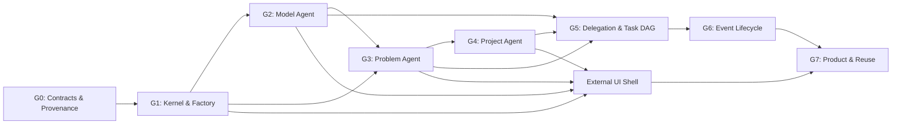

# Dependency Map and Build Order

**Version:** 2.0 | **Date:** 10 November 2026.

The phases are milestone gates, not eight all-or-nothing coding sprints. Phase 1 can include a basic UI and fake provider integration; Phase 7 completes the external product rather than delaying all UI until the end.

## Ordering rules

- **G0 is mandatory before training new models or connecting unrestricted data sources.** Establish provenance and data rights first.
- **G1 supplies a safe skeleton.** Shared kernel, template registry, instance factory, identity, auditing and provider contracts are implemented once; harnesses have distinct domain ownership.
- **G2 proves model truthfulness.** Start read-only, then deterministic evaluations, diagnostics and approval-gated candidate training.
- **G3 depends on model provenance.** Problem Agent may exist before full G2, but any claims about a linked model require verified Model Agent evidence.
- **G4 depends on problem ownership.** Project Agent should coordinate 2+ problems and respect their decisions and permissions.
- **G5 composes stable capabilities.** The multi-agent task coordinator should not become an excuse to rebuild individual harnesses.
- **G6 adds proactive events only after safe manual execution and recovery are proven.** Events must not silently trigger deployment.
- **G7 completes external product hardening and generalized reusable onboarding.** Release depends on all prior critical security gates.

## Cross-phase unblock points

| Dependency | Blocks | Safe parallel activity |
|---|---|---|
| Entity IDs and template contract P0-03 | Factory P1-04 | Read-only DCLab adapter feasibility spike |
| Dataset card and baseline P0-04/05 | Model evaluation G2 | Design UI shell and scenario fixtures |
| Policy checks P1-07 | Any tool side effects G2-G6 | Read-only retrieval capability tests |
| Problem relation schema G3 | Project portfolio G4 | Independent project navigation UI |
| Task protocol G5 | Incident handoff G6 | Deterministic monitoring signals and dashboards |
| External API contract and component status | SDK/dashboard G7 | Frontend design against generated mocks |

## Staged release policy

1. Internal developer preview: manifests, entity APIs, read-only model knowledge, small UI shell.
2. Controlled test pilot: evaluation, problem memory and solution history, project context.
3. Workflow pilot: scoped delegation, checkpointing and operator approvals.
4. Monitoring pilot: events, deduplication, incident review and proposals.
5. External release candidate: cross-tenant verification, 5/3/2 reuse suite, stress/fault tests, documented rollback.

Avoid premature billing/payments, arbitrary user-installed executable plugins, unmanaged tool execution and model-specific copies of harness code.
