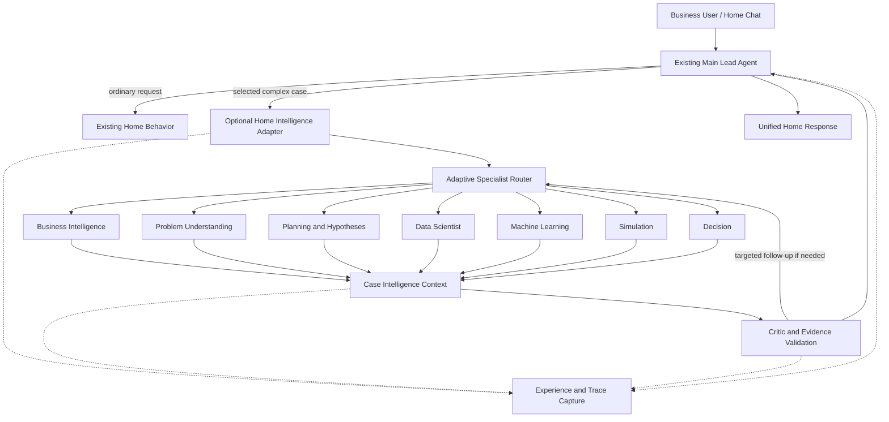

# DCLab — Home Multi-Perspective Intelligence

**Document 1 of 2 | Additive Architecture and Implementation Plan | 24 November 2026**

Status: proposed implementation for review and approval. No source code has been modified at this stage.

## 1. Objective and scope

The goal is to enable the Main Lead Agent in Home to understand ambiguous problems from multiple independent perspectives, generate hypotheses, assess evidence, perform analysis and modeling when appropriate, and deliver a practical answer or solution plan. This is a general intelligence capability, not a collection of fixed industry-specific workflows.

Non-negotiable requirements:

- Workspace, its independent Lead, teams, projects, UI, API, routing and persistence are entirely out of scope. Introduce no new dependencies on them.
- Preserve existing Home behavior, tools, legacy specialists, contracts, fallbacks and capabilities.
- Add a new module alongside the existing code, with a narrow integration point and a feature flag disabled by default. Turning it off must restore the unchanged legacy path.
- Fine-tuning is not a prerequisite for delivery; Document 2 covers that workstream. Experience capture begins with the first version.
- AI has discretion over hypotheses, tools and solution paths. Code enforces access, validity, security and resource budgets rather than prescribing the intellectual solution.
- Do not modify existing code until the implementation plan has been reviewed and approved.

## 2. Findings from the existing repository

| Existing component | Observation | Proposed reuse |
|---|---|---|
| `dclab_rnd/agents/case_agent.py` | The Home Lead exposes `consult`, `ask_teams`, `design_solution_without_data`, and CaseState. Think-first and fallback paths exist. | Preserve the Lead and add only an optional tool or adapter; do not change existing tools. |
| `dclab_rnd/agents/specialists.py` | Five specialists, findings-based output, a three-consultation limit and restricted data inputs. | Preserve them entirely; add an independent layer with richer contracts, without changing legacy roles or limits. |
| `dclab_core/case` and context builder | Case file and conversational context. | Read a case snapshot; write new intelligence into independent state initially. |
| `dclab_rnd/agents/runtime.py` and harness | Shared agent runtime. | Reuse only after checking isolation, testing and model/tool injection; do not change shared runtime behavior. |
| `dclab_rnd/orchestra/` | Existing orchestration and checkpoints, partly dependent on Workspace. | Do not use that path for the new Home layer except for demonstrably pure, independent utilities. No rewrite or migration. |
| `experience`, `code_runs.py`, `corrections.py` | Existing experience, code and correction capture. | Audit coverage and reuse Home-safe adapters; add separate adapters where existing ones depend on Workspace. |

These observations are based on selected repository searches and code excerpts, not a complete audit or executed tests. References appear in Section 12. Pin a baseline commit and conduct a dependency audit before implementation.

## 3. Target architecture



The existing Lead remains the owner of the conversation and final synthesis; it is not reduced to a coordinator. It may perform its own analysis and consult specialists, but must not impose its initial interpretation as fact. Each specialist receives the original user request and verified facts and develops an independent assessment.

The physical MVP architecture is one process and one shared model with separate roles. Independent services, a new vector database, message broker, graph framework or eight individually trained models are not required initially. Independence means separate contracts, context, tools, evaluation and state, not necessarily separate infrastructure.

## 4. Specialist roles and capabilities

| Agent | Responsibility and knowledge | Expected output | Initial tools and boundaries |
|---|---|---|---|
| Main Lead | Conversation understanding, case ownership, specialist selection, synthesis and natural interaction | Unified answer, next action, conflicts and uncertainty | Existing tools plus optional adapter; sole publisher of the final response |
| Problem Understanding | Identify genuine intent, goals, constraints, scope and ambiguity | ProblemFrame, alternative interpretations, scope, success criteria | Case snapshot and proposed questions; no invented facts |
| Business Intelligence | Business model, processes, KPIs, customer behavior and industry context | BusinessContext, KPI tree, driver map, constraints | Versioned KPI definitions and domain knowledge; company-specific claims require evidence |
| Planning & Hypothesis | Competing hypotheses, falsifiable tests and sequencing | HypothesisSet, analysis tasks, dependencies, stop criteria | Schema/metadata and specialist findings; revisable plans |
| Data Scientist | Profiling, data grain, cohorts, segmentation, statistics and relationships | AnalysisPlan, computations, evidence-linked findings, code/artifact references | Read-only queries, Python sandbox, SQL, statistics; association is not causation |
| Machine Learning | Determine whether prediction is needed; target, horizon, splits, leakage, baselines | ML feasibility, candidate models, metrics and trained artifact references if executed | sklearn baselines, temporal splits, feature checks; explicitly decline unnecessary ML |
| Simulation | Scenario models, assumptions, sensitivity, uncertainty and limitations | ScenarioSpec, baseline/alternative, ranges, reproducible runs | Deterministic or seeded Monte Carlo simulation; no unsupported causal effects |
| Decision | Actions, utility, costs, risks, constraints and trade-offs | Ranked action candidates, rationale, prerequisites and evaluation plan | Policy constraints, simple optimization, uncertainty; no autonomous external action |
| Critical Thinking | Challenge assumptions, identify contradictions and unsupported claims | Critical findings, unresolved conflicts, verification requests | Evidence checker; complements rather than replaces legacy leakage auditor |

Each role has a versioned prompt, input/output schema, domain resources, tool allowlist, budget, stopping policy, evaluator and trace identity. Start with a shared model; enable role-specific model routing later if justified. Domain knowledge belongs in prompts or versioned knowledge packs and executable skills in tools. The language model does not replace the computational engine.

## 5. Shared data contract

Proposed independent, versioned `HomeIntelligenceCase` (not an existing schema):

```json
{
  "schema_version": "home_intelligence.case.v1",
  "case_id": "c_001",
  "conversation_id": "home_001",
  "turn_id": "t_003",
  "revision": 2,
  "user_request": "My sales have declined",
  "verified_facts": [],
  "problem_frames": [],
  "business_context": {},
  "hypotheses": [],
  "data_catalog": [],
  "agent_reports": [],
  "evidence_index": [],
  "conflicts": [],
  "unknowns": [],
  "plan": [],
  "decision_candidates": [],
  "final_response_ref": null
}
```

Every SpecialistReport must contain at least `report_id`, `agent_role`, `role_version`, `input_revision`, `status`, `findings[]`, `hypotheses[]`, `evidence_refs[]`, `assumptions[]`, `unknowns[]`, `recommended_tasks[]`, `risks[]`, `confidence_basis`, and `artifact_refs[]`. Each finding has an ID, type (`fact/hypothesis/inference/unknown`), source, validation status and conditions of validity. Numerical confidence is allowed only when suitably calibrated; otherwise use qualitative uncertainty.

Each Task includes goal, owner_role, dependencies, input references, allowed tools, acceptance checks, status and artifact references. Each Evidence record includes source type, provenance, time window, unit, query/code reference, data version and validation status. Findings must not become facts without evidence.

The orchestrator maintains append-only events and versioned snapshots. Specialists submit proposals rather than overwriting shared facts directly. Merge operations check revisions, preserve provenance and identify conflicts. Only context relevant to this Home case and authorized for this user is included.

## 6. Execution lifecycle and specialist independence

1. Receive the message and current case snapshot. Determine whether the request is simple or complex, what data is available and which tools are authorized. Preserve the existing fast path.
2. Optionally invoke the adapter. The router selects relevant roles. AI-driven selection is constrained by structural rules and records an explainable selection decision.
3. Round 1: Specialists work independently and in parallel when possible. Inputs include the original request, verified facts and authorized data. Other specialists' reports are withheld at this stage.
4. Merge: deduplicate findings, record disagreement, distinguish fact from hypothesis and identify missing evidence. Agreement alone is not verification.
5. Round 2, if necessary: assign targeted tasks to test hypotheses, perform analysis or resolve contradictions. Revisit problem framing or revise the plan when appropriate.
6. Validation: verify calculations, source references, schemas, leakage, time windows, permissions, conflicts and unsupported causal claims. Invoke the Critic only when useful; deterministic validation rules remain active.
7. Lead synthesis: deliver one audience-appropriate answer, distinguish confirmed and tentative findings, provide next steps and ask only questions that materially affect the plan.
8. Finalize the trace and feedback: record outcomes, incomplete stages, costs and errors. Capture failures must never silently become valid training records.

### Operating modes

- **No data:** problem framing, hypotheses and an analysis plan only. Do not invent KPIs, real charts, trained models or proven causes. Clearly labeled illustrative simulation is permitted.
- **Data available:** analyze authorized data in a Home-local environment, compute deterministic results and report evidence. Run ML only if justified and permitted.
- **Simulation:** use explicitly synthetic scenarios and assumptions; never represent simulated outcomes as real company facts.
- **Decision:** provide recommendations with costs and trade-offs. Autonomous external interventions are outside the MVP.

Proposed configurable initial budget: two or three specialists for medium cases, at most four independent calls in the first round and two targeted follow-up calls, plus the Lead. All eight roles remain eligible; running all of them is not mandatory. Allow one retry for transient errors, enforce timeouts, per-case token/cost caps and concurrency limits. On timeout, mark results partial and fall back to the existing Lead. These are experimental starting values, not permanent constraints.

## 7. User experience and realistic demonstrations

Preserve the existing Home chat interface. Provide a concise executive response, expandable reports, relevant charts and provenance on request. Show hypothesis status as confirmed, insufficient evidence or rejected. Avoid eight separate messages or forcing technical complexity on business users. Technical users may access code, metrics and execution details through an optional Home-only view; no mandatory UI migration.

Initial scenario: “My sales have declined, and I think I am losing customers.” Business, Problem and Data Scientist agents investigate:

`Revenue = Active buyers × Orders per buyer × Average order value`

Also examine refunds, net/gross definitions, conversion, pricing, inventory and product mix. Clarify the objective if revenue fell but profit increased. If average order value is the primary driver, reject or deprioritize churn. If churn is supported, consider cohort/survival analysis or a predictive model with temporal splits. Activate Simulation and Decision when assumptions and goals are sufficiently clear.

### Demo scenarios and acceptance criteria

| ID | Input and synthetic ground truth | Expected output |
|---|---|---|
| D01 | Sales decline caused by AOV rather than churn | Correct decomposition; challenge the user's initial hypothesis |
| D02 | Sales decline driven by lower repeat purchases in a particular cohort | Identify cohort and period; distinguish behavior from causation |
| D03 | Order decline associated with stockouts | Identify the inventory relationship and propose a counterfactual investigation |
| D04 | Stable sales but falling profit due to discounts/cost | Focus on margin rather than revenue alone |
| D05 | High-risk customers without intervention data | Risk model if data supports it; propose an experiment, not an uplift claim |
| D06 | Ambiguous problem without data | Hypotheses and minimum data request; zero invented numbers |
| D07 | Seasonality combined with falling purchase frequency | Control for seasonality and separate drivers or acknowledge non-identifiability |
| D08 | Simple explanation of churn | Fast Lead-only response, no unnecessary team |
| D09 | Incomplete data and specialist timeout | Partial result with limitations; Home remains functional |
| D10 | Context changes from e-commerce to SaaS | Correct context selection without carrying irrelevant facts across |

## 8. Simulation environment and tools

MVP: a seeded Python generator, small CSV/Parquet datasets and a data dictionary. Tables: customers, orders, order_items, products, sessions, inventory, campaigns, support and events. Start with 1,000 customers and several thousand orders; scale later. Model seasonality, heterogeneous customer behavior, prices/discounts, stockouts, cohorts, noise and interacting causes. An independent configuration creates ground truth; hidden truth files and parameters must never enter agent context.

Provide two isolated tool classes: read-only metadata/query tools and a Python sandbox with network, memory, time and filesystem restrictions. Code must be replayable with seeds and environment versions. Start with Pandas/Polars, local SQL, sklearn and existing chart libraries. Add infrastructure only when benchmark evidence justifies it. Simulate decisions using synthetic data or explicit user assumptions; without treatment/outcome data, credible causal effect estimation may not be possible.

## 9. Proposed file structure and integration contract

These paths are proposals, subject to repository naming conventions:

```text
dclab_rnd/home_intelligence/
  __init__.py
  settings.py          # feature flag / budgets
  contracts.py         # versioned input/output
  adapter.py           # narrow interface for Home Lead
  router.py            # role selection
  coordinator.py       # fan-out, merge, targeted review
  context.py           # Home-local case snapshot / revision
  registry.py          # role manifests and allowlists
  roles/               # problem, business, planning, ds, ml, simulation, decision, critic
  tools/               # safe adapters to existing utilities
  validation.py        # grounding, conflicts and checks
  capture.py           # bridge to existing experience/gateway
  simulation/          # seedable business generator
  eval/                # fixtures, scoring and ablations
tests/home_intelligence/
```

Proposed internal API: `run_intelligence(request, case_snapshot, budget, tool_policy) -> IntelligenceResult`. The sole integration point with the Lead is a new tool such as `consult_intelligence`, behind a flag. It returns structured results for the Lead to use at its discretion. The adapter creates no routes or projects. If the prompt registry requires a declaration, register a separate version and retain the legacy version. No breaking schema changes, Workspace data migration, Workspace API modifications or shared runtime default changes are allowed.

## 10. Implementation roadmap and definition of done

| Phase | Work | Testable deliverable |
|---|---|---|
| P0 | Pin commit, inventory and snapshot Home behavior, audit dependencies | Baseline tests, prohibited paths, regression fixtures |
| P1 | Contracts, flag, adapter, trace interface | Flag-off matches baseline; malformed reports rejected |
| P2 | Problem, Business, Planning; independent parallel execution | D01/D06; three independent reports with provenance |
| P3 | DS and ML; safe tools and initial simulator | D02/D03/D07; replayable computations, leakage test |
| P4 | Simulation, Decision, Critic and validation | D04/D05/D09; correct conflict and uncertainty handling |
| P5 | Adaptive routing, budgets, unified response and optional UI | D08/D10; latency/cost logged; no forced UX changes |
| P6 | Baseline/ablation/sealed evaluation and review | Comparison report and go/no-go decision for activation |

P2–P4 are sequenced to deliver a narrow MVP, not to remove other roles. The first vertical slice is a single sales problem with and without synthetic data. A tentative MVP estimate is three to five weeks with incremental delivery; this is not a guaranteed schedule.

## 11. Tests and acceptance criteria

### Software tests

- Unit: schemas, role/tool permissions, flags, routing, evidence merge, conflicts, budgets, retries, cancellation and timeout.
- Integration: Lead → adapter → specialist → Lead; correlated trace IDs, unified output, no-data and data-backed paths.
- Regression: flag-off retains existing Home routes and contracts; Workspace and its Lead remain unchanged. Add dependency tests forbidding Workspace imports or calls from the new module.
- Security: prompt injection in files, cross-case access, secrets, destructive SQL, sandbox escape and unauthorized tools.
- Reproducibility: seeds, code/environment hashes, fixed datasets, deterministic metrics; replay calculations without additional model calls.

### Intelligence tests

Compare four arms: A) LLM alone; B) existing Lead; C) Lead with independent specialists; D) C plus targeted collaboration and adaptive routing. Use the same base model and comparable inputs and tools where applicable; separately identify differences in tool access. Run paired cases with repeated seeds/runs, an independent judge, a preregistered rubric and human review. Report quality alongside cost, p50/p95 latency and cost per successful case.

Metrics: problem definition, hypothesis coverage and precision, simulator root-cause recovery, numerical grounding, evidence correctness, leakage, task/plan validity, decision utility, conflict resolution, calibrated uncertainty, success without unnecessary tools, completion and trace completeness. Start with 30–50 development cases and define a separate sealed set. Determine final exam size using variance and statistical power.

Proposed release gate: zero unsupported numerical claims in the reviewed set; zero access violations and undetected planted leakage in critical fixtures; 100% mandatory regression passes; meaningful quality improvement over the existing Lead without safety regression and within approved cost/latency limits. If no improvement is demonstrated, keep the flag disabled and revise roles or orchestration. More agents are not themselves a success metric.

## 12. Repository references

- [Lead / Case Agent](https://github.com/Shahriyar-Moradi/Research_Development_DCLab/blob/main/dclab_rnd/agents/case_agent.py)
- [Current specialists](https://github.com/Shahriyar-Moradi/Research_Development_DCLab/blob/main/dclab_rnd/agents/specialists.py)
- [Existing orchestration snapshot](https://github.com/Shahriyar-Moradi/Research_Development_DCLab/blob/f2514ea47d55fe07f6fec18ecbeb24e7af9241da/dclab_rnd/orchestra/board.py)
- [Code capture](https://github.com/Shahriyar-Moradi/Research_Development_DCLab/blob/34fe927c8049f1d4000408ab41cf6fbe621f4191/dclab_rnd/code_runs.py)
- [Existing benchmark manifest](https://github.com/Shahriyar-Moradi/Research_Development_DCLab/blob/34fe927c8049f1d4000408ab41cf6fbe621f4191/evidence/campaigns/harness_ablation_v1/manifest.json)

Companion document: `DCLab_02_All_Agent_Data_and_Fine_Tuning_EN.md`.
