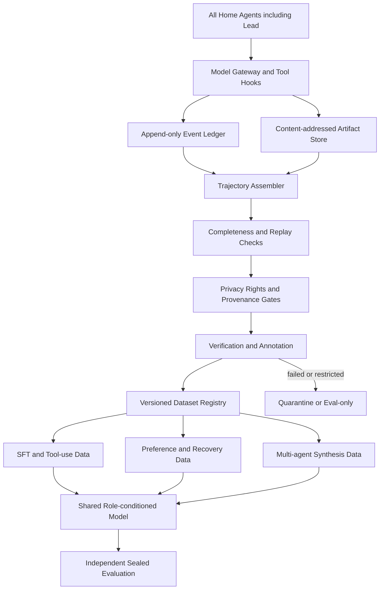

# DCLab — All-Agent Experience Collection & Fine-Tuning

**Document 2 of 2 | Independent Data Collection and Model Training Plan | 24 November 2026**

Status: proposed plan, not a completed training report. Scope: the Main Lead and every Home agent. Workspace and its independent agents remain outside scope and unchanged.

## 1. Objective and principles

The future proprietary model must learn business problem understanding, planning, tool selection, analytical coding, leakage-safe modeling, simulation, decision-making, error recovery and synthesis across specialists. It must not merely imitate the Lead's final answer. The fundamental unit of experience is a **complete case trajectory**: input, actual execution path, decisions, code, evidence, outcomes, failures and feedback.

Comprehensive capture does not mean retaining unrestricted personal data or secrets. Every relevant artifact and event category must be covered across all roles, subject to redaction, permissions, retention and data rights. Collected records are not automatically eligible or suitable for training. Fine-tuning remains independent of product delivery: Home operates with existing models while the training workstream proceeds separately.

## 2. Existing infrastructure and reuse policy

The repository contains experience binding, gateway exchanges, code_runs, corrections, usage, tracing, benchmarks and `research/llm-fine-tuning/experiments/dev_trajectories/records/`. The `thinking-asked` and `store-gaps-no-model-and-label-thinking` records explicitly distinguish API thinking summaries from their absence. Do not request fabricated reasoning in response text to fill missing summaries. Observed portions of code_runs and corrections may return None when no Workspace is available; Home-local capture must be audited and extended with independent adapters if necessary. These observations do not establish complete coverage or training eligibility.

First inventory all Home gateways, roles, runtimes, tool executors and event stores. Produce a coverage matrix for each role, event, provider and success/failure path. Reuse existing components; add versioned contracts and additive Home adapters only for uncovered paths. Do not modify Workspace.

## 3. Data architecture



Three storage layers: **Raw/Restricted** (permitted events and artifacts, access control and retention); **Normalized** (linked, redacted trajectories with lineage); **Curated** (verified, authorized samples for defined training objectives). Keep sealed evaluation data in a separate vault, never in the raw training pool or training retrieval. Operational logs and training corpora remain separate.

## 4. All-agent collection matrix

| Role | Specialist data to collect in addition to common records | Training objective |
|---|---|---|
| Main Lead | Conversation, case snapshots, routing, role-selection and non-selection decisions, delegation, received reports, disagreements, synthesis, final response, corrections and feedback | End-to-end understanding, orchestration, unified responses |
| Problem Understanding | Alternative intents, problem frames, constraints, unknowns, chosen/rejected questions, success criteria | Ambiguous problem understanding and revision |
| Business Intelligence | Context, business model, KPI definitions and decomposition, process maps, domain assumptions and evidence | Business reasoning and metric decomposition |
| Planning & Hypothesis | Hypothesis tree, initial/revised/alternative plans, task dependencies, falsification tests and stopping criteria | Adaptive and testable planning |
| Data Scientist | Profiling, grain, joins, SQL/Python, EDA, features/segmentation, statistics, charts, tests and interpretation | Real analysis, coding and grounded claims |
| Machine Learning | Target/horizon, feature availability, split indices/references, leakage audit, baselines, configurations, code, fitting/evaluation, metrics, failures and model registry references | ML design, selection, evaluation and recovery |
| Simulation | Model equations, assumptions, initial state, distributions, seeds, intervention configurations, results, uncertainty and sensitivity | Simulation design and interpretation |
| Decision | Candidate actions, utility function, costs, constraints, predictive versus causal effect, rankings, uncertainty, choices/rejections and outcomes | Evidence-based decisions under risk |
| Critic | Critiques, conflicts, calculation errors, unsupported claims, verification tasks, corrected outputs and judge outcomes | Self-correction and verification |
| Legacy Home specialists | Data investigator, leakage auditor, critic, domain expert, solution designer and every future registered Home role/model | Preserve existing competencies and avoid regression |
| Router / deterministic validators | Inputs, rules, outcomes, reason codes, policy/version; `producer_type=rule` | Routing labels and evaluation, not model reasoning |

Generate the role inventory from the registry. Adding a role without capture coverage must trigger a CI warning or failure. When a role uses multiple models, record separate model identities and versions.

## 5. Comprehensive capture checklist for every run and model call

| Category | Required information or explicit absence status |
|---|---|
| Identity | Tenant/user pseudonym, case/conversation/turn/run/trace/span IDs, parent, agent role/version, task ID, UTC timestamps, sequence and schema version |
| Inputs | User messages, exact transmitted conversation history, permitted system/developer/role prompts, rendered prompts, variables, selected context, memory/retrieval references, tool schemas, context truncation and excluded ranges |
| Model configuration | Provider/model/revision, gateway, tokenizer/version when available, temperature/top_p, seed, token limits, thinking settings, tools, request ID, retries, finish reason |
| Model outputs | Assistant text, structured outputs, permitted raw response, tool-call requests/IDs, API thinking summary when available and authorized, refusals, parse errors, truncation, validation status |
| Decisions | Selected action, purpose, observable rationale/decision record, assumptions, alternatives actually recorded, evidence references, rejected routes and policy checks |
| Agent interaction | Delegation payloads, independent input snapshots, handoffs, report revisions, disagreements, merge diffs, follow-ups, state before/after and synthesis lineage |
| Tools | Name/version, arguments, resolved inputs, results, errors, status, latency, retries, permission checks, side effects and hashes; safe raw outputs or artifact references |
| Data | Source, schema, units, grain, dataset/version/hash, date range, queries/filters, missingness, joins, sampling, snapshots/references, transformations and split membership |
| Code | Complete generated code, language, original/revised diff, SQL, cells/scripts, execution command, stdout/stderr/return code, test outputs, dependencies, seed, runtime/container digest and artifacts |
| ML | Target, horizon, train/validation/test strategy, leakage checks, fit configuration, features, baselines, metrics, confidence intervals, model/checkpoint references and experiment tracking IDs |
| Simulation | Initial conditions, causal assumptions, intervention configuration, seeds, equations, distribution parameters, runs, outputs, sensitivity and limits |
| Outcomes | Final user-visible response, citations/evidence, charts/specifications, rejected intermediate versions, completion, corrections, reviewer/judge, user feedback and authorized downstream outcomes when available |
| Operations | Latency, input/output/reasoning token counts when supplied, estimated/actual cost with currency, cache, errors, cancellation, fallback and resource usage |
| Governance | License/terms version, source rights, consent/use basis, training eligibility, retention, redaction, PII/secret scans, split, lineage, reviewer and approval status |

Do not use ambiguous nulls. Record explicit metadata statuses such as `not_applicable`, `not_requested`, `not_returned`, `redacted`, `not_permitted` or `capture_error`. Failed model calls, partial responses and retries also require traces. Remove sensitive details and secrets before persistence according to policy.

## 6. Reasoning policy: completeness without fabrication

Maintain three separate kinds of records:

1. `provider_thinking_summary`: an official API-provided reasoning summary, only when actually returned and when storage and use are authorized. Preserve request settings and availability metadata. Never reconstruct or guess missing content.
2. `decision_record`: a task-oriented, shareable explanation of a practical decision (for example, selecting a temporal split because of prediction timing), including assumptions, evidence, alternatives and limitations. This is a decision artifact, not private chain of thought. Preserve it only when genuinely produced or recorded and identify its provenance.
3. `observable_execution_trace`: tool actions, plans, code, data, computed outputs, failures, revisions and outcomes. It is replayable and verifiable, and is the primary source of practical agentic learning.

Do not extract or reconstruct hidden/private chain of thought or information not supplied by an API. If no summary is returned, do not manufacture an explanation and label it as that summary. A trajectory with evidence and actions can be suitable for SFT while unsuitable for a reasoning-summary dataset. Record deterministic rules with reason codes rather than attributing them to model reasoning. Retrospective annotations by humans or another model must identify their annotation producer.

## 7. Event and artifact contracts

Illustrative event schema, not actual system output:

```json
{
  "schema_version": "dclab.home.trace.v1",
  "event_id": "evt_004",
  "trace_id": "tr_001",
  "case_id": "case_001",
  "conversation_id": "home_001",
  "turn_id": "t_02",
  "run_id": "run_001",
  "span_id": "span_ds_01",
  "parent_span_id": "span_lead_01",
  "sequence": 4,
  "event_type": "tool.result",
  "actor": {"role": "data_scientist", "role_version": "1", "producer_type": "tool"},
  "model_exchange_ref": "exchange_003",
  "input_state_ref": "state_rev_2",
  "output_state_ref": "state_rev_3",
  "payload": {"tool": "python_sandbox", "status": "success", "code_ref": "artifact_code_01", "output_ref": "artifact_stdout_01"},
  "privacy": {"classification": "synthetic", "training_eligibility": "pending_review"},
  "timestamp_utc": "2026-11-24T09:00:00Z"
}
```

Minimum event types: `case.start/end`, `turn.start/end`, `agent.start/end`, `route.selected`, `context.snapshot`, `prompt.rendered`, `model.request/response/error`, `thinking.availability`, `tool.request/result/error`, `code.generated/executed/revised`, `data.snapshot`, `model.trained/evaluated`, `simulation.executed`, `hypothesis.created/tested`, `plan.created/revised`, `report.submitted`, `conflict.detected/resolved`, `validation.result`, `decision.proposed`, `lead.synthesized`, `user.feedback`, `correction`, `budget.exceeded`, `run.cancelled`, `capture.error`.

The artifact manifest contains `artifact_id`, content hash, MIME/type, size, storage reference, producer span, data rights, retention, schema/version and references. Store code, stdout, output tables, model artifacts, charts and large contexts once; events reference them by ID and hash. Snapshot source files only where rights and security allow; otherwise retain authorized references or clearly identified synthetic surrogates for practice. Reject unresolved references in trainable samples unless the target schema explicitly permits them.

## 8. Capture implementation: preserve the complete execution path

- Gateway hooks capture every model call, including Lead, specialists, model-based router and judge. Store judge records separately and identify the label producer. Do not merely intercept final responses.
- Runtime hooks capture spans, tool requests/results, state diffs, handoffs, failures and stopping reasons. For parallel calls, record parent spans and causal ordering rather than relying solely on timestamps.
- Code executor hooks capture code, stdout/stderr, environment/data references, ML and simulation artifacts. Record generated but unexecuted code as `not_executed`.
- Preserve existing capture infrastructure; use Home-local adapters and storage independent of Workspace. Implement idempotent events, atomic writes, retry queues, checksums and reconciliation against gateway usage and tool counts. Mark and quarantine interrupted runs explicitly.
- Separate operational logging from training storage. If capture fails, Home may continue serving according to policy, but incomplete traces cannot enter the training dataset. Alerts and completeness reports are required.
- Provide replay tooling for deterministic calculations and code using fixed datasets and environments. Replay historical model calls using recorded responses; do not promise exact regeneration of stochastic model responses.

### Proposed CI coverage checks

For every applicable agent manifest: a scripted successful call, tool success, tool error, model error, refusal/invalid schema and no-data run. Reconcile expected events with gateway and executor counters. Add separate fixtures for parallel cases, cancellation, timeout, context truncation, retries and persistence failure. Matrix-test all active roles, prompt variants and providers. Target 100% mandatory-event coverage in controlled tests; report actual production coverage separately.

## 9. Dataset generation and sources

1. **Synthetic business environment:** realistic relational data with seeds, hidden causes, distractors, seasonality, mixed causes, missing data, label noise, stockouts and known interventions. Ground truth stays in a separate vault. Include no-data, metadata-only, full-data and multi-turn scenarios.
2. **Expert-authored cases:** DS/ML/business experts develop valid alternative solutions, rubrics and controlled negative examples. Humans verify decision explanations and evidence.
3. **Model-generated trajectories:** use only models and terms that permit training the intended target model. Record provenance for every call and output. Third-party model outputs are not automatically eligible.
4. **Real Home runs:** only with appropriate rights, consent or other lawful basis, redaction, tenant isolation and policy eligibility. Customer data is not required for the initial version.
5. **Existing DCLab records:** inventory historical corpora; migrate/normalize with lineage intact. Do not guess missing fields. Distinguish development, sealed and non-model-generated records.
6. **Failure and recovery:** wrong routes, unsupported numbers, leakage, schema failures, invalid queries, incorrect assumptions, tool timeouts, irrelevant actions and unresolved conflicts. Pair corrected answers with failures only after verification. Raw failures are not positive training targets.

Start with e-commerce: six problem families with approximately 20–30 variants per family for the development pilot. Expand to SaaS, retail, fintech and logistics. These are proposed targets, not existing dataset counts. Diversify Persian/English input language, user expertise, data size/quality, ambiguity, problem type and tools. Hold out industries, combinations of causes, request formats and generator families. Merely changing synthetic seeds is insufficient; separate scenario families and template lineage too.

## 10. Cleaning, verification and annotation

- Gate 1: schemas, mandatory events, causal links, artifact existence and checksums.
- Gate 2: privacy/rights, PII/secret scans, retention policy and complete provenance.
- Gate 3: sandbox execution, unit tests, numerical checks, leakage and source grounding.
- Gate 4: specialist rubrics, contradictory hypotheses and decisions, independent judging and human spot checks.
- Gate 5: exact and near-duplicate removal based on case families, prompt similarity, code, scenario lineage and source datasets; split before augmentation.
- Gate 6: training exports with compatible tokenizer/chat templates and correct loss masks.

Registry statuses: `raw`, `normalized`, `quarantined`, `verified`, `train_eligible`, `eval_only`, `rejected`, `revoked`. Sealed records are never train-eligible. Unknown permissions or eligibility default to exclusion. Record reviewers, reason codes, rubric versions, evidence references and scores.

Proposed 0–4 rubric: problem understanding, business correctness, hypotheses, plan validity, tool use, code correctness, leakage, uncertainty, evidence grounding, simulation validity, decision usefulness and synthesis. Fabricated numbers, unsafe execution, critical leakage, incorrect labels, unauthorized data and irreconcilable traces are hard rejections regardless of other scores.

## 11. Constructing training datasets from a trajectory

All exports reference a common `source_trajectory_id` and provenance, while producing separate task-level examples:

| Dataset | Input / target |
|---|---|
| Lead Understanding SFT | Conversation and facts → problem frame, answer or necessary clarification |
| Specialist SFT | Role and authorized context → verified specialist report |
| Routing/Planning | Case snapshot → role/tool/task selection and dependencies |
| Tool-use / Function calling | Messages and tools → correct tool call; result → next action |
| Code Generation/Repair | Task, schema and optional error → verified code or patch |
| Evidence/Validation | Claim and evidence → verdict and correction |
| Simulation & Decision | Scenario, assumptions and constraints → valid plan and recommendation |
| Lead Synthesis | Independent reports, conflicts and evidence → unified response |
| Multi-turn Recovery | Error or changed context → replanning and correction |
| Preference pairs | Identical input → chosen/rejected outputs with reason code and rubric |
| Full trajectory evaluation | All stages and artifact references → independent replay and scoring |

### Specialist SFT example

```json
{"sample_id":"s001","source_trajectory_id":"tr001","role":"problem_understanding","messages":[{"role":"system","content":"DCLab role: problem_understanding"},{"role":"user","content":"Sales have declined; we do not have any data."},{"role":"assistant","content":"{\"problem_type\":\"revenue_decline\",\"hypotheses\":[\"buyer_count\",\"purchase_frequency\",\"order_value\"],\"evidence_status\":\"unverified\"}"}],"quality":"verified","rights":"synthetic_allowed"}
```

The example is a conceptual schema only. Test the target model's chat template, tool-call serialization, loss masks and exporter version. In multi-agent samples, specialist messages are context/input for the Lead, not outputs falsely attributed to the Lead. Mask tool outputs, user/system messages and environmental data from target loss unless an explicit, permitted objective requires otherwise. Export long contexts using task/evidence-aware windows and intentional chunking. Never truncate silently or cut structured tool calls and code in the middle.

## 12. Fine-tuning strategy: one comprehensive model, separate roles

The long-term goal is a role-conditioned model that supports every specialist and orchestration. This does not require merging all agents into one inference call: Home retains independent role execution, with a shared checkpoint and appropriate role prompts.

- **Baseline:** select a suitably licensed open-weight model with coding, structured output, tool calling and Persian/English capabilities; assess it on a fixed evaluation suite. Final selection follows local benchmarking.
- **FT1 — Pilot:** proposed 4–8B model with LoRA/QLoRA and a small curated dataset. Prioritize schema/tool adherence, problem understanding and code quality. Measure memory and throughput on actual hardware before increasing context.
- **FT2 — Joint Role SFT:** balanced mixing across all roles, including Lead and legacy specialists; use role tokens/prompts, short and long examples and task-level mixing. Mitigate catastrophic forgetting with authorized general-purpose replay data. Compare joint versus role-specific adapters using the same evaluation.
- **FT3 — Tool and Code Competence:** multi-step execution/recovery trajectories, tool selection and evidence-grounded synthesis. Evaluate actual sandbox execution, not merely text matching.
- **FT4 — Preference:** DPO or another suitable method with verified pairs sharing an identical prompt, grounded in human preferences or validated verifiers. Prioritize deficiencies not solved by SFT. Consider execution-reward RL only after reliable verifiers and simulators exist.
- **FT5 — Context & Scaling:** consider 7–14B or larger models only if quality/cost curves and hardware justify them. Include long-context evaluation and context-packing examples. Training from scratch is not required.
- **FT6 — Deployment:** shadow testing, A/B testing, limited rollout, pinned checkpoints/versions and rollback to the base model. The architecture feature flag remains independent of model selection.

An initial pilot could use 500–2,000 curated task-level samples derived from independent trajectories, after measuring coverage and reproducibility. Scale using learning curves and independent diversity, not merely JSONL counts. Tune batch size, learning rate, rank, sequence length and epochs with small sweeps. Fixed hyperparameters are not recommended before measuring hardware constraints and the chosen model's behavior.

## 13. Evaluation and contamination prevention

Use group-based splits across cases, customers, businesses, generator families, sources and lineage. A proposed development split is 80/10/10, with a separate sealed final exam that is never used for training. Derived tasks from the same trajectory remain in the same split. Test examples, judge messages and hidden ground truth must not enter training prompts, retrieval or checkpoint selection. Use validation for tuning; use sealed evaluation only according to a preregistered protocol.

Compare base versus fine-tuned models with identical harnesses; role-specific versus joint adapters; data-category ablations; and Lead-only versus multi-agent with a fixed model to separate the effects of training and architecture.

Metrics include schema pass rate, exact/semantic tool success, code execution pass rate, leakage detection, fact/evidence accuracy, hypothesis coverage, root-cause recovery, simulation error, decision utility/regret in measurable environments, Lead synthesis, language quality, latency/cost and generalization. Report uncertainty intervals, worst-performing roles and human review. Release requires no safety/grounding regressions, meaningful gains on target roles, no critical degradation of other roles and acceptable cost/latency. Failure means reverting to the baseline.

## 14. Rights, security and governance

- Record each provider's, dataset's and code license's terms version, review date, permission to train internal or competing models and applicable scope. API access or logging capability is not permission to fine-tune. This plan makes no claim about any specific provider's permission; complete legal review before export.
- Enforce tenant isolation, encryption at rest/in transit, access control, audit logging, bounded retention and deletion lineage through dataset manifests. If post-training deletion is required, identify affected models and document remediation or retraining decisions.
- Remove or mask credentials, API keys, raw PII, payment information and data outside authorized scope. Scan code and outputs separately. Use personal data only where necessary and justified, with a clear lawful basis and use restrictions. Prefer synthetic and de-identified data.
- Prompts, retrieval chunks and trace artifacts may contain sensitive or third-party copyrighted material; apply the same gates to all. Separately assess eligibility of judge labels and generated outputs.
- Give sealed vaults and training stores different access controls, independent audits and immutable/versioned manifests. Never export records with unknown eligibility.

## 15. Independent implementation roadmap

| Stage | Deliverable | Acceptance |
|---|---|---|
| T0 | Inventory existing capture and provider/role matrix | All Home roles and gateway paths identified |
| T1 | Schemas, capture adapter, IDs and artifact store | Complete success/failure/parallel traces in controlled tests |
| T2 | Simulator, scenario registry and benchmark fixtures | Isolated ground truth and reproducible computation replay |
| T3 | Assembler, privacy/rights gates, replay and completeness checks | Incomplete records quarantined, export blocked |
| T4 | Annotation rubrics, dataset registry and exporters | SFT, tool, code, preference and synthesis format tests |
| T5 | Pilot SFT/LoRA and baselines | Per-role metrics, loss, resource and failure reports |
| T6 | Joint training and targeted preference experiments | Held-out gains without catastrophic regressions |
| T7 | Sealed evaluation, model card and deployment gate | Documented go/no-go, rollback and monitoring |

T0–T3 begin alongside the product plan from its first execution. T5–T7 depend on data quality, not the product calendar. Training remains independent and may be paused for insufficient data without blocking Home.

## 16. Final completeness checklist

- [ ] Every role has a trace identity, including Main Lead, new roles, legacy specialists, model-based routers and validators.
- [ ] All model calls, including errors, retries, refusals, truncation and configurations, are captured and reconciled.
- [ ] All independent reports, handoffs, disagreements, merges and synthesis link to one trace.
- [ ] All generated/executed/revised code, stdout/stderr, tests and reproducible execution environments are recorded.
- [ ] Dataset schemas/versions, queries, transformations, splits, leakage checks and artifact references are captured.
- [ ] Thinking availability and permitted API summaries, decision records and observable execution traces are separate; no fabricated reasoning.
- [ ] ML, simulations, decision utility, assumptions and uncertainty have versions and seeds where applicable.
- [ ] Feedback, corrections, failures, negative examples and rejected outputs are preserved and labeled for their proper objective.
- [ ] Rights, privacy, retention, redaction, provenance and training eligibility apply to every content category.
- [ ] Sealed data, ground truth and final exam judge outputs are excluded from the training corpus.
- [ ] Dataset manifests, deduplication/split lineage, format/mask tests, quality reviews and checkpoint lineage are complete.
- [ ] Home has defined capture-failure behavior; incomplete traces cannot be treated as healthy training data.
- [ ] No Workspace file or capability has changed, and training is not a dependency of Home execution.

## 17. Existing repository references and reviewed components

- [Specialists and gateway thinking summary](https://github.com/Shahriyar-Moradi/Research_Development_DCLab/blob/main/dclab_rnd/agents/specialists.py)
- [Existing thinking availability record](https://github.com/Shahriyar-Moradi/Research_Development_DCLab/blob/34fe927c8049f1d4000408ab41cf6fbe621f4191/research/llm-fine-tuning/experiments/dev_trajectories/records/thinking-asked.json)
- [Existing capture gaps record](https://github.com/Shahriyar-Moradi/Research_Development_DCLab/blob/34fe927c8049f1d4000408ab41cf6fbe621f4191/research/llm-fine-tuning/experiments/dev_trajectories/records/store-gaps-no-model-and-label-thinking.json)
- [Code runs](https://github.com/Shahriyar-Moradi/Research_Development_DCLab/blob/34fe927c8049f1d4000408ab41cf6fbe621f4191/dclab_rnd/code_runs.py)
- [Corrections](https://github.com/Shahriyar-Moradi/Research_Development_DCLab/blob/34fe927c8049f1d4000408ab41cf6fbe621f4191/dclab_rnd/corrections.py)
- [Planning gate result — existing example of sealed evidence](https://github.com/Shahriyar-Moradi/Research_Development_DCLab/blob/34fe927c8049f1d4000408ab41cf6fbe621f4191/evidence/campaigns/planning_gate_v2/RESULT_gate.md)

These references support selected findings from existing code and documentation. Complete coverage can be established only through an audit and executed tests. Companion document: `DCLab_01_Home_Multi_Agent_Architecture_EN.md`.
