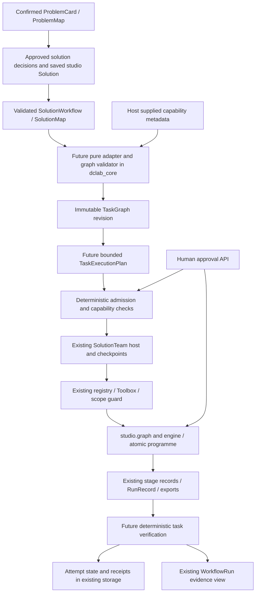

# Hierarchical task planning architecture — TP-01A

Reviewed 2026-11-04 against checkout `81e8a9009174031c64148ebd22ef035500fccd08`. Scope: investigation and design only. No execution runtime, public contract, model prompt, default, dependency or database was changed. Proposed behavior below belongs to later packages and is not available today.

Read together with [capability matrix](TASK_CAPABILITY_MATRIX.md), [acceptance and verification](TASK_PLANNING_ACCEPTANCE.md), [master package](../../engineering/planning/DCLab_Hierarchical_Planning_Codex_Pack.md), and [source evidence](../../engineering/planning/TP_01A_EVIDENCE.json). Evidence includes source hashes, full registry schemas and all 105 mandatory family/step mappings. A later checkout must revalidate this inventory.

## 1. What exists and what each object means

| Object / source owner | Responsibility and dependencies | Representative case | Boundary |
|---|---|---|---|
| `ProblemCard`, `ProblemMap`; `core/problem_map.py::decompose/validate`, `mapping.py::draw/review/needs_for` | Confirm business intent, parts, subproblems, composition and needed data. Mapping roles receive an injected Advisor; deterministic checks and rule fallback constrain proposals. | Churn risk plus a separate retention outcome question. | Business decomposition; does not authorize tool calls or schedule fits. |
| `SolutionPlan`; `core/plan.py::plan/validate/override/plan_with` | Versioned decisions, alternatives, reasons, evidence and human overrides. | Choose a split and decision rule from the problem and findings. | A decision plan is distinct from the studio's executable `studio.solution.Solution`. Saving one does not automatically sign the other. |
| `SolutionWorkflow`; `core/solution_workflow.py::solution_workflow/validate/propose` | Descriptive WF-01…WF-10 steps, artifacts and checks from cards/findings. Twelve families, seven shared safety steps and family additions. Invalid proposals fall back to the validated current workflow. | Leakage audit before validation selection; final score only after the gate. | No generic executor traverses this object today. Its validation does not certify that every criterion has an executable binding or human approval. |
| `SolutionMap`; `core/solution_map.py::solution_map/validate` | Route subproblems to blocks, one shared SplitDesign and a composition. Complex leaves defer final scoring. | Two screening leaves composed on validation, then scored once together. | Describes solution composition, not independently runnable child tasks. |
| `WorkflowRun`; `core/workflow_run.py`, `studio/workflow_run.py::build` | Readback of twelve conceptual steps from existing stage evidence. Missing proof remains partial/missing. | Candidates/evaluate/select all read the same models record. | Evidence view, not a second run controller. A “report done” derived from final does not prove an exported report exists. |
| `Programme`; `core/programme.py::execute`, `leaves.py`, `compose.py`, `studio/programme.py::run` | Existing complex execution: shared split, fit/validation leaves, validation composition, one composition holdout, counts and results without rows. | Best leaf versus fusion on the same protected holdout. | Keep atomic at task boundary. Its fingerprint includes evolving state/results; it is not a stable structural task-graph hash. Studio replaces its current document and keeps limited earlier holdout summaries. |
| Studio graph/engine; `studio/graph.py::check`, `engine.py::execute/_run_stage` | Saved solution, data, predecessor, actor, approval and holdout checks; five stage records, fits, scores and final read accounting. Kind machines specialize the same stage boundary. | `run_stage(models)` produces candidate ranking and selected model together. | Authoritative science and execution effects. A task must not duplicate splits, metrics, model selection, fit or final logic. |
| Registry/Toolbox; `agents/registry.py`, `intern/tools.py` | Canonical tool names, argument schemas, effects, scopes and write guards; Toolbox connects project calls to studio. | `run_stage(project_id, stage="leakage")`. | Schema validity is not principal authorization. Explicit host context, policy and scope remain required. |
| Lead/Case/Home and multi-agent hosts; `agents/case_agent.py`, `draft/coordinator.py`, `draft/orchestrator.py`, `orchestra/solution.py` | Existing understanding, clarification and governed build/solution orchestration. SolutionTeam already sequences flat stages, invokes audit, handles interrupts and checkpoints, and hosts complex composition. | Person supplies prediction moment; Home builds only after blockers clear; SolutionTeam asks before holdout. | Do not change Home routing, Lead Agent behavior, role rollout or defaults. Future task execution extends SolutionTeam at its existing boundary. No new agent or orchestration framework. |
| Intern; `intern/loop.py`, `agents/runtime.py`, `agents/harness.py`, `agents/traces.py` | Bounded policy/tool loop, typed outcomes, traces, budgets and session notes. | Intern writes a short plan and calls an allowed stage tool. | `write_plan` is a 2,000-character note, not a dependency graph. `finish` is not proof of task success. |

Paths beginning `core/` in this table mean `dclab_core/`; host paths mean `dclab_rnd/`. [TP_01A_EVIDENCE.json](../../engineering/planning/TP_01A_EVIDENCE.json) supplies concrete source file/function/line references for every mandatory step and registered handler.

## 2. Target integration, without a parallel engine

The pure adapter receives metadata. It imports no registry, model provider, network client or store. A later host binding selects from actual registered capabilities and passes sanitized descriptions into core. Model suggestions are untrusted proposals, checked before adoption. An invalid suggestion leaves the prior validated graph usable or returns explicit blockers.

For a flat project the execution unit is one existing stage action, with several conceptual checks attached. For a complex project it is the existing atomic programme. A future bounded sequential dependency dispatcher extends SolutionTeam; it does not add another LangGraph graph, general workflow framework or leaf engine. Graph parents express business/task grouping. Dependency edges express ordering. Neither implies that a parent/group runs a tool.

## 3. Authority owners

| Concern | Existing authority | Task layer's permitted role |
|---|---|---|
| User intent and corrections | Confirmed cards, ProblemMap, saved human decisions/brief, project solution; coordinator build gate | Reference exact revisions and preserve human provenance. Never infer consent from task wording. |
| Tool authorization | Host principal/workspace binding; API `Router.add_api_route` → `accounts.guard.require`; agent Policy.tools; Registry scope/schema; registered guard | Request a bounded permitted call. Never treat `Registry.check` as an authorization grant. |
| Scientific state and results | Stage records/RunRecord, studio engine/kind machines and Programme | Link current evidence; no copied metric as an independent authority. |
| Human gates | `studio.graph.approve_gate`, valid signed solution/brief, approval records and original API actor | Return `needs human input` and wait. No model-generated approval or fabricated human actor. |
| Holdout read count | Project `holdout_uses`, final stage, programme records and `consume_holdout_approval` under original owners | Enforce at least the same restrictions and block unknown outcomes. Never zero/reset/reconstruct a counter from a task status. |
| Host run state | SolutionTeam/checkpointer plus studio stage/programme state and jobs | Store task attempts, links and receipts; reconcile against actual effect evidence. |
| Spend/stop | Runtime Policy, gateway live guard/control/caps, jobs checkpoints | Stay within existing caps and cancellation checks; a task plan cannot authorize spending. |
| Model exchange and thinking | Model gateway `_keep_exchange`, existing cell-aware redaction | Task logs retain allowlisted references and summaries of decisions only. Any later model purpose must preserve and test the API thinking summary through the existing gateway. |

`Registry.call` permits omitted scope, and read handlers bypass write guards. Therefore future dispatch must always supply the intended scope and a bound context. Internal Python calls do not automatically acquire the API's role checks. There is no new unguarded dispatch path in this package.

## 4. Decisions settled for the foundation

### 4.1 Structural graph versus attempts

The future TaskGraph is a versioned immutable description: tasks, parent/dependency edges, source fingerprints, expected artifact references, checks, capability requirements and blockers. It is derived from the validated workflow and current approved solution inputs. It does not replace those inputs. A model's task text cannot become the business source of truth.

Execution attempts, status transitions, approvals consumed, resolved artifact links and verifier outcomes are mutable host records outside the structural graph. Every attempt references graph revision, task ID, execution-plan fingerprint, input fingerprints and owner run ID. Completion is a deterministic result over evidence, never a model's `done` message.

Current frozen contracts are shallow: nested lists can still be mutated. TP-01B must use defensive boundaries and TP-01C must detect stale content/fingerprints. Do not rely on `frozen=True` alone for nested graph immutability.

### 4.2 Revisions and recovery in existing storage

Reuse project storage plus the existing file catalog. Later packages need unique graph-revision/artifact/attempt keys, an authoritative current revision pointer, and atomic conditional update or equivalent project-level coordination. Reject a replacement with different content under the same fingerprint. Preserve previous graph revisions and attempt evidence; a whole-document status map must not silently erase concurrent work.

This is an extension requirement, not a capability the stores already guarantee. File writes are atomic and project locks exist; PG update locks rows, but generic save still replaces a JSON document. Artifact `put` may overwrite a key. Neither mode currently provides a task-specific compare-and-swap receipt transaction. Reuse these backends and add the missing semantics later; do not introduce a task database.

A future dispatcher must persist intent before a side effect, link the effect's durable run/receipt, then verify before completing. After a crash, reconcile stage/Programme/output hashes and approval consumption against the attempt. A checkpoint alone is insufficient because it does not transactionally commit engine effects. If reconciliation cannot prove whether a final score occurred, block and ask for investigation. Never repeat final scoring to discover what happened.

Retry pre-final work only after proving unchanged inputs, valid current approval and no completed/ambiguous conflicting effect. An input, human decision, capability version or upstream output change creates a new graph revision and invalidates affected descendants. Unaffected work can be reused only with verified matching dependencies and artifact hashes. Keep unknown completion separate from both success and safely retryable failure.

### 4.3 Approved-solution admission

A saved studio Solution, a valid SolutionWorkflow and a human-approved solution are different facts. `graph.DEFAULT_POLICY` currently sets both `require_solution_signoff` and `require_holdout_approval` to false. Legacy agent final still blocks a second counted read, but may permit the first without explicit approval under those defaults. SolutionTeam asks a person for holdout approval on its own path. The mandatory workflow gate is stronger than legacy default policy.

Future task execution must require an explicit current approved solution reference before dispatch, bound to the solution/data/source graph revision. If absent, planning may describe the blocker but execution is blocked. Do not silently synthesize a SolutionPlan, signature, approval or person-stated review budget for older projects. Preserve their existing execution behavior; the new opt-in path adds admission at its own boundary without changing defaults.

The holdout human gate must also be satisfied against the current solution, split and task attempt. Existing unused approval entries contain gate/by/at/reason/used, without all current input hashes. A valid signed SolutionBrief can cover one flat final read, but it is not a generic programme signature. Later wiring must resolve these exact revision bindings through the original graph/API owner and keep its execution-time recheck. An `approve_stage` call is not a human `approve_gate`.

### 4.4 Minimal v1 and deferred work

The field categories below settle responsibilities. TP-01B owns exact names, types and frozen JSON Schemas; this document does not implement an alternative contract.

| Essential v1 categories | Why |
|---|---|
| Explicit schema version; graph/task/plan IDs; source workflow/solution/problem/data references and fingerprints | Reject unknown versions and stale or unapproved sources. |
| Business parent/subproblem reference; task group/parent; explicit dependencies | Preserve purpose separately from execution order; reject cycles/dangling references. |
| Task kind: group, action, check, human gate or blocked; capability name/scope and typed argument/reference binding | A descriptive step must not become an invented action. Unsupported requirements remain visible. |
| Declared input/output artifact references, deterministic acceptance checks and evidence requirements | Completion has inspectable proof and current lineage. No raw rows. |
| Constraints, approval/provenance requirements, explicit blocker and stop/escalation reasons | Model proposals cannot erase gates or silently fall back to a weaker operation. |
| Bounded ordered action plan, call count/retry/spend limits within host limits, expected effects and verification links | Plans can be validated before guarded execution. Empty/no-op success differs from a blocked plan. |
| Separate host attempt identity/status, durable effect/run receipts and verifier result linked to graph/plan fingerprints | Recovery can reconcile effects without mutating the structural graph. Exact persistence belongs to TP-04/05. |

Defer parallel execution, independently checkpointed programme leaves, arbitrary code tools, new orchestration agents, optimization/search schedulers, a monitoring service, live rollout and UI/default routing changes. A required criterion with no supported binding remains blocked; v1 must represent this rather than promise all families runnable.

### 4.5 Capability binding and fingerprints

A future binding needs an exact canonical tool name, explicit scope, schema-compatible arguments, declared effect, project move, prerequisites, original guard, approval requirement, expected output/run evidence and replay rule. Validate against the current host capability snapshot. Reject aliases with ambiguous ownership, unknown names, changed schemas, unresolvable artifact references or unmet checks. Never invoke handlers as preflight. All mandatory workflow steps must be covered by an action's checks, a pure check, a human gate or an explicit blocker.

One `run_stage(models)` binds many checks. One `run_stage(final)` binds threshold/calibration and `final_once`; never issue a second final action for the threshold step. Reports are supported only where an actual registered export path meets the checks. Near-copy isolation, group splitting and other family guarantees cannot be inferred from a template name.

TP-01C must define canonical semantic fingerprints: stable map ordering, bounded unique IDs, canonical set-like references, meaningful action order preserved, no transient timestamps/status/results/raw rows or self-fingerprint in structural content. Structural graph hash and execution-plan hash are separate from input/output hashes. Prefer full SHA-256 for new identities; existing short map hashes and Programme's evolving result hash do not settle the new contract. Equivalent-input and changed-input tests must pin the chosen rules.

### 4.6 Core wheel and main-product compatibility

Current core version is **0.155.0**, with **105 registered contracts**, from `dclab_core/__init__.py`, `pyproject.toml` and `schemas.py::generate`. `Contract`/`Versioned` are frozen, forbid extra fields and non-finite values. `Versioned.read` requires an explicitly supported version; ordinary model construction can use its default. Exported JSON Schemas require version explicitly. Schema shape changes, including optional fields, require a contract version bump and baseline update through `make core-schemas`. No such changes occur in TP-01A.

Core stays independently installable on Python ≥3.10 with numpy, pandas, scikit-learn and pydantic only. Provider, storage, network, Registry, LangGraph and `dclab_rnd` imports remain outside core. Later TaskGraph/TaskExecutionPlan additions must be additive exports/registrations with pinned schemas and an appropriate core release/changelog. Existing v1 payloads and unsupported-version errors must remain stable. `make core-wheel-check` builds and exercises the wheel in isolated Python 3.12 with its declared dependencies and adapter smoke checks.

Main-product integration is proposal-only at its governed points. The current field inventory pins `Shahriyar-Moradi/DCLab` commit `7fa23b977685634c9e103771a9a502c96830afde` in `adapters/main_product_fields.json`. No host TaskGraph field/contract is inventoried. Do not stuff task fields into ExperimentPlan or invent a host property. TP-01B must check additive serialization and existing adapter conformance; later host wiring needs an explicitly reviewed field inventory/adapter and a `CORE_INTEGRATION.md` section, followed by adoption in that repository. No main-product source is copied or changed here. `CORE_INTEGRATION.md`'s old introductory version is historical; pyproject/current exports are authoritative.

## 5. Storage, checkpoints and observation

| Concern | File mode | PostgreSQL mode | Task integration limit |
|---|---|---|---|
| Projects/stages | `studio.store.ProjectStore`: project JSON, atomic writes, locks, latest stage JSON | `storage.postgres.PgProjects`: project JSON and stage upserts; row locks on update; get may migrate old data | Not an immutable attempt archive or generic conditional revision API. Whole-document saves can replace concurrent state. |
| Drafts/sessions | DraftStore and intern SessionStore | PgDrafts/PgSessions through storage protocols | Reuse; no second task session system. Session plan/finish notes are not execution evidence. |
| Artifacts | `storage.files.LocalFiles` catalog, SHA-checked reads | Same file interface/catalog; local or S3 configured independently of project backend | Key overwrite is possible. Future attempt/revision keys must prevent accidental evidence replacement. No cells in task metadata. |
| Jobs | FileJobs prunes to newest 500 ended jobs; history remembers best effort | PG job rows, claim/heartbeat/checkpoint/stop | Active uniqueness is `(kind,key)` within workspace, not a general cross-kind project lock. Job history is not exactly-once authority. |
| Agent traces | `agents.traces.FileTraces` JSONL | PgTraces / agent_step | Existing scrubbing is useful but not universal; args can be truncated rather than semantically redacted. New task events must use a strict metadata allowlist. |
| Events/audit/ledger | Workspace logs through existing writers | Selected PG experience/ledger backends; some orchestra board/walk logs remain JSONL | Core event kinds and ledger points are closed vocabularies. New task event kinds need deliberate version/schema changes; do not emit undeclared `task.*`. Consent/export/retention still apply. |
| Orchestra checkpoints | SQLite `orchestra/checkpoints.sqlite3` under workspace | Existing PostgresSaver; opening invokes idempotent setup DDL | Reuse saver and interrupt protocol. Saver is not atomic with engine scoring/artifact effects. `where` is metadata; opening a saver is not a pure planning check. |
| Run lineage | `core.lineage.RunRecord`, stage records and `studio.lineage` | Same contract in persisted records | Bind source inputs/settings/code/output run; verify current hashes and actual artifact presence rather than a cached task status. |

Source owners: `storage/__init__.py`, `storage/postgres.py::PgProjects/PgDrafts/PgSessions`, `storage/files.py::LocalFiles/S3Files`, `jobs/store.py`, `orchestra/checkpoints.py::where/open_checkpointer`, `orchestra/service.py::walk_project`, `agents/traces.py`, `experience/__init__.py`, `core/experience.py`, `core/ledger.py`, `studio/lineage.py`. Core paths mean `dclab_core`; other paths mean `dclab_rnd`. The existing walk lock is process-local; it cannot be claimed as a distributed project lock.

## 6. Existing safety gaps that later execution must block

These are source-review findings, not regressions caused by this documentation package.

1. **Ambiguous final completion.** `engine._run_stage` persists running state, increments the read count in its local project object, computes final, then writes notes/lineage/stage and eventually saves the count. A failure after scoring can enter the failure path which reloads the older project. `studio.programme.run` similarly saves consumed-read state after execution returns. A saved zero count or failed stage is not proof the holdout was unread. TP-04/05 need a durable intent/receipt and conservative reconciliation through these original owners before automatic recovery can be enabled.
2. **Incomplete split proof.** Normal tabular data evidence records source hash, settings, seed and protocol, but no dedicated persisted membership digest. Several kind machines have split fingerprints. Reproducibility is weaker than an immutable split receipt. Later verification must either obtain adequate proof from the owner or block strict membership claims; do not run another split to manufacture proof.
3. **Template versus capability gaps.** Human review capacity cannot come from a default; near-duplicate detection does not prove isolation; regression target summary does not universally prove a chosen target transform; multiple DataCard entities may exceed the studio's one group-column binding. Some conceptual WF positions describe checks whose evidence is only produced in later stages. Cover these explicitly without executing an extra fit.
4. **Metadata purity and privacy.** A registered read can call a model, touch rows, write caches/decisions or mutate a Case/Turn. Stage data also computes PSI from holdout feature distributions; training-only analysis is not a claim that all holdout features are never inspected. Holdout labels, selection boundaries and final score protection remain owned by the engine. Pure planning accepts sanitized existing references only.

## 7. First implementation slice: binary Telco churn

This is a proposed deterministic adapter fixture for TP-01D/E, not a run performed in TP-01A. Existing sample key `telco_churn` is in `dclab_rnd/studio/data.py::SAMPLE_META`; the target is `Churn`. `customerID` is an identifier and must be excluded. A person must state the prediction moment and available inputs; a filename does not establish that contract. Use complete labels, existing approved solution/decision provenance, fixed data/settings hashes and a validated classification workflow. No new synthetic benchmark or real table values are copied into task logs.

Setup is outside the adapter: the existing sample attach and solution/approval APIs must already have produced current inputs. Missing cards, approved solution provenance or split metadata yield blockers. The adapter never calls `use_sample`, `set_solution` or `adopt_plan` to repair missing inputs during planning.

| Proposed group/action/check | Actual callable or pure check | Produced artifact / acceptance evidence | Dependency |
|---|---|---|---|
| Confirm business source and input identity | Inspect supplied cards/solution hashes and human provenance; core `solution_workflow.validate` | Approved current objective, prediction moment, target/identifier exclusions, unblocked workflow | Before any execution |
| Bind capabilities | `Registry.check` for exact arguments and `graph.check` over supplied project metadata; no handler | Schema/scope/capability compatibility, permissions bound by host; no side effect | Source admission |
| Understand data (one action) | `Toolbox.call("run_stage", stage="data")` → `engine.execute` → `prepare`, `stage_data` | `data.run.inputs`, provenance data/settings/seed/split, training target/class summaries. Covers lock_holdout, class_balance, train_only_analysis. Strict split membership proof remains explicit if missing. | Approved saved solution + table |
| Audit leakage (one action) | Same tool, `stage="leakage"` → `stage_leakage` | Current leakage record, declared exclusions, heuristic review, canary and safe/unsafe training CV evidence; any unresolved problem blocks downstream | Current data run |
| Prepare/select features (one action) | Same tool, `stage="features"` → `stage_features` | Current selected recipe and training-fold feature evidence | Leakage/audit accepted |
| Select on validation (one action) | Same tool, `stage="models"` → `stage_models` | Models ranking, selected model, selection rule, RunRecord. No final score used for selection | Current features |
| Human holdout gate | Original human approval API → `graph.approve_gate`, or valid current signed brief; no agent tool | Current source-bound permission checked again at dispatch; unused stale legacy entry alone is insufficient | Models complete; current solution/inputs |
| Final once (one action) | Same tool, `stage="final"` → `stage_final`, `_task_assessment` | Training/OOF threshold/calibration, single protected holdout metric and uncertainty, G4, consumed-read count/approval, final RunRecord. Covers both threshold and final_once | Human gate and original engine guard |
| Report and verify (one export action plus checks) | `Toolbox.export_notebook`; inspect resulting file catalog, record paths and hashes | Actual notebook/report with current final number provenance, limits and uncertainty; do not accept a work-in-progress export as completion | Current final evidence; supported tabular export |

Source: `intern/tools.py::Toolbox.run_stage/export_notebook`, `studio/engine.py::execute/prepare/stage_data/stage_leakage/stage_features/stage_models/stage_final/_task_assessment`, `studio/graph.py::check/approve_gate`, `studio/export.py`, `studio/workflow_run.py::build`. Full field-level citations are in the capability matrix. No `run_all`, no second split tool, no separate threshold fit, no `final` leaf in a programme, no rescore for verification.

For example, “choose a churn threshold” and “read the final churn score” are two checks attached to one final-stage operation. Treating them as two tool calls is like charging a customer twice because one receipt has two lines.

## 8. Plan discrepancies and handoff

- Delivered planning prompts are flat in `engineering/planning/`, not in a `codex/` subdirectory. The master filename is `DCLab_Hierarchical_Planning_Codex_Pack.md`. README paths are corrected to the actual files; no duplicate directory/files are created.
- The repository, not conceptual step numbering, determines physical execution boundaries. Shared stage actions and delayed machine evidence are documented instead of inventing fine-grained tools.
- TP-01A explicitly forbids implementation. Its failing pre-change check was missing required documentation; verification checks source/matrix coverage and existing regressions. No artificial runtime test or schema was introduced to satisfy a generic implementation template.
- R-01 is independent and remains pending verification in this checkout. Its earlier work was preserved outside the checkout before restoring its source/generated files. It is not part of this package.

TP-01B can define additive pure contracts and blocked/unknown states using these boundaries. Exact field naming is intentionally its work. Automatic execution is not ready: approval revision binding, durable split/effect receipts and crash reconciliation remain required work for the execution/recovery packages. No later package is started here.
