# The DCLab studio: set it up, run it, use it

DCLab turns a problem described in one sentence into a machine-learning model you can trust. It asks what it needs to
know, reads your table, keeps every column that would leak the answer out of the model, compares model families on the
same folds, reads the held-back rows **once**, and writes a one-page brief with the honest score and its limits. Every
step is recorded, and every suggestion cites the measured evidence behind it.

This guide walks through the setup, how to start the studio, a first project from start to finish, and then every page.
The screenshots come from a demo workspace built on the public Telco churn sample, with no model configured
([how to make them again](#make-the-screenshots-again)).

**Contents:** [Set up](#1-set-up-once) · [Run](#2-run-the-studio) · [A first project](#3-a-first-project-from-start-to-finish) ·
[Every page](#4-every-page) · [The rules the studio keeps](#5-the-rules-the-studio-keeps) · [Troubleshooting](#6-troubleshooting) ·
[خلاصهٔ فارسی](#خلاصهٔ-فارسی)

---

## 1. Set up (once)

**You need:** macOS or Linux, Python 3.10 or newer, and git. These are optional:

- PostgreSQL 16, for `make dev` and for sign-in with accounts;
- an Anthropic key, so that Claude asks the questions and writes the notes;
- a Kaggle or Hugging Face token, to import datasets from there.

```bash
git clone git@github.com:Shahriyar-Moradi/Research_Development_DCLab.git
cd Research_Development_DCLab
python -m venv .venv
.venv/bin/pip install -r requirements/base.txt pyarrow
cp .env.example .env
```

**The model (optional).** Without a key the studio still works: it asks its standard questions and every stage runs, so
the scores are the same. With a key, Claude Sonnet 5.5 holds the conversation, explains the stages and drives the intern.
Put these in `.env`:

```bash
DCLAB_LLM_PROVIDER=anthropic
ANTHROPIC_API_KEY=sk-ant-...
```

**Data sources (optional).** Add `KAGGLE_USERNAME` and `KAGGLE_KEY` (Kaggle), `HF_TOKEN` (Hugging Face), or a database URL
(`DCLAB_DB_WAREHOUSE`) to `.env`. Credentials stay on the server and are never shown on a page.

**PostgreSQL (optional, for `make dev`).** Install it once:

```bash
brew install postgresql@16
```

Then start it:

```bash
brew services start postgresql@16
```

`make dev` creates and migrates its own `dclab_dev` database. On Linux, start it with `sudo systemctl start postgresql`.

**Sign-in (optional).** Without it, the studio runs as one owner on this machine ("This machine · One owner · no sign-in"
in the sidebar). To turn accounts on for `make dev`:

```bash
make login
```

It sets `DCLAB_AUTH=password` for `make dev` and creates your owner account. Restart `make dev` afterwards. Add more people
on the **Admin** page (Members tab), or with `python -m dclab_rnd.accounts add --username NAME --role data_scientist`.

## 2. Run the studio

| Command | What it runs | Use it when |
|---|---|---|
| `make notebook` | The app on `http://127.0.0.1:8765`, everything kept in files under `agent_runs/`, jobs run inside the server | trying it, a single person, no database |
| `make dev` | The app on PostgreSQL (`dclab_dev`) with a separate job worker; reloads when the code changes and rebuilds the page when `dclab_rnd/agentic/web/src` changes | everyday work and development |

```bash
make notebook
```

Open **http://127.0.0.1:8765** in your browser. The sidebar has three groups:

- **Workspace:** Home, New project, Intern, Compute & jobs.
- **Project:** the open project's pages.
- **Knowledge:** the evidence library and the research lab.

Use the green **Project** button at the top of a page to switch project. `Ctrl+K` (or `⌘K`) searches the workspace and jumps
to any page.

Leave the terminal open: Ctrl-C stops the studio.

## 3. A first project from start to finish

1. On **Home**, describe the problem in one sentence, for example *"Which of our customers will cancel their
   subscription next month?"*, and press **Draft the solution**.
2. Bring the data. You can upload a CSV, Excel, Parquet, JSON or log file, or pick one of the studied samples (for example
   Telco churn). You can also import from Kaggle or Hugging Face, connect a database, or ask for a synthetic table.
3. Answer DCLab's questions in the conversation. They cover the outcome column, the moment the prediction is made, and what
   happens with each prediction. Click an option or write your own words.
4. Press **Build this chat as a project**, or let **the team** walk the draft to the build.
5. Run the five stages from the **Workflow** page (or let the intern run them). They are data, leakage, features, models,
   and final.
6. Read the result:
   - **Models:** which family won on the folds, and why;
   - **Evaluation:** precision, recall and the other measures;
   - **Reliability & holdout:** the one honest read of the held-back rows.
7. Open the **Decision brief**: one page for the people who decide, with the value, its range, and what is not proven yet.
   Export it as Markdown, or download the notebook that reproduces everything.

The intern can do steps 1 to 6 for you from one task: *"Build a leakage-safe churn model on the Telco sample and tell me
the honest score"* (the **Intern** page).

---

## 4. Every page

### Home

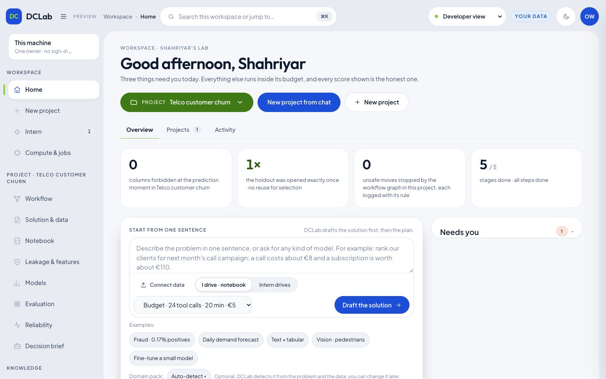

Where every problem starts.

- **The cards at the top** follow the open project: columns forbidden at the prediction moment, how many times the holdout
  was opened, unsafe moves the workflow graph stopped, and stages done.
- **Start from one sentence:** write the problem in your own words, then choose who drives:
  - *I drive · notebook*: you work the stages;
  - *Intern drives*: the intern plans and runs them.
- **Budget:** limits the intern's tool calls, minutes and spend.
- **Draft the solution** starts the conversation.
- **Examples** fill the box with typical problems (fraud, a daily forecast, text with a table…).
- **Domain pack** is detected from your words and the data; you can change it.
- **Needs you** lists what waits for your answer or approval.
- Further down, **Bring the data** has tabs:
  - **Upload**;
  - **Studied samples**: 16 tables the R&D measured;
  - **Kaggle**, **Hugging Face**, **Warehouse**;
  - **Synthetic**: either the AI builds the table, or you describe it, approve the design, and then it is created.

### The conversation

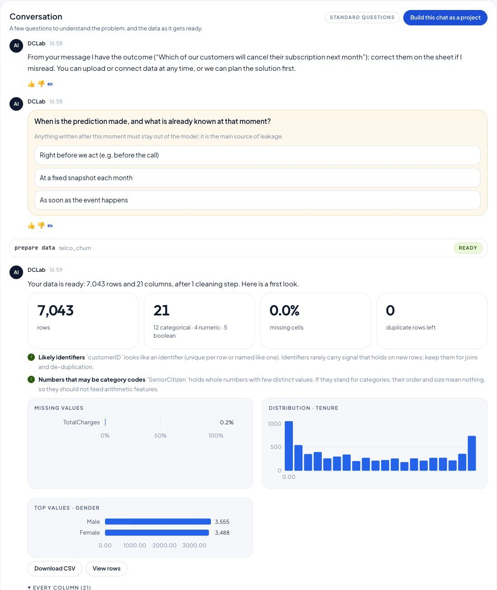

DCLab asks a few questions, and each one says why it matters. In the screenshot, the question is when the prediction is
made, because anything written after that moment must stay out of the model.

- Click an option, or type your own answer at the bottom.
- When the data is ready, the conversation shows a first look:
  - rows, columns, missing cells and duplicates;
  - likely identifiers and category codes;
  - a distribution and the top values;
  - every column under **Every column**.

  Nothing about the outcome is looked at yet: its relations with other columns are measured later, on the training rows
  only.
- Use 👍 or 👎 to rate an answer, or ✏ to correct DCLab's reading. Your corrections are kept and teach DCLab.
- The pill at the top right shows who answers: **Standard questions** with no model, or the model's name.
- **Build this chat as a project** makes the project from what the conversation settled.

### The team

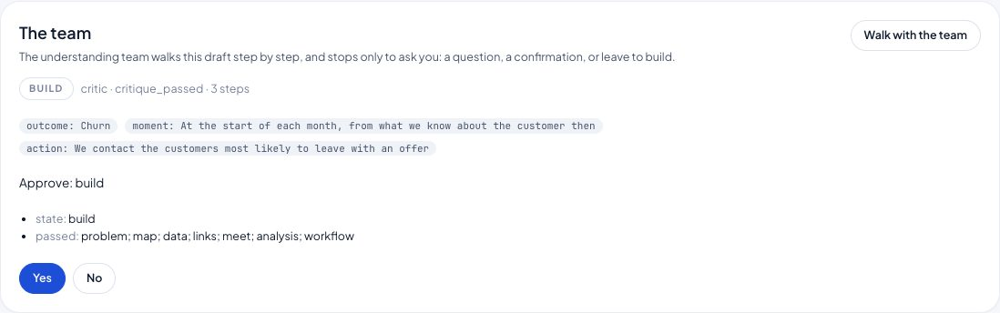

**Walk with the team** hands the draft to the understanding team: the coordinator and the critic. They check the problem,
the data, the links between tables and the solution's workflow, step by step. The walk stops only to ask you something:

- a question;
- a confirmation;
- leave to build.

In the screenshot, every state has passed (problem, map, data, links, meet, analysis, workflow), and the team asks
**Approve: build** with Yes and No.

> If you click it right after creating a draft, it may answer that the agent is still answering: wait a few seconds and
> click again.

### New project (the wizard)

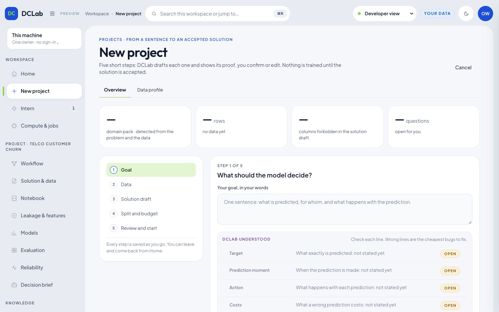

The same thing as Home, as a form, for people who prefer one. It has five short steps:

1. Goal
2. Data
3. Solution draft
4. Split and budget
5. Review and start

DCLab drafts each step and shows its proof, and you confirm or edit it. **DCLab understood** lists each line of your goal
it has read (target, prediction moment, action, costs); a line still OPEN is waiting for you. Nothing is trained until the
solution is accepted.

### Workflow

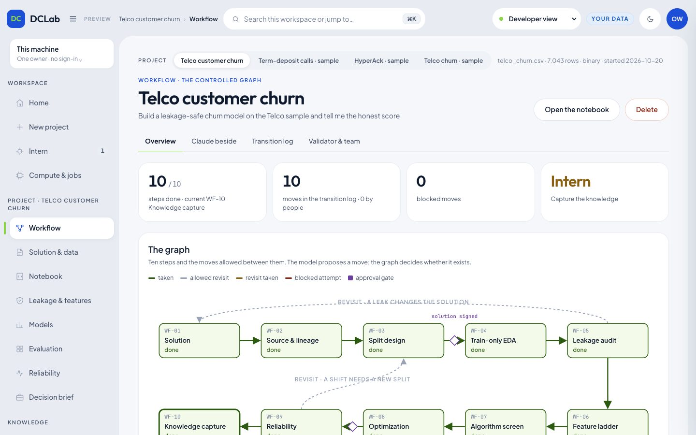

The project's ten steps, WF-01 (Solution) to WF-10 (Knowledge capture), and the moves allowed between them.

- **The cards:** steps done, moves in the transition log, moves the graph blocked, and who is waiting for what.
- **The graph** draws:
  - the steps taken;
  - the revisits that are allowed (*a leak changes the solution*, *a shift needs a new split*);
  - blocked attempts;
  - the approval gates.
- **Tabs:**
  - **Transition log:** every move ever proposed: who proposed it, the verdict, and the rule behind it.
  - **Validator & team:** try a move and see whether it would be allowed.
  - **Claude beside:** shows Claude working on the same problem next to DCLab, when it is turned on.
- **Open the notebook** goes to the code view.
- Before a move runs (yours, the intern's or the API's), deterministic code checks it and answers *allowed*, *blocked*
  or *needs a person*.

### Solution & data

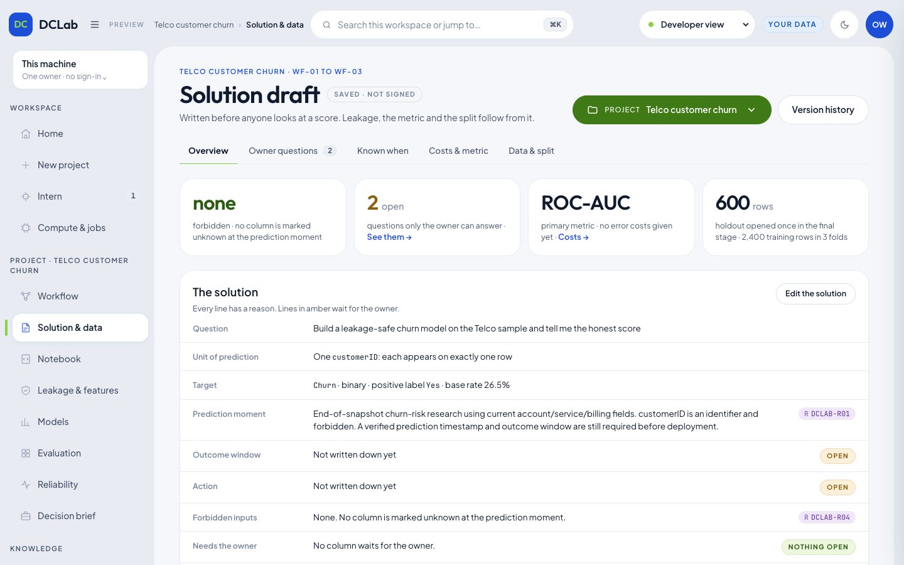

The solution is written **before anyone looks at a score**; leakage, the metric and the split follow from it.

- **The solution** gives a line and its reason for each of these:
  - the question;
  - the unit of prediction;
  - the target and its base rate;
  - the prediction moment;
  - the outcome window;
  - the action;
  - the forbidden inputs.

  Lines in amber wait for the owner.
- **The cards:**
  - columns forbidden;
  - questions only the owner can answer;
  - the primary metric;
  - the holdout's size (opened once, in the final stage).
- **Tabs:**
  - **Owner questions:** what only you can say.
  - **Known when:** for each column, whether it is known at the prediction moment.
  - **Costs & metric:** what a false alarm and a miss cost; this chooses the metric and the threshold.
  - **Data & split:** how the rows are split, by time, group or stratified.
- **Edit the solution** opens the editor. **Version history** keeps every version.

### Notebook

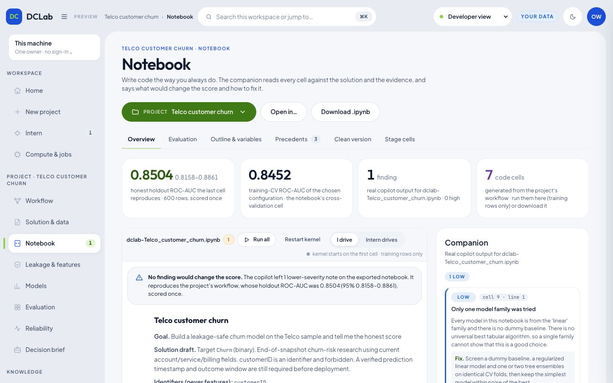

Write code the way you always do. The companion reads every cell against the solution and the evidence, and says what
would change the score and how to fix it.

- The project's workflow is generated as cells.
  - **Run all** runs them in a kernel that sees the training rows only.
  - Under **I drive · Intern drives**, *Intern drives* hands the cells to the intern.
- **The cards:**
  - the honest holdout score the last cell reproduces;
  - the training-CV score;
  - the companion's findings;
  - the code cells.
- **Companion** (right) lists each note: its severity, its cell and line, what is wrong and the **Fix**.
- **Tabs:** **Evaluation**, **Outline & variables**, **Precedents** (the measured mistakes these notes rest on), **Clean
  version** and **Stage cells**.
- **Download .ipynb** gives you the notebook. **Open in…** opens it in your own editor.

### Leakage & features

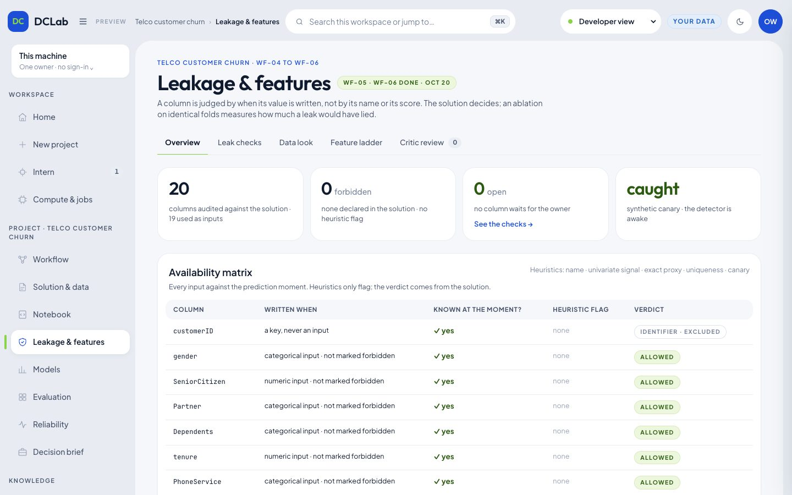

A column is judged by **when its value is written**, not by its name or its score.

- **The availability matrix** shows, for every input:
  - when it is written;
  - whether it is known at the prediction moment;
  - the heuristic flag (name, univariate signal, exact proxy, uniqueness, canary);
  - the verdict: allowed, excluded as an identifier, or forbidden.
- Heuristics only flag a column; the verdict comes from the solution.
- **The cards:**
  - columns audited;
  - columns forbidden;
  - columns waiting for the owner;
  - the synthetic canary. *Caught* means the detector is awake: a planted leak was found.
- **Tabs:**
  - **Leak checks:** an ablation on identical folds measures how much a leak would have lied.
  - **Data look:** the training-only profile.
  - **Feature ladder:** recipes compared on the same folds; the smallest one within tolerance wins.
  - **Critic review:** the model's advisory critique, checked against the numbers.

### Models

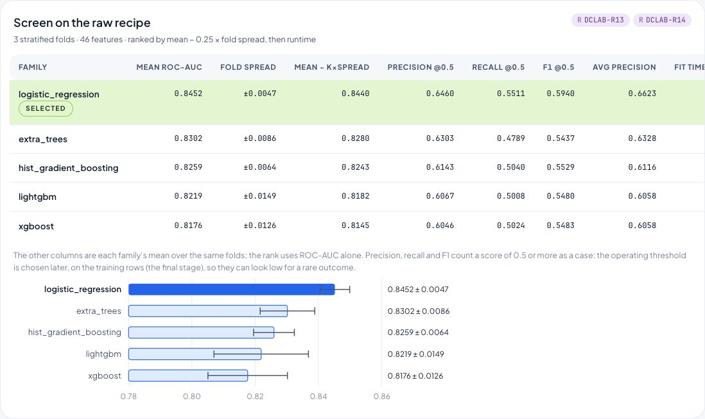

Several model families, screened on **identical folds** and ranked by a rule declared before the run.

- **The table:**
  - each family's mean of the ranking metric (here ROC-AUC), its fold spread, and *mean − k×spread*;
  - beside them, the task's other measures from the same folds:
    - binary: precision, recall and F1 at the 0.5 cut, and average precision;
    - multiclass: macro-F1, balanced accuracy and accuracy;
    - regression: MAE, RMSE and R².
  - the fit time and the rank.

  The rank uses the ranking metric alone. Precision, recall and F1 at 0.5 can look low for a rare outcome, because the real
  threshold is chosen later, in the final stage.
- **The chart** shows each family's mean with its spread.
- **Tabs:**
  - **Selection rule:** move *k*, the penalty on spread, and watch the ranking change.
  - **Evaluation**.
  - **Tuning:** explicit candidates, kept only if they clear a margin set in advance.
  - **Cost & context:** run time per family.
- **Choose a different model…** (top) lets you override the rule. The override is recorded as your choice.

### Evaluation

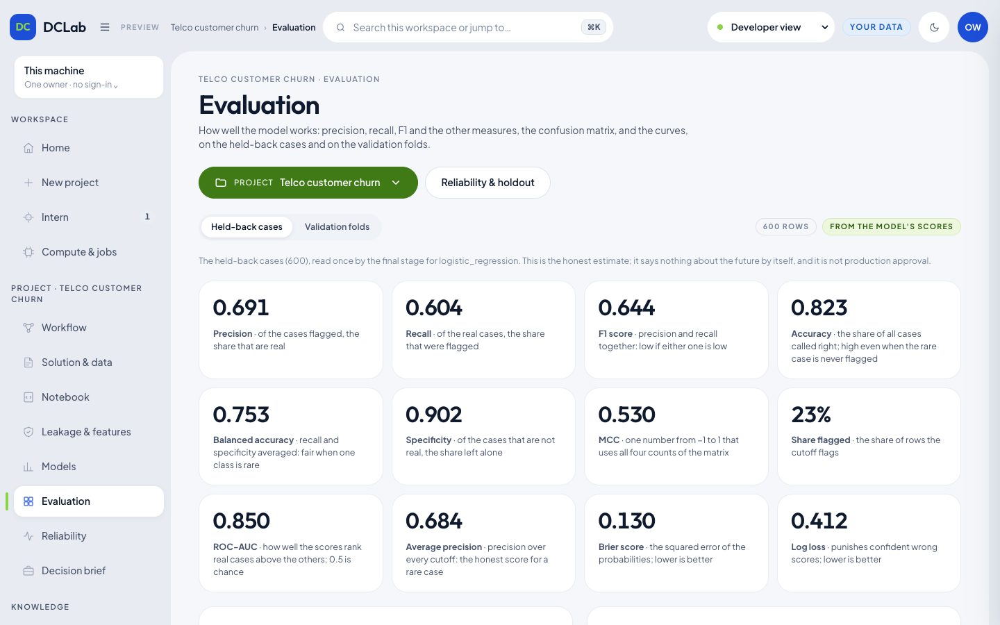

How well the model works, in plain words.

- The measures, each with what it means:
  - precision, recall, F1;
  - accuracy, balanced accuracy, specificity;
  - MCC;
  - the share of rows flagged;
  - ROC-AUC, average precision;
  - Brier score and log loss.
- Further down: the confusion matrix and the curves.
- **Held-back cases** are the rows read once by the final stage: the honest estimate. **Validation folds** shows the same
  measures on the training folds.
- An estimate is not production approval.

### Reliability & holdout

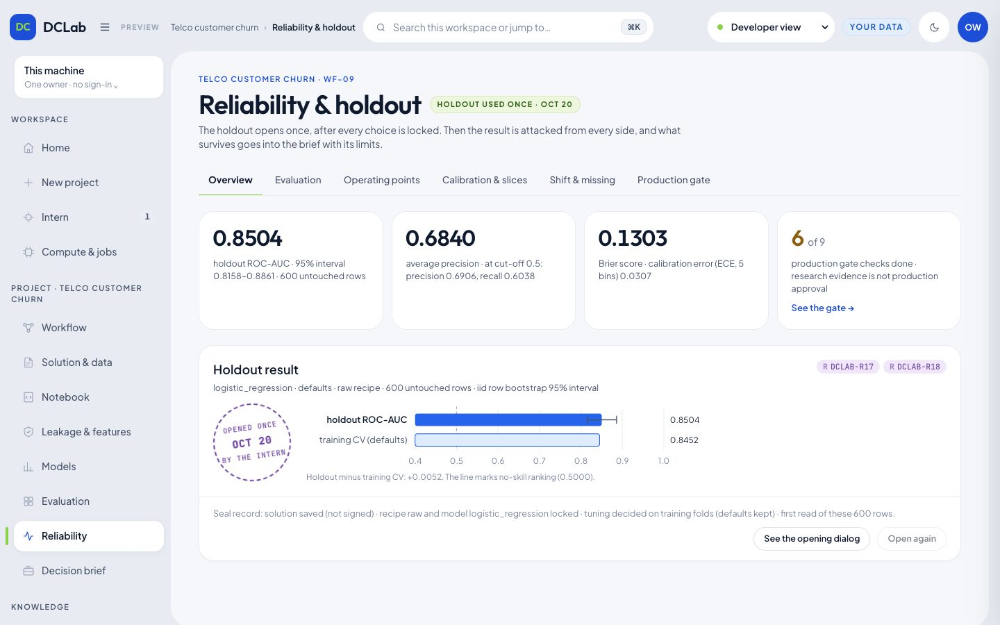

The holdout opens **once**, after every choice is locked. Then the result is attacked from every side.

- **The cards:**
  - the holdout score with its 95% interval;
  - average precision, and precision and recall at the cut-off;
  - the Brier score and the calibration error;
  - the production gate's checks.
- **Holdout result:** the holdout score against the training-CV score. *Opened once* says when and by whom. **Seal
  record** says what was locked before the read.
- **Tabs:**
  - **Operating points:** choose a threshold.
  - **Calibration & slices:** whether the probabilities mean what they say, and how each segment does.
  - **Shift & missing:** drift between training and holdout.
  - **Production gate:** what research evidence cannot prove on its own.

### Decision brief

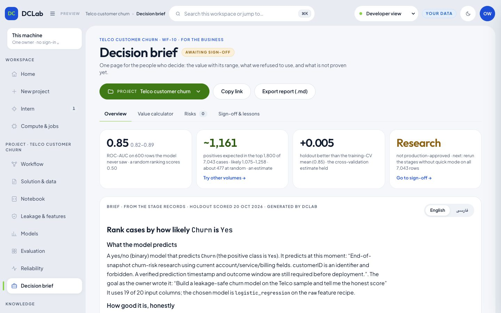

One page for the people who decide, generated from the stage records. Every number in it traces back to a record.

- **The cards:**
  - the score and its range;
  - the expected positives in the top of the list (**Try other volumes**);
  - how the holdout compared with the training-CV estimate;
  - the status, for example *Research*: not production-approved, with the next step.
- The brief reads in English or **فارسی**: switch at the top right.
- **Tabs:**
  - **Value calculator**;
  - **Risks**;
  - **Sign-off & lessons:** the owner signs off and accepts the lessons learned.
- **Export report (.md)** downloads the brief. **Copy link** shares it.

### Intern

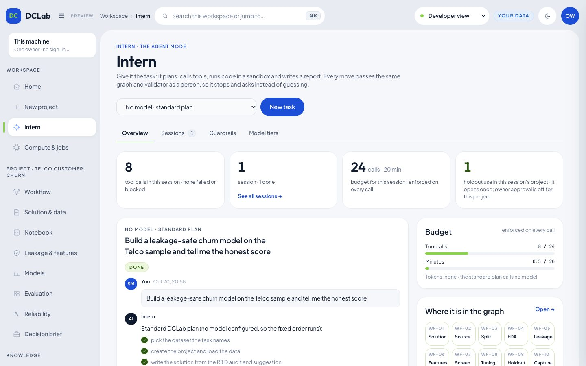

Give it a task. It plans, calls DCLab's tools, runs the stages and writes a report.

- Every move passes the same graph and validator as a person's, so the intern stops and asks instead of guessing.
- **The model** (top left) picks who drives:
  - *No model · standard plan*: the fixed order: pick the dataset, create the project, write the solution, run the
    stages, report;
  - or a configured model.
- **New task** starts one.
- **Budget** (right): tool calls and minutes, enforced on every call. **Where it is in the graph** shows the step it has
  reached.
- **Tabs:**
  - **Sessions:** every task so far.
  - **Guardrails:** what it may never do (reuse the holdout, approve a gate…).
  - **Model tiers**.

### Compute & jobs

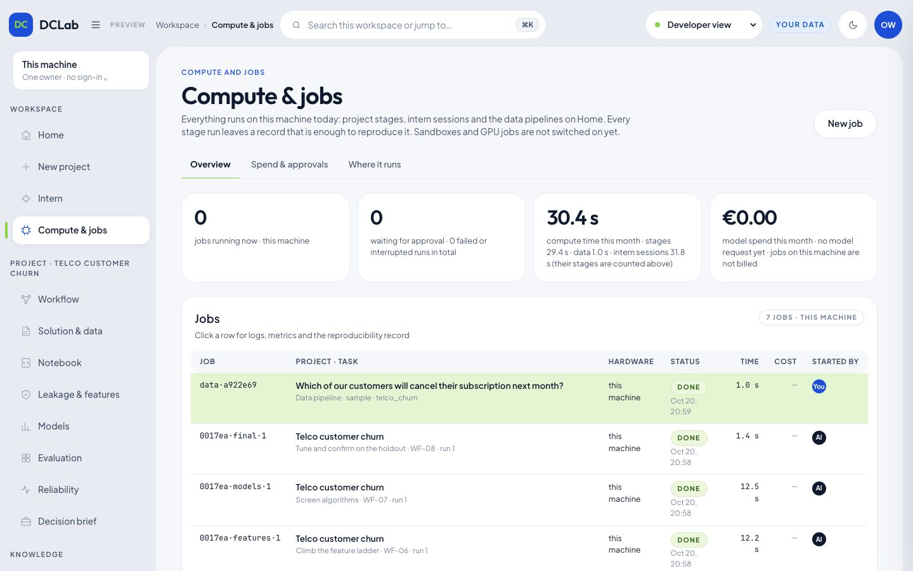

Everything that runs: project stages, intern sessions and the data pipelines on Home.

- **The table** shows each job's project and task, hardware, status, time, cost and who started it. Click a row for its
  logs, metrics and reproducibility record.
- **The cards:** jobs running now, jobs waiting for approval, compute time this month, and model spend this month.
- **Tabs:** **Spend & approvals** and **Where it runs**.

### Evidence library

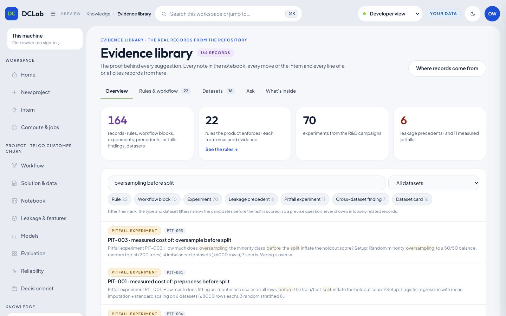

The proof behind every suggestion: rules, workflow blocks, experiments, leakage precedents, measured pitfalls, findings
across datasets, and dataset cards.

- Search in plain words (*"oversampling before split"*), then filter by type and dataset.
- Every note in the notebook, every move of the intern and every line of a brief cites records from here.
- **Tabs:** **Rules & workflow** (the rules the product enforces), **Datasets**, **Ask** (a question answered from the
  records) and **What's inside**.

### Research lab

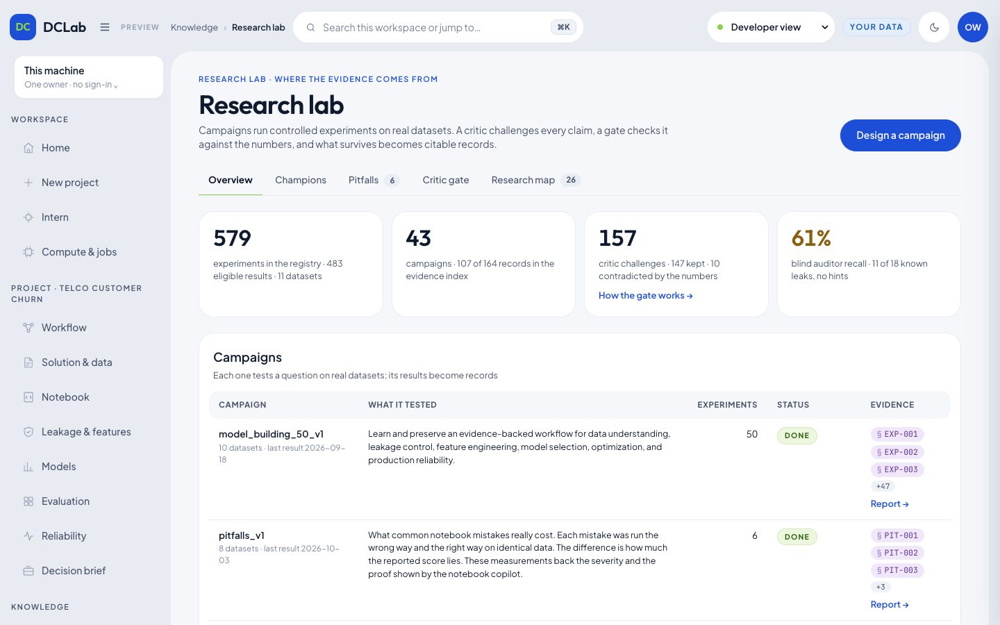

Where the evidence comes from.

- Campaigns run controlled experiments on real datasets. A critic challenges every claim, a gate checks the claim against
  the numbers, and what survives becomes a citable record.
- **The cards:** experiments in the registry, campaigns, critic challenges (kept and contradicted), and the blind
  auditor's recall.
- **Tabs:** **Champions**, **Pitfalls**, **Critic gate** and **Research map** (every research idea and its state).

### Domain packs

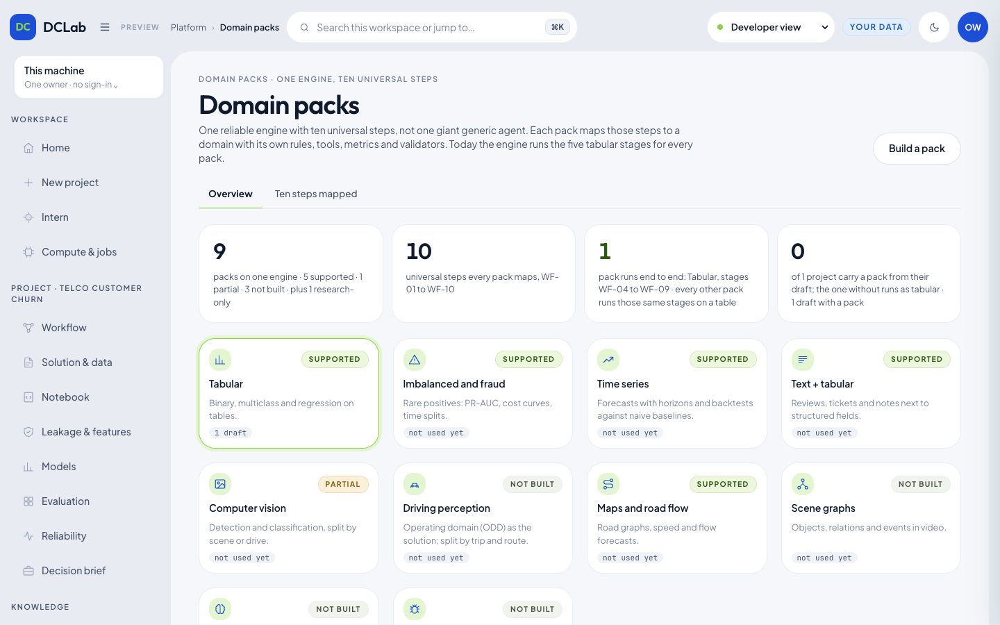

One engine with ten universal steps, mapped to a domain's own rules, tools, metrics and validators.

- Each pack says whether it is supported, partial or not built, and which projects use it.
- Home picks a pack from your words and data.
- **Ten steps mapped** shows how a pack maps WF-01 to WF-10.

### Admin

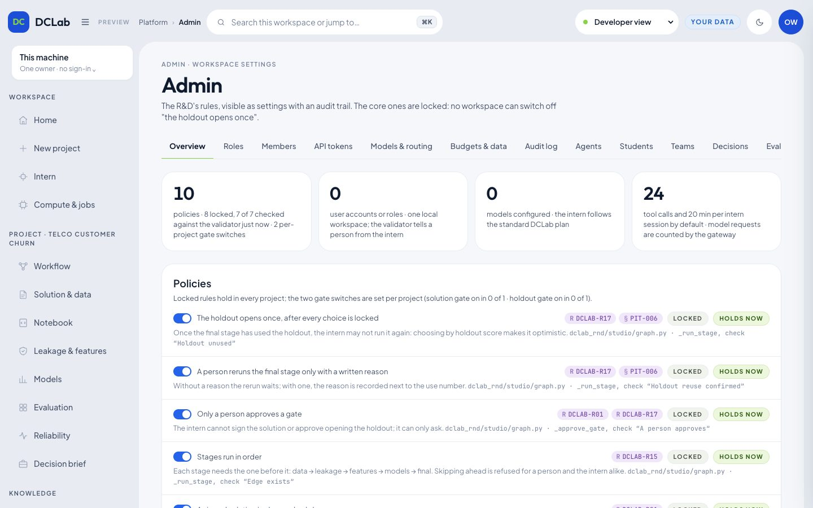

The R&D's rules, shown as settings with an audit trail.

- The core rules are locked: no workspace can switch off "the holdout opens once".
- **Policies** shows each rule with the code that enforces it, and whether it holds now.
- **Tabs:**
  - Roles, Members, API tokens;
  - Models & routing: which model answers each role, its cost and its score;
  - Budgets & data;
  - Audit log: every governed action;
  - Agents, Students (the small decision models), Teams;
  - Decisions: the decision ledger;
  - Eval.

The other pages are:

- **Judgment benchmark:** the frozen benchmark of unseen cases;
- **Policy model:** the model learning DCLab's decisions;
- **Integrations:** connectors, the MCP endpoint and Hugging Face Chat UI;
- **Blueprint & roadmap:** what is built and what is next.

---

## 5. The rules the studio keeps

- **Leakage first.** A value that is not known at the prediction moment never reaches the model. Identifiers are never
  features.
- **Training rows only.** Every preprocessing, selection, resampling and encoding step is fitted inside the training folds.
- **The holdout once.** The held-back rows are read once, after every choice is locked. The intern may never read them
  again. A person can, but only with a written reason, which is recorded.
- **People approve.** Only a person signs the solution, approves a gate or overrides the selection rule. Your override is
  recorded beside the rule's choice.
- **Proof, not opinion.** A model's critique is advisory. Splits, metrics and selection rules belong to deterministic
  code, and every note cites its evidence.
- **Honest limits.** A score is shown with its interval and its limits. Nothing is called production-ready from benchmark
  evidence alone.

## 6. Troubleshooting

| What you see | Why | What to do |
|---|---|---|
| *The worker cannot start: the database's schema is at 00NN, this code needs 00MM* | the code moved ahead of `dclab_dev` while `make dev` ran | run the command below, then restart `make dev` |
| A page reloads, or a walk or stage stops, while you work | `make dev` reloads whenever code under `dclab_rnd/` changes (for example while a coding session edits it) | wait until the edits stop and click again; `make notebook` does not reload |
| *The team could not go on: the agent is answering this draft* | the walk waits for the agent's turn to finish | wait a few seconds and click again |
| The conversation's pill says **Standard questions** | no model is configured (or `DCLAB_NO_LIVE_MODELS=1` is set) | add the key to `.env` (see [Set up](#1-set-up-once)) and restart |
| A sign-in page | `DCLAB_AUTH=password` is on | sign in, or `make login` to create your owner account |
| Precision and recall are 0 for some families on **Models** | they are read at the 0.5 cut, and a rare outcome's scores rarely reach it | read the threshold chosen in the final stage (**Reliability → Operating points**) |

The fix for the schema mismatch:

```bash
DCLAB_DATABASE_URL=postgresql+psycopg://$USER@/dclab_dev .venv/bin/python -m dclab_rnd.storage upgrade
```

The command-line tools (the notebook copilot, evidence search, the column audit, experiments) are in the
[README](../../README.md#how-to-use-it).

## Make the screenshots again

```bash
.venv/bin/python scripts/user_guide_shots.py                 # every page
.venv/bin/python scripts/user_guide_shots.py --only models   # one page
```

The script builds a demo workspace in a temporary folder through the app's own API: the intern runs the Telco sample
through the five stages, and Home holds a conversation about it. It serves the app on that folder with no sign-in and no
model, and photographs each page with the Chrome installed on this machine (through Playwright). Nothing of your own
workspace is read or shown.

---

## خلاصهٔ فارسی

DCLab یک مسئله را که در یک جمله گفته شده، به مدل یادگیری ماشینِ قابل اعتماد تبدیل می‌کند. آنچه لازم دارد را می‌پرسد و
جدول شما را می‌خواند. هر ستونی را که جواب را لو بدهد بیرون می‌گذارد و خانواده‌های مدل را روی foldهای یکسان مقایسه
می‌کند. ردیف‌های کنارگذاشته را **فقط یک بار** می‌خواند و یک خلاصهٔ یک‌صفحه‌ای با نمرهٔ صادقانه و محدودیت‌هایش می‌نویسد.

**نصب (یک بار):**
- `git clone`، سپس `python -m venv .venv` و `pip install -r requirements/base.txt pyarrow`، و `cp .env.example .env`.
- کلید Anthropic اختیاری است. بدون آن، DCLab سؤال‌های استاندارد را می‌پرسد و همهٔ مرحله‌ها اجرا می‌شوند.
- PostgreSQL 16 فقط برای `make dev` لازم است. ورود با حساب کاربری با `make login` روشن می‌شود.

**اجرا:**
- `make notebook`: با فایل، ساده‌ترین راه.
- `make dev`: با PostgreSQL، و با هر تغییر کد ری‌استارت می‌شود.
- سپس `http://127.0.0.1:8765` را باز کنید.

**اولین پروژه:**
۱. در **Home** مسئله را در یک جمله بنویسید.
۲. داده را بیاورید (آپلود، نمونه‌های آماده، Kaggle، Hugging Face، پایگاه داده یا داده‌ٔ ساختگی).
۳. به چند سؤال جواب بدهید.
۴. پروژه را بسازید، یا بگذارید تیم آن را بسازد.
۵. پنج مرحله را اجرا کنید: داده، نشت، ویژگی، مدل و نهایی.
۶. نتیجه را در صفحه‌های **Models**، **Evaluation** و **Reliability** ببینید.
۷. **Decision brief** را برای تصمیم‌گیران صادر کنید.

Intern می‌تواند همهٔ این کارها را با یک دستور انجام دهد.

**هر صفحه** در بخش ۴ با تصویر توضیح داده شده است:
- Home، گفت‌وگو و تیم؛
- ساخت پروژه، گردش‌کار، راه‌حل و داده؛
- نوت‌بوک، نشت و ویژگی‌ها، مدل‌ها؛
- ارزیابی، اعتبار و holdout، خلاصهٔ تصمیم؛
- Intern، محاسبه و کارها؛
- کتابخانهٔ شواهد، آزمایشگاه پژوهش، بسته‌های دامنه، Admin.

**قانون‌ها:**
- اول نشت: ستونی که در لحظهٔ پیش‌بینی معلوم نیست وارد مدل نمی‌شود.
- هر پیش‌پردازش فقط روی foldهای آموزشی fit می‌شود.
- holdout یک بار خوانده می‌شود.
- فقط انسان دروازه‌ها را تأیید می‌کند.
- هر یادداشت شاهد دارد.
- هیچ مدلی فقط با نمرهٔ بنچمارک «آمادهٔ تولید» خوانده نمی‌شود.

**رفع مشکل:**
- اگر worker بالا نیامد و گفت schema عقب است: `python -m dclab_rnd.storage upgrade` را اجرا و `make dev` را دوباره شروع کنید.
- اگر صفحه وسط کار ری‌استارت شد: صبر کنید تا ویرایش کد تمام شود.
- اگر تیم گفت عامل در حال پاسخ دادن است: چند ثانیه بعد دوباره کلیک کنید.

تصویرها را با `scripts/user_guide_shots.py` می‌توان دوباره ساخت. این اسکریپت فقط از داده‌ٔ عمومی Telco استفاده می‌کند،
بدون مدل و بدون ورود.
